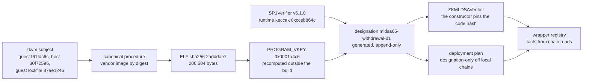
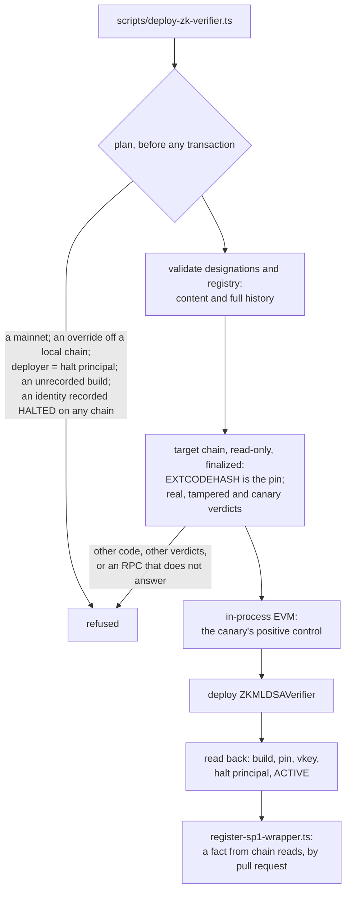

# SP1 implementation lane — the direct verifier pin, generated designations and the append-only registry

> [!CAUTION]
> Research prototype. Not audited. Testnet/local only. Do not use real funds. This lane implements what SP1-TD1
> froze, after SP1-TD2. It deploys nothing, downloads no circuit, generates no proof and writes nothing to any chain;
> its only chain activity was read-only `eth_call` and code reads at finalized blocks. No consumer is bound to a
> production SP1 identity, and nothing here is production-ready.

**Verdict: `BUILT_AND_TESTED_AWAITING_OWNER_REVIEW`. `PRODUCTION_SP1_BINDING_STATUS = NOT_ESTABLISHED`.**

SP1-TD2 admitted the wrapper to the halt model; this lane makes it bindable to a designated SP1 identity. One contract
changes: `ZKMLDSAVerifier`'s constructor now refuses any SP1 verifier whose runtime code is not the designated
SP1Verifier v6.1.0, and `verify()` compares the full chain id (F-1). Everything else is process, generated and
checked: the `mldsa65-withdrawal` designation derived from SP1-TD1's evidence, successor designations, a record of each
wrapper build, an append-only registry of wrapper facts proved against git history, refusal of a halted identity on
every chain, a two-runner canonical-build workflow, designation-only deployment tooling with a per-chain execution
check, and a proving-availability record. Nothing re-decides SP1-TD1 or SP1-TD2.

The machine-readable receipt is [`evidence/zk/sp1-impl/implementation-receipt.json`](../evidence/zk/sp1-impl/implementation-receipt.json),
generated by [`scripts/lib/sp1-impl-receipt.ts`](../scripts/lib/sp1-impl-receipt.ts) and re-derived byte for byte in
CI (`npm run validate:sp1-impl-receipt`). No status in it is typed: each is computed from the compiled wrapper's AST,
the records and their validators, the measured observations and probes that run the lane's own decision functions.

> Provenance proves which verifier and which program a wrapper binds. It does not prove that verifier or that program
> is sound.

## Status

| Status | Value |
| --- | --- |
| `SP1_DIRECT_VERIFIER_PIN` | `CONSTRUCTOR_CODE_HASH_PIN` |
| `SP1_VERIFIER_RUNTIME_HASH` | `0xcceb864cd8a5a36b2073a8f2b32a773835cd2dd2c78a56f8e6fdb942feff04dd` |
| `PROGRAM_IDENTITY_DECISION` | `PINNED_VENDOR_BUILD` (SP1-TD1's) |
| `PROGRAM_VKEY_DESIGNATION` | `mldsa65-withdrawal-d1`: `0x0001a4c62de43425bce9febc352a74acc01bac70c02d8acedc09085c4eb8c2dc` |
| `CANONICAL_BUILD_STATUS` | `REPRODUCED` on one host; the two-host release rebuild is the CI workflow's |
| `SUCCESSOR_DESIGNATION_STATUS` | `SUCCESSOR_PATH_READY_NONE_DESIGNATED` |
| `REGISTRY_APPEND_ONLY_STATUS` | `APPEND_ONLY_ON_FULL_HISTORY` |
| `REGISTRY_BUILD_PROVENANCE_STATUS` | `BUILD_RECORDED_PER_FACT` |
| `CROSS_CHAIN_HALTED_IDENTITY_STATUS` | `REPOSITORY_PUBLISHED_HALT_REFUSED_ON_EVERY_CHAIN` |
| `PER_CHAIN_EXECUTION_CHECK` | `PASSED` on Ethereum, Base, Sepolia and Base Sepolia |
| `F1_CHAIN_ID_FIX` | `FULL_WIDTH_WRAPPER_ONLY` |
| `TD2_HALT_INVARIANTS_PRESERVED` | `PRESERVED` |
| `MULTISIG_AUTHORIZATION_CLASS_PRESERVED` | `NEW_AUTHORIZATION_CAPABILITY_FOR_AN_EXISTING_PRINCIPAL` |
| `PROVING_AVAILABILITY` | `OWNER_DOWNLOAD_REQUIRED` |
| `PRODUCTION_SP1_BINDING_STATUS` | `NOT_ESTABLISHED` |

The authorization delta is `NONE_BEYOND_TD2`: the wrapper's only state-changing function is still `halt()`, and no
consumer, rotation guard or vault contract changed.

## The binding



### The direct immutable verifier pin

`ZKMLDSAVerifier` (`contracts/verifiers/ZKMLDSAVerifier.sol`) carries SP1-TD1's measured trust target as compile-time
constants — `SP1_VERIFIER_CODEHASH` `0xcceb864c…04dd`, `SP1_VERIFIER_HASH` `0x4388a21c…e696`, `SP1_VK_ROOT`
`0x002f850e…5352`, `SP1_VERSION` `"v6.1.0"` — and its constructor refuses a target without code (`InvalidSP1Verifier`)
and any target whose `EXTCODEHASH` is not the pin (`UndesignatedSP1Verifier(target, codehash)`). The target it checked
is the target it stores: `SP1_VERIFIER` is immutable and `verify()` calls nothing else for the proof. Succinct's
`SP1VerifierGateway`, the v6.0.0 verifier, every accept-all route, every mock and an address one byte off the pinned
code are refused at construction; the real v6.1.0 bytes are accepted at any address.

The pin is checked once, at construction. SP1-TD1's runtime scan found no reachable `SELFDESTRUCT` or `DELEGATECALL` in
the pinned code, so the code under the stored address cannot change after the check. A check inside `verify()` would
add gas to every verification and protect nothing more.

SP1-TD1's gateway attack, re-run against the pinned wrapper: the gateway owner adds an accept-all route for the v6.1.0
selector and for a rogue one, and freezes v6.1.0's route. A forged withdrawal stays refused, and the real v6.1.0 proof
still verifies at the pinned verifier: the wrapper never calls the gateway, so its owner holds no lever over it.

`halt()`, `HALT_PRINCIPAL`, `PROGRAM_VKEY` and every consumer are SP1-TD2's, unchanged.

### F-1: the full chain id

The journal's chain id is a `uint64` the guest commits; `verify()` used to compare it with `uint64(block.chainid)`, so a
journal for chain `x` also matched chain `x + k · 2^64`. It now compares `uint256(committed) == block.chainid`
(`_chainIdMatches`): ids that differ only above bit 63 no longer collide, and a chain id of `2^64` or more matches no
journal and fails closed. Contract only: the guest, the ELF, `PROGRAM_VKEY`, the journal (160 bytes, a `uint64` tag)
and the proof format are unchanged, which the designation's subject check and the compiler's AST both show. Each
consumer's EIP-712 domain always bound the full chain id. F-2 (the journal's signature hash is not checked) stays
informational: no authorization fact depends on which valid signature was used.

## Address, code, program, identity — and soundness

| Layer | What pins it | What it establishes | What it does not |
| --- | --- | --- | --- |
| Address | the constructor argument, immutable `SP1_VERIFIER` | which account the wrapper calls | what that account does: a gateway's routes change what one address accepts |
| Code | `EXTCODEHASH == SP1_VERIFIER_CODEHASH`, checked at construction | which bytecode verifies | what those bytes do on a chain whose precompiles differ (the per-chain check below) |
| Program | `PROGRAM_VKEY`, only from a designation | which guest program a proof attests | that the guest's relation is the intended one |
| Identity | `keccak256(abi.encode(code hash, PROGRAM_VKEY))`, SP1-TD2's definition | the pair, address-free: the same code and vkey at any address is the same identity | — |
| Soundness | nothing in this lane | — | that SP1, the v6.1.0 circuit, its Groth16 setup or the guest are sound |

## Designations: generated, never typed

[`evidence/zk/sp1/designations/mldsa65-withdrawal-d1.json`](../evidence/zk/sp1/designations/mldsa65-withdrawal-d1.json)
is generated by [`scripts/lib/sp1-designation.ts`](../scripts/lib/sp1-designation.ts) from SP1-TD1's committed
evidence, as of the subject SP1-TD1 measured. It binds the subject (guest tree `f61fdc6c`, host tree `30f72596`, source
manifest `877fbcb2…`, guest lockfile `87ae1246…`) to the procedure (the vendor image
`ghcr.io/succinctlabs/sp1@sha256:0942a27d…3400`, SP1-TD1's preserved entrypoint and driver, SP1 6.3.1, circuit
v6.1.0), the ELF (`2adddae7…2d8a`, 206,504 bytes), `PROGRAM_VKEY` (recomputed outside every build by Succinct's
released `cargo-prove`: three agreeing results, none conflicting), the two hosts that reproduced it, the verifier
(SP1Verifier v6.1.0 at `0xb69f2584CBcFf99a58C4e7002E8b89Af54a6f4e2`, CREATE2-authenticated, measured on four chains)
and the identity `0xf3c63083…16c8`. Its `soundness` is `NOT_ESTABLISHED_BY_DESIGNATION`, and it names `mldsa65-acvp`
as a program never to pin.

- **CI, on every pull request** (`npm run validate:sp1-designation`): the designation regenerates byte for byte (a
  hand-edited value is drift), the zkvm subject on disk and at `HEAD` is the designation's (the stale-vkey tripwire:
  a guest, host or lockfile change needs a new designation), and the compiled wrapper's pins are a designation's
  verifier. The guest also compiles with `--locked` (TD1-N7).
- **The canonical build** ([`scripts/sp1-canonical/canonical-build.sh`](../scripts/sp1-canonical/canonical-build.sh),
  checked by [`scripts/lib/sp1-canonical-build.ts`](../scripts/lib/sp1-canonical-build.ts)): SP1-TD1's procedure in a
  fresh container of the image by digest, from `git archive HEAD`, with the guest lockfile hashed before and after.
  Rebuilt here on the developer workstation (165 s): the designated ELF and vkey, the ACVP program's too, the lockfile
  unchanged, and the vkey recomputed outside the build agrees — `REPRODUCED`, no `PROGRAM_IDENTITY_DRIFT`.
  [`.github/workflows/sp1-canonical-build.yml`](../.github/workflows/sp1-canonical-build.yml) runs the release
  rebuild on two GitHub runners (`ubuntu-24.04`, `ubuntu-22.04`), recomputes the vkey on a third from the ELFs alone
  with the released `cargo-prove` verified by digest, and fails on any drift; it runs when the subject, a designation
  or the procedure changes, on `main` after such a merge, and on demand. Common mode, stated: every host runs the same
  image, toolchain, source archive and entrypoint and fetches the same locked crates, and the outside recompute is the
  same upstream prover library in another binary distribution, not an independent implementation. Hosts agreeing
  shows the procedure is deterministic; it cannot show the image or the prover is right.

### Successor designations

Recovery from a halt, or any new SP1 verifier or program build, needs a new identity — never the halted one again.
`npm run sp1:designation -- --successor <bundle.json>` derives the next designation from a committed evidence bundle
(`evidence/zk/sp1/designation-evidence/`) that meets the first designation's contract: a digest-pinned image, the
lockfile unchanged, two hosts agreeing, the vkey recomputed outside the build, and one ELF never mapping to two vkeys.
The bundle names the predecessor and the reason (both digest-bound), the result must be a new identity, and every
earlier designation stays byte-identical. The same verifier code and `PROGRAM_VKEY` are refused as a successor — a
redeployment of the halted identity — and so is a change of the verifier's address alone, because the identity is
address-free. No successor exists yet.

## Wrapper builds and the registry

**Build records (SP1-TD2 residual R2-3).** SP1-TD2 judged every registered wrapper against today's compile, so any
change to the wrapper's compiled code would have made every earlier entry "not genuine". Each build is now recorded
once, from the compiler's own output, in
[`evidence/zk/sp1/wrapper-builds/`](../evidence/zk/sp1/wrapper-builds/zkmldsa-verifier-b1.json): the runtime template
(immutables zero), its keccak, the metadata boundary, the immutables' positions by name, the compiler settings, the
import closure's sources (provenance) and the pins read from the AST. A deployed wrapper is judged against the build
it was deployed from by SP1-TD2's rule: the same length and metadata boundary, and every byte before the boundary
outside its immutables. The CBOR metadata trailer is not compared because it hashes the compilation job, not the code:
Hardhat groups files into jobs, and a job's remappings enter each contract's metadata, so the same source compiled
fresh (as CI does) or incrementally carries different trailers. CI refuses a compiled wrapper whose code, compiler,
pins or immutables are not the latest record's (`npm run validate:sp1-wrapper-build`). Under
`hardhat test --coverage` the instrumented wrapper is no recorded build, so the tests that need a genuine wrapper are
skipped there; the plain test run and the validators, which CI runs first, check them.

**The registry** ([`evidence/zk/sp1-td2/wrapper-registry.json`](../evidence/zk/sp1-td2/wrapper-registry.json)) is
migrated in place from SP1-TD2's empty v1 list to a v2 fact log: `WRAPPER_REGISTERED` (chain, address, wrapper build,
designation, SP1 verifier and its code hash, `PROGRAM_VKEY`, identity, halt principal, deployment) and
`WRAPPER_HALTED` (with a reason). [`scripts/register-sp1-wrapper.ts`](../scripts/register-sp1-wrapper.ts) measures a
fact from chain reads — the deployment or halt transaction's receipt and the wrapper's live profile — and appends it;
a pull request publishes it. It sends no transaction.

**Append-only, proved on the history.** [`scripts/lib/append-only-history.ts`](../scripts/lib/append-only-history.ts)
walks every parent edge of every commit reachable from `HEAD`, and the working tree, and requires each version of the
registry to extend the one before (and each file under the designations, the evidence bundles and the wrapper builds
never to change once added). Following `git log -- <path>` would miss a merge that resolves a conflict by dropping a
fact; walking the edges does not. A shallow clone cannot show the history and fails closed (CI checks out with
`fetch-depth: 0`). The tests rewrite and restore on a side branch, resolve a merge by dropping a fact, edit the
working tree and clone shallow: each is refused.

**Cross-chain halted identity.** A `WRAPPER_HALTED` fact refuses its identity on every chain: the registry will not
register it again, the deployment plan will not deploy it, and the binding gate will not bind it, even where that
chain's wrapper is `ACTIVE`. The gate also refuses a registry that records a halt the chain does not show, and a
halted wrapper the registry does not record yet. This needs no new principal, no oracle and no on-chain registry: a
halt fact is published by pull request and can only refuse. Its limit is liveness: another chain's tooling learns of a
halt only once its fact is published, so the halt principal's procedure still halts each chain's wrapper.

## Deployment: designation-only



Off a local chain, [`scripts/deploy-zk-verifier.ts`](../scripts/deploy-zk-verifier.ts) takes the SP1 verifier, its
code hash and `PROGRAM_VKEY` only from an accepted designation (`SP1_DESIGNATION_ID` chooses when several are), the
wrapper only from the latest recorded build, and the halt principal from `HALT_PRINCIPAL_ADDRESS` (never the
deployer). `SP1_VERIFIER_ADDRESS`, `PROGRAM_VKEY` and `ALLOW_MOCK_SP1` are refused there; mainnets are refused. A local
chain (31337/1337) deploys the designated verifier's real bytes; with `ALLOW_MOCK_SP1=true` it puts an always-accepting
mock behind the genuine wrapper, labelled TEST ONLY, which the binding gate refuses off a local chain. Every RPC failure
stops the deployment: only the chain's own revert is an answer.

## The per-chain execution check

The code-hash pin fixes the bytes, not what they do: the Groth16 verifier ANDs its pairing call's success with the
call's first output word, so on a chain whose `0x08` precompile is missing an invalid proof whose first word is odd
verifies (TD1-N8). Each chain's governance decides its precompiles. [`scripts/lib/sp1-chain-execution.ts`](../scripts/lib/sp1-chain-execution.ts)
rebuilds three calls from committed evidence and requires, by `eth_call` at a finalized block through two agreeing
providers: a real v6.1.0 proof (a third party's, from a successful mainnet call) succeeds, the same proof with its last
public-value bit flipped reverts `ProofInvalid` (`0x7fcdd1f4`), and the odd-word canary reverts `ProofInvalid`. The
required verdicts are constants of the check, never values an observation brings. The canary's positive control is
executed: the same runtime with its pairing calls aimed at an empty account accepts the canary, so the check does see
a missing precompile.

| Chain | Finalized block | Code | Real | Tampered | Canary |
| --- | --- | --- | --- | --- | --- |
| Ethereum (1) | 26,205,755 | `0xcceb864c…` | success | `ProofInvalid` | `ProofInvalid` |
| Base (8453) | 52,686,124 | `0xcceb864c…` | success | `ProofInvalid` | `ProofInvalid` |
| Base Sepolia (84532) | 48,196,557 | `0xcceb864c…` | success | `ProofInvalid` | `ProofInvalid` |
| Sepolia (11155111) | 11,927,959 | `0xcceb864c…` | success | `ProofInvalid` | `ProofInvalid` |

Measured read-only on 2026-10-16 ([`evidence/zk/sp1-impl/observations/chain-execution.raw.json`](../evidence/zk/sp1-impl/observations/chain-execution.raw.json));
the deployment tooling runs the same check on the target chain before each deployment. A check is true when it ran:
re-run it whenever a chain may have changed.

## The halt, the rotation and the multisig cut (SP1-TD2's, unchanged)

- **One-way halt.** The halt principal's only power is `halt()`: `ACTIVE → HALTED`, after which `verify()` returns
  false for every consumer of that wrapper in the same block. It cannot make an invalid proof valid, rotate or unhalt.
- **Recovery.** A new wrapper of a successor identity, through each consumer's own delayed rotation: 172,800 s, then a
  14-day apply window. Never a fresh deployment of the halted identity (refused on chain by each consumer that knew it,
  and by the tooling on every chain).
- **The multisig authorization cut.** `WalletWallMultiSigVault`'s delayed rotation is
  `NEW_AUTHORIZATION_CAPABILITY_FOR_AN_EXISTING_PRINCIPAL` for its owner, which the owner accepted; this lane changes no
  contract outside the wrapper, so the cut is SP1-TD2's.
- **Upstream signals.** A Succinct advisory or an upstream `RouteFrozen` is detection evidence for the halt principal,
  never wired to any authority: the pinned wrapper does not read the gateway at all.

## Authority: authorization and liveness, kept apart

| Principal | Capability | Authorization | Liveness |
| --- | --- | --- | --- |
| Vault owners (`WalletWallVault`, `StablecoinVaultSimulator`) | the delayed `pqVerifier` rotation | retained: after the delay, any code-bearing verifier (SP1-TD2's cut) | can rotate away a halted wrapper |
| `WalletWallMultiSigVault` owner | the delayed rotation SP1-TD2 added | new for an existing principal (accepted) | as above |
| Halt principal | `halt()` | none: it can only make verification fail | stops PQ verification for every consumer of the wrapper |
| Succinct, as gateway owner | routes on `SP1VerifierGateway` | none over the pinned wrapper | none over it |
| Succinct, as circuit host and prover network | the v6.1.0 artifacts, the network | none | whether a user can prove (TD1-N9) |
| Chain governance (an L2's upgrade keys) | precompile semantics | can change what the pinned code accepts; the per-chain check detects it, it does not prevent it | can break verification |
| Repository maintainers (merge) | designations, the registry, the tooling | what the tooling admits, by process; no on-chain authority | how soon a halt fact reaches other chains' tooling |
| RPC providers | answers | none: a failure fails closed | can stall the tooling |

## Proving availability (TD1-N9)

`PROVING_AVAILABILITY = OWNER_DOWNLOAD_REQUIRED`
([`evidence/zk/sp1-impl/proving-availability.json`](../evidence/zk/sp1-impl/proving-availability.json), derived by
[`scripts/lib/sp1-proving-availability.ts`](../scripts/lib/sp1-proving-availability.ts)). The 2-day rotation protects
a PqOnly user only while they can prove, and Groth16 proving for circuit v6.1.0 needs Succinct's artifacts. Measured
without downloading them, from the crates `zkvm/host/Cargo.lock` pins (each `.crate`'s sha256 is the lockfile's
checksum, and the members are read from those bytes):

- the expected `groth16_vk.bin`: sha256 `0x4388a21c…e696`, 492 bytes — the key `sp1-verifier` 6.3.1 embeds, and the
  designated `VERIFIER_HASH`, so a downloaded archive can be checked offline;
- the pinned prover downloads `https://sp1-circuits.s3-us-east-2.amazonaws.com/v6.1.0-groth16.tar.gz` only when
  `$SP1_GROTH16_CIRCUIT_PATH/v6.1.0` (else `~/.sp1/circuits/groth16/v6.1.0`) is absent, uses an existing directory as
  it is, checks no digest of the download and extracts it with `tar -Pxzf`; Groth16 proving reads
  `constraints.json`, `groth16_circuit.bin` and `groth16_pk.bin`;
- the host's feature graph leaves the gnark prover in docker: `ghcr.io/succinctlabs/sp1-gnark:v6.1.0`, a mutable tag;
- on the proving host, `~/.sp1/circuits` is absent and no gnark image is present.

Upstream hosting the files is not availability, and the artifacts' integrity is not soundness (the designated verifier
refuses a proof made under any other key or circuit). The owner action: authorize the download (about 6.21 GB, per
SP1-TD1) and the gnark image by digest, name two WalletWall-controlled archive locations, and authorize a self-hosted
proving run with network egress off whose proof the designated verifier accepts on every supported chain. A
WalletWall archive record is refused until a lane defines and validates one.

## STOP conditions

None is triggered; each is evaluated by the receipt from the same inputs as the statuses.

| Condition | Evidence |
| --- | --- |
| the canonical build does not reproduce | the rebuild is `REPRODUCED` |
| one ELF maps to conflicting vkeys | none, in the builds or the outside recompute |
| chains disagree on the runtime identity | one code hash on all four chains |
| per-chain verdicts diverge | every chain gives the required verdicts |
| the pin is bypassable via gateway routing | the proof check calls only the immutable, constructor-pinned `SP1_VERIFIER` |
| production values can be overridden | six override probes refused, their controls accepted |
| registry history can be rewritten undetected | the append-only proof passes on the full history |
| a halted identity can be republished by an address change | the identity is address-free; the reuse and halted-identity probes refuse |
| the cross-chain fix needs a new mutable principal | `halt()` is the only mutator; the refusal is repository-published data |
| F-1 changes the guest, ELF, vkey or proof format | the subject is the designated one; the journal decodes as before |
| an RPC failure becomes fail-open | a rate limit is not read as the chain's answer |
| SP1-TD2's invariants are weakened | `PRESERVED` |
| bytecode exceeds its budget | every gated contract is within EIP-170 |

## What remains unestablished

> [!IMPORTANT]
>
> - **No production SP1 binding.** `PRODUCTION_SP1_BINDING_STATUS` waits on five prerequisites: the two-host release
>   rebuild in committed evidence (the workflow produces it in CI; the committed evidence has one host), a registered
>   `ACTIVE` wrapper (none is deployed anywhere), a real WalletWall proof of the designated program verified by the
>   designated verifier (none exists), proving availability, and the owner's review and merge.
> - **Soundness.** Nothing here establishes that SP1, the v6.1.0 circuit and its Groth16 setup, or the guest are
>   sound; designations and pins are provenance.
> - **Common mode.** The canonical build's hosts share the image, toolchain, crates and operator, and the outside
>   vkey recompute is the same upstream library.
> - **Detection and publication are off chain.** The halt principal must read the signal and act; a registry fact
>   reaches other chains' tooling only once published; a deployment nobody registers is invisible to the cross-chain
>   refusal.
> - **Precompile semantics are chain-governed.** The per-chain check is true when it ran.
> - **Recovery-target gating is process (TD1-N12).** After the delay an owner who skips the tooling can still install
>   any code-bearing verifier.
> - **Proving availability** needs the owner's download, archive and a self-hosted proving run.

## Supersession and annotations

SP1-P1's STOP receipt binds `ZKMLDSAVerifier.sol` and the runbook's section 4, both of which this lane changes; it is
superseded, never restamped ([`evidence/zk/sp1-p1/supersession.json`](../evidence/zk/sp1-p1/supersession.json) names
this lane after SP1-TD1 and SP1-TD2). [`ZK_Verifier_Production.md`](ZK_Verifier_Production.md) and
[section 4 of the runbook](ZK_Prover_Runbook.md#4-deploy-against-the-designated-sp1-verifier) are rewritten in these
terms (F-3), and the SP1-TD1 and SP1-TD2 documents carry a note pointing here; their records are unchanged.

## Reproduce / check

```bash
npm run validate:sp1-wrapper-build
npm run validate:sp1-designation
npm run validate:sp1-registry
npm run validate:sp1-proving-availability
npm run validate:sp1-impl-receipt
npx hardhat test test/Sp1Impl*.test.ts
```

Read-only measurements (network): `SP1_CHAIN_EXEC_WRITE=1 npm run sp1:chain-exec` re-measures the per-chain check;
`scripts/sp1-canonical/canonical-build.sh` rebuilds the subject with Docker. Neither downloads the circuit.
