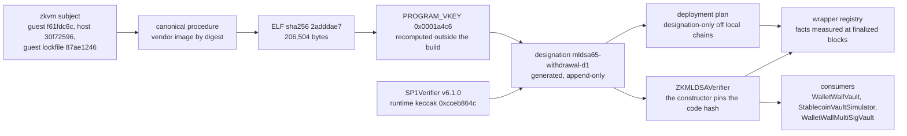
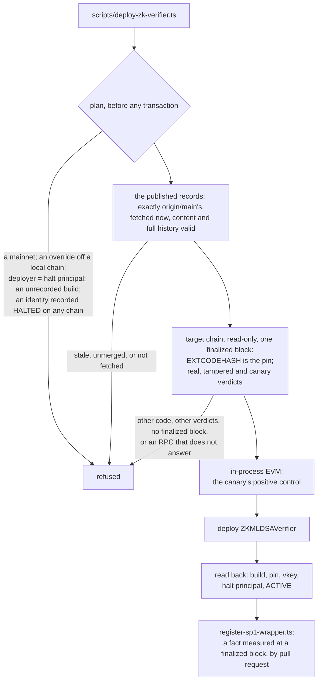
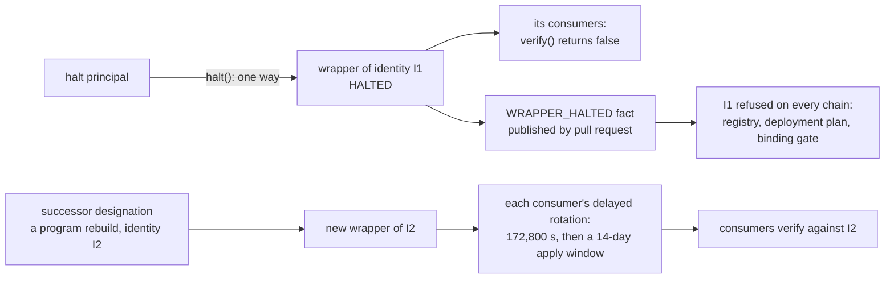

# SP1 implementation lane — the direct verifier pin, generated designations and the append-only registry

> [!CAUTION]
> Research prototype. Not audited. Testnet/local only. Do not use real funds. This lane implements what SP1-TD1
> froze, after SP1-TD2. It deploys nothing, downloads no circuit, generates no proof and writes nothing to any chain;
> its only chain activity was read-only `eth_call` and code reads at finalized blocks. No consumer is bound to a
> production SP1 identity, and nothing here is production-ready.

**Verdict: `BUILT_AND_TESTED_AWAITING_OWNER_REVIEW`. `PRODUCTION_SP1_BINDING_STATUS = NOT_ESTABLISHED`.**

SP1-TD2 admitted the wrapper to the halt model; this lane makes it bindable to a designated SP1 identity. One contract
changes: `ZKMLDSAVerifier`'s constructor now refuses any SP1 verifier whose runtime code is not the designated
SP1Verifier v6.1.0, and `verify()` compares the full chain id (F-1). Everything else is process, generated and
checked: the `mldsa65-withdrawal` designation derived from SP1-TD1's evidence, successor designations, a record of each
wrapper build, an append-only registry of wrapper facts measured from the chain and proved against git history,
refusal of a halted identity on every chain, a canonical-build workflow with one always-reporting gate,
designation-only deployment tooling with a per-chain execution check, and a proving-availability record. Nothing
re-decides SP1-TD1 or SP1-TD2.

The machine-readable receipt is [`evidence/zk/sp1-impl/implementation-receipt.json`](../evidence/zk/sp1-impl/implementation-receipt.json),
generated by [`scripts/lib/sp1-impl-receipt.ts`](../scripts/lib/sp1-impl-receipt.ts) and re-derived byte for byte in
CI (`npm run validate:sp1-impl-receipt`). No status in it is typed: each is computed from the compiled wrapper's AST,
the records and their validators, the measured observations, and probes that run the lane's own decision functions,
each refusal paired with its positive control. Its base is verified, never taken from the receipt: a published main
commit, the latest one in the history of the commit that wrote the receipt, and, once main has moved (the lane merged
it, or a pull request's synthetic merge), what the receipt states against its base must read the same against the
newer main commit. Its verdict is a STOP if one is triggered — and a STOP is raised only from records that validate —
else `EVIDENCE_INVALID` if any record fails its validator, else `BUILT_AND_TESTED_AWAITING_OWNER_REVIEW`.
Three of `PRODUCTION_SP1_BINDING_STATUS`'s prerequisites cannot be met by any evidence this lane produces, and the
receipt says so (`reachableInThisLane: false`): the status cannot be `ESTABLISHED` here, by construction.

> Provenance proves which verifier and which program a wrapper binds. It does not prove that verifier or that program
> is sound.

## Status

| Status | Value |
| --- | --- |
| `SP1_DIRECT_VERIFIER_PIN` | `CONSTRUCTOR_CODE_HASH_PIN` |
| `SP1_VERIFIER_RUNTIME_HASH` | `0xcceb864cd8a5a36b2073a8f2b32a773835cd2dd2c78a56f8e6fdb942feff04dd` |
| `PROGRAM_IDENTITY_DECISION` | `PINNED_VENDOR_BUILD` (SP1-TD1's) |
| `PROGRAM_VKEY_DESIGNATION` | `mldsa65-withdrawal-d1`: `0x0001a4c62de43425bce9febc352a74acc01bac70c02d8acedc09085c4eb8c2dc` |
| `CANONICAL_BUILD_STATUS` | `REPRODUCED` on one host (re-derived from its committed raw records); the two-host release rebuild is the CI workflow's |
| `SUCCESSOR_DESIGNATION_STATUS` | `PROGRAM_REBUILD_SUCCESSORS_ONLY_NONE_DESIGNATED` |
| `REGISTRY_APPEND_ONLY_STATUS` | `APPEND_ONLY_ON_FULL_HISTORY` |
| `REGISTRY_BUILD_PROVENANCE_STATUS` | `BUILD_RECORDED_PER_FACT` (vacuous today: the registry holds no fact) |
| `CROSS_CHAIN_HALTED_IDENTITY_STATUS` | `REPOSITORY_PUBLISHED_HALT_REFUSED_ON_EVERY_CHAIN` |
| `PER_CHAIN_EXECUTION_CHECK` | `PASSED` on Ethereum, Base, Sepolia and Base Sepolia |
| `F1_CHAIN_ID_FIX` | `FULL_WIDTH_WRAPPER_ONLY` |
| `TD2_HALT_INVARIANTS_PRESERVED` | `PRESERVED` |
| `MULTISIG_AUTHORIZATION_CLASS_PRESERVED` | `NEW_AUTHORIZATION_CAPABILITY_FOR_AN_EXISTING_PRINCIPAL` |
| `PROVING_AVAILABILITY` | `OWNER_DOWNLOAD_REQUIRED` |
| `PRODUCTION_SP1_BINDING_STATUS` | `NOT_ESTABLISHED` |

The authorization delta is `NONE_BEYOND_TD2`: the wrapper's only state-changing function is still `halt()`, and no
consumer, rotation guard or vault contract changed.

## The binding



### The direct immutable verifier pin

`ZKMLDSAVerifier` (`contracts/verifiers/ZKMLDSAVerifier.sol`) carries SP1-TD1's measured trust target as compile-time
constants — `SP1_VERIFIER_CODEHASH` `0xcceb864c…04dd`, `SP1_VERIFIER_HASH` `0x4388a21c…e696`, `SP1_VK_ROOT`
`0x002f850e…5352`, `SP1_VERSION` `"v6.1.0"` — and its constructor refuses a target without code (`InvalidSP1Verifier`)
and any target whose `EXTCODEHASH` is not the pin (`UndesignatedSP1Verifier(target, codehash)`). The target it checked
is the target it stores: `SP1_VERIFIER` is immutable and `verify()` calls nothing else for the proof. Succinct's
`SP1VerifierGateway`, the v6.0.0 verifier, every accept-all route, every mock and an address one byte off the pinned
code are refused at construction; the real v6.1.0 bytes are accepted at any address.

The pin is checked once, at construction. SP1-TD1's runtime scan found no reachable `SELFDESTRUCT` or `DELEGATECALL` in
the pinned code, so the code under the stored address cannot change after the check. A check inside `verify()` would
add gas to every verification and protect nothing more.

SP1-TD1's gateway attack, re-run against the pinned wrapper: the gateway owner adds an accept-all route for the v6.1.0
selector and for a rogue one, and freezes v6.1.0's route. A forged withdrawal stays refused, and the real v6.1.0 proof
still verifies at the pinned verifier: the wrapper never calls the gateway, so its owner holds no lever over it.

`halt()`, `HALT_PRINCIPAL`, `PROGRAM_VKEY` and every consumer are SP1-TD2's, unchanged.

### F-1: the full chain id

The journal's chain id is a `uint64` the guest commits; `verify()` used to compare it with `uint64(block.chainid)`, so a
journal for chain `x` also matched chain `x + k · 2^64`. It now compares `uint256(committed) == block.chainid`
(`_chainIdMatches`): ids that differ only above bit 63 no longer collide, and a chain id of `2^64` or more matches no
journal and fails closed. Contract only: the guest, the ELF, `PROGRAM_VKEY`, the journal (160 bytes, a `uint64` tag)
and the proof format are unchanged, which the designation's subject check and the compiler's AST both show. Each
consumer's EIP-712 domain always bound the full chain id. F-2 (the journal's signature hash is not checked) stays
informational: no authorization fact depends on which valid signature was used.

## Address, code, program, identity — and soundness

| Layer | What pins it | What it establishes | What it does not |
| --- | --- | --- | --- |
| Address | the constructor argument, immutable `SP1_VERIFIER` | which account the wrapper calls | what that account does: a gateway's routes change what one address accepts |
| Code | `EXTCODEHASH == SP1_VERIFIER_CODEHASH`, checked at construction | which bytecode verifies | what those bytes do on a chain whose precompiles differ (the per-chain check below) |
| Program | `PROGRAM_VKEY`, only from a designation | which guest program a proof attests | that the guest's relation is the intended one |
| Identity | `keccak256(abi.encode(code hash, PROGRAM_VKEY))`, SP1-TD2's definition | the pair, address-free: the same code and vkey at any address is the same identity | — |
| Soundness | nothing in this lane | — | that SP1, the v6.1.0 circuit, its Groth16 setup or the guest are sound |

## Designations: generated, never typed

[`evidence/zk/sp1/designations/mldsa65-withdrawal-d1.json`](../evidence/zk/sp1/designations/mldsa65-withdrawal-d1.json)
is generated by [`scripts/lib/sp1-designation.ts`](../scripts/lib/sp1-designation.ts) from SP1-TD1's committed
evidence, as of the subject SP1-TD1 measured. It binds the subject (guest tree `f61fdc6c`, host tree `30f72596`, source
manifest `877fbcb2…`, guest lockfile `87ae1246…`) to the procedure (the vendor image
`ghcr.io/succinctlabs/sp1@sha256:0942a27d…3400`, SP1-TD1's preserved entrypoint and driver, SP1 6.3.1, circuit
v6.1.0), the ELF (`2adddae7…2d8a`, 206,504 bytes), `PROGRAM_VKEY`, the two hosts that built and reproduced it, the
verifier (SP1Verifier v6.1.0 at `0xb69f2584CBcFf99a58C4e7002E8b89Af54a6f4e2`, CREATE2-authenticated, measured on four
chains) and the identity `0xf3c63083…16c8`. `PROGRAM_VKEY` was recomputed from the ELF outside the build containers by
Succinct's released `cargo-prove`: three agreeing results of **one** computation, on the developer workstation, none
conflicting. Its guest lock policy, `UNCHANGED_BY_THE_BUILD`, is the frozen procedure's: SP1-TD1's hosts hashed the
lockfile before their builds only, so TD1-N7 was measured after a build for the first time by this lane's rebuild, on
one host. Its `soundness` is `NOT_ESTABLISHED_BY_DESIGNATION`, and it names `mldsa65-acvp` as a program never to pin.

- **CI, on every pull request** (`npm run validate:sp1-designation`): the designation regenerates byte for byte (a
  hand-edited value is drift), the zkvm subject on disk and at `HEAD` is the latest designation's (the stale-vkey
  tripwire: a guest, host or lockfile change needs a new designation), one ELF never maps to two vkeys across the set
  (pins compared canonically, so key order or whitespace cannot hide a contradiction), and the compiled wrapper's pins
  are a designation's verifier. The guest also compiles with `--locked` (TD1-N7).
- **The canonical build** ([`scripts/sp1-canonical/canonical-build.sh`](../scripts/sp1-canonical/canonical-build.sh),
  checked by [`scripts/lib/sp1-canonical-build.ts`](../scripts/lib/sp1-canonical-build.ts)): SP1-TD1's procedure in a
  fresh container of the image by digest, from `git archive HEAD`, with the guest lockfile hashed before and after.
  The driver records what ran — its own sha256, the designation file, the image reference, the entrypoint copy's
  sha256 and the times — and the host it ran on; it fails when the build fails, and when a build that exited 0 left an
  output missing. An absent record is `INCOMPLETE`, a liveness failure that is never read as drift; only a present
  record that differs is `PROCEDURE_DRIFT` or `PROGRAM_IDENTITY_DRIFT`, and only the latter is the STOP. Hosts are
  told apart by what the driver measured about each machine — its kernel, its CPU, its Docker engine — never by the
  label it was given or what it read from its environment (`RUNNER_NAME`, the run id): one machine run twice, under any
  names, is one host. A recompute of an ELF no completed build produced is `PROCEDURE_DRIFT`.
- **Rebuilt here** on the developer workstation, at `39066b4`, by the driver it records (`a2ce5403…`): the designated
  ELF and vkey and the ACVP program's, in 121 s, the lockfile unchanged, and the vkey recomputed outside the container
  (WSL2, the released `cargo-prove` `e21aa7bd…`) agrees — `REPRODUCED`. The observation
  ([`canonical-rebuild-developer-workstation.raw.json`](../evidence/zk/sp1-impl/observations/canonical-rebuild-developer-workstation.raw.json))
  sits next to the raw records it is derived from, names the driver and the checker by sha256, and is re-derived by
  this tree's checker in every validation; change either tool and the evidence must be made again. It is one machine,
  and self-attested: the records are what the driver wrote there.
- **The release rebuild**: [`.github/workflows/sp1-canonical-build.yml`](../.github/workflows/sp1-canonical-build.yml)
  runs for every pull request and push to `main`. A `changes` job decides from the diff whether an input changed —
  the subject, the designations and their evidence, the procedure, the driver, every file the checker imports, the
  packages, the workflow ([`scripts/sp1-canonical/ci-gate.mjs`](../scripts/sp1-canonical/ci-gate.mjs)); if one did, it
  rebuilds on two GitHub runners (`ubuntu-24.04`, `ubuntu-22.04`), recomputes the vkey on a third from the ELFs alone
  with the released `cargo-prove` verified by digest, compares, and uploads the observation with its raw records in
  the committed layout. One job, **`SP1 canonical build gate`**, always runs and passes only when every job the change
  requires passed; the ruleset guard lists it ahead of the ruleset, so it is reportable for every pull request.
  Requiring it is the owner's ruleset change; until then a designation can merge without a passing two-host rebuild.
- **Common mode**, stated: every host runs the same image, toolchain, source archive and entrypoint and fetches the
  same locked crates, and the outside recompute is the same upstream prover library in another binary distribution,
  not an independent implementation. Hosts agreeing shows the procedure is deterministic; it cannot show the image or
  the prover is right.

### Successor designations

Recovery from a halt needs a new identity — never the halted one again. A successor here is a **program rebuild**:
`npm run sp1:designation -- --successor <bundle.json>` derives the next designation from a committed evidence bundle
(`evidence/zk/sp1/designation-evidence/`) whose subject is new and whose procedure is the first designation's, field
for field (another procedure needs its own decision). The bundle must show the image by digest, the lockfile
unchanged, two hosts agreeing, the vkey recomputed outside the build by a tool named by its sha256, and no ELF with two
vkeys; it names the predecessor and the reason (both digest-bound); the result must be a new identity; and every
earlier designation stays byte-identical. Refused: an earlier designation's subject (under the same procedure it
builds that designation's ELF), the same verifier code and `PROGRAM_VKEY` (a redeployment of the halted identity), and
a change of the verifier's address alone (the identity is address-free).

A new SP1 verifier cannot be designated by this tooling: it needs a trust-target derivation as SP1-TD1's. Recovery
from a halt for a verifier defect (`VERIFIER_SOUNDNESS`, `PRECOMPILE_CHANGE`) therefore waits for that lane. A
successor's ELF and vkey are what its evidence bundle reports until the canonical-build workflow, which compares with
the latest designation, rebuilds that subject on two runners. No successor exists yet.

## Wrapper builds and the registry

**Build records (SP1-TD2 residual R2-3).** SP1-TD2 judged every registered wrapper against today's compile, so any
change to the wrapper's compiled code would have made every earlier entry "not genuine". Each build is now recorded
once, from the compiler's own output, in
[`evidence/zk/sp1/wrapper-builds/`](../evidence/zk/sp1/wrapper-builds/zkmldsa-verifier-b1.json): the runtime template
(immutables zero), its keccak, the metadata boundary, the immutables' positions by name, the compiler settings, the
import closure's sources (provenance) and the pins read from the AST. A deployed wrapper is judged against the build
it was deployed from by SP1-TD2's rule: the same length and metadata boundary, and every byte before the boundary
outside its immutables. The CBOR metadata trailer is not compared because it hashes the compilation job, not the code:
Hardhat groups files into jobs, and a job's remappings enter each contract's metadata, so the same source compiled
fresh (as CI does) or incrementally carries different trailers. CI refuses a compiled wrapper whose code, compiler,
pins or immutables are not the latest record's (`npm run validate:sp1-wrapper-build`). Under
`hardhat test --coverage` the instrumented wrapper is no recorded build, so the tests that need a genuine wrapper are
skipped there; the plain test run and the validators, which CI runs first, check them.

**The registry** ([`evidence/zk/sp1-td2/wrapper-registry.json`](../evidence/zk/sp1-td2/wrapper-registry.json)) is
migrated in place from SP1-TD2's empty v1 list to a v2 fact log: `WRAPPER_REGISTERED` (chain, address, wrapper build,
designation, SP1 verifier and its code hash, `PROGRAM_VKEY`, identity, halt principal, deployment) and
`WRAPPER_HALTED` (with a reason). [`scripts/register-sp1-wrapper.ts`](../scripts/register-sp1-wrapper.ts) measures a
fact from the chain and appends it; a pull request publishes it. It sends no transaction. Every fact is observed at the
chain's finalized block: the transaction it records must be final by then, the wrapper is measured at that block, and
a finalized read that fails is no answer (it is never replaced by the latest block). A wrapper already halted is
registered all the same (what a registration records is immutable), so that its halt can be published; the
registration script may append facts to the published registry, so both go in one pull request, and until they are
merged the binding gate refuses the wrapper because the chain shows a halt the registry does not. A halt fact requires the wrapper
`HALTED` and still the wrapper its registration records — identity, `PROGRAM_VKEY`, SP1 verifier, its code, halt
principal and build — and records the measured identity, never a typed one. The binding gate reconciles every
registered fact with the chain, on each of those fields, at one block, and refuses on any difference ("the registry or
the RPC is wrong; refusing rather than guessing").

**Append-only, proved on the history.** [`scripts/lib/append-only-history.ts`](../scripts/lib/append-only-history.ts)
walks every parent edge of every commit reachable from `HEAD`, and the working tree, and requires each version of the
registry to extend the one before (and each file under the designations, the evidence bundles and the wrapper builds
never to change once added). Following `git log -- <path>` would miss a merge that resolves a conflict by dropping a
fact; walking the edges does not. The record's first version must be SP1-TD2's v1 list, so a history that starts at
the fact log (an orphan root, as a rewrite would make) is refused. A shallow clone cannot show the history and fails
closed (CI checks out with `fetch-depth: 0`). The receipt runs the walk itself on a throwaway repository on every
validation: an append passes, a dropped halt is refused.

**What the walk cannot see**, and what holds it: a rewrite of `main` itself (a force push, a deletion) hands the walk a
history without the rewritten facts. Main's ruleset forbids that, and it is measured by a read-only GET
([`scripts/measure-main-ruleset.ts`](../scripts/measure-main-ruleset.ts),
[`main-ruleset.raw.json`](../evidence/zk/sp1-impl/observations/main-ruleset.raw.json)): ruleset 21256062 is active on
`refs/heads/main` with `non_fast_forward` and `deletion`, no bypass actors, and the measuring account can never bypass
it. Whoever administers the repository can change that, and only the next measurement would show it.

**Off a local chain, only the published records.** The cross-chain refusal is repository-published data, so it is only
as fresh as the checkout that reads it. Before anything binds (`deploy.ts`, `deploy-multisig.ts`,
`propose-verifier-update.ts`), deploys (`deploy-zk-verifier.ts`) or registers (`register-sp1-wrapper.ts`) off a local
chain, the registry, the designations, their evidence bundles and the wrapper builds on disk must be, byte for byte,
what the canonical repository's main holds — fetched then from `https://github.com/Wallet-Wall/walletwall-vault.git`
itself into a private ref, never whatever `origin` names — and must validate
([`scripts/lib/sp1-published-records.ts`](../scripts/lib/sp1-published-records.ts)). Every file on disk is compared,
ignored ones included, as the tooling reads it, not through git's index. A stale checkout, a stale fork as `origin`, an
unmerged or ignored record, an edit git was told not to look at, and a fetch that fails are each refused, before any
transaction.

**Cross-chain halted identity.** A `WRAPPER_HALTED` fact refuses its identity on every chain: the registry will not
register it again, the deployment plan will not deploy it (chosen automatically or named by `SP1_DESIGNATION_ID`), and
the binding gate will not bind it, even where that chain's wrapper is `ACTIVE`. The gate also refuses a registry that
records a halt the chain does not show, and a halted wrapper the registry does not record yet. This needs no new
principal, no oracle and no on-chain registry: a halt fact is published by pull request and can only refuse. Its limit
is liveness: another chain's tooling learns of a halt only once its fact is published, so the halt principal's
procedure still halts each chain's wrapper.

## Deployment: designation-only



Off a local chain, [`scripts/deploy-zk-verifier.ts`](../scripts/deploy-zk-verifier.ts) takes the SP1 verifier, its
code hash and `PROGRAM_VKEY` only from an accepted designation (`SP1_DESIGNATION_ID` chooses when several are), the
wrapper only from the latest recorded build, and the halt principal from `HALT_PRINCIPAL_ADDRESS` (never the
deployer). `SP1_VERIFIER_ADDRESS`, `PROGRAM_VKEY` and `ALLOW_MOCK_SP1` are refused there; mainnets are refused. A local
chain (31337/1337) deploys the designated verifier's real bytes; with `ALLOW_MOCK_SP1=true` it puts an always-accepting
mock behind the genuine wrapper, labelled TEST ONLY, which the binding gate refuses off a local chain. Before
deploying, the target chain's verifier code and the three verdicts are read at one finalized block, fetched once; a
chain or RPC that names no finalized block, and every RPC failure, stop the deployment (only the chain's own revert is
an answer). That check reads the deployment's one provider and trusts what it reports: a lying RPC is not refused
there.

## The per-chain execution check

The code-hash pin fixes the bytes, not what they do: the Groth16 verifier ANDs its pairing call's success with the
call's first output word, so on a chain whose `0x08` precompile is missing an invalid proof whose first word is odd
verifies (TD1-N8). Each chain's governance decides its precompiles. [`scripts/lib/sp1-chain-execution.ts`](../scripts/lib/sp1-chain-execution.ts)
rebuilds three calls from committed evidence and requires, by `eth_call` at a finalized block through two agreeing
providers: a real v6.1.0 proof (a third party's, from a successful mainnet call) succeeds, the same proof with its last
public-value bit flipped reverts `ProofInvalid` (`0x7fcdd1f4`), and the odd-word canary reverts `ProofInvalid`. The
required verdicts are constants of the check, never values an observation brings. The canary's positive control is
executed: the same runtime with its pairing calls aimed at an empty account accepts the canary, so the check does see
a missing precompile. The validator judges that control from its two recorded verdicts, never from its flag, and
requires the observation to name this tree's measuring script by sha256.

| Chain | Finalized block | Code | Real | Tampered | Canary |
| --- | --- | --- | --- | --- | --- |
| Ethereum (1) | 26,205,755 | `0xcceb864c…` | success | `ProofInvalid` | `ProofInvalid` |
| Base (8453) | 52,686,124 | `0xcceb864c…` | success | `ProofInvalid` | `ProofInvalid` |
| Base Sepolia (84532) | 48,196,557 | `0xcceb864c…` | success | `ProofInvalid` | `ProofInvalid` |
| Sepolia (11155111) | 11,927,959 | `0xcceb864c…` | success | `ProofInvalid` | `ProofInvalid` |

Measured read-only on 2026-10-16 ([`evidence/zk/sp1-impl/observations/chain-execution.raw.json`](../evidence/zk/sp1-impl/observations/chain-execution.raw.json)).
The deployment tooling runs the same three calls on the target chain before each deployment, at one finalized block,
through the deployment's one provider. A check is true when it ran: re-run it whenever a chain may have changed.

## The halt, the rotation and the multisig cut (SP1-TD2's, unchanged)



- **One-way halt.** The halt principal's only power is `halt()`: `ACTIVE → HALTED`, after which `verify()` returns
  false for every consumer of that wrapper in the same block. It cannot make an invalid proof valid, rotate or unhalt.
- **Recovery.** A new wrapper of a successor identity, through each consumer's own delayed rotation: 172,800 s, then a
  14-day apply window. Never a fresh deployment of the halted identity (refused on chain by each consumer that knew it,
  and by the tooling on every chain). A program rebuild is designatable here; a fixed SP1 verifier is not (above).
- **The multisig authorization cut.** `WalletWallMultiSigVault`'s delayed rotation is
  `NEW_AUTHORIZATION_CAPABILITY_FOR_AN_EXISTING_PRINCIPAL` for its owner, which the owner accepted; this lane changes no
  contract outside the wrapper, so the cut is SP1-TD2's.
- **Upstream signals.** A Succinct advisory or an upstream `RouteFrozen` is detection evidence for the halt principal,
  never wired to any authority: the pinned wrapper does not read the gateway at all.

## Authority: authorization and liveness, kept apart

| Principal | Capability | Authorization | Liveness |
| --- | --- | --- | --- |
| Vault owners (`WalletWallVault`, `StablecoinVaultSimulator`) | the delayed `pqVerifier` rotation | retained: after the delay, any code-bearing verifier (SP1-TD2's cut) | can rotate away a halted wrapper |
| `WalletWallMultiSigVault` owner | the delayed rotation SP1-TD2 added | new for an existing principal (accepted) | as above |
| Halt principal | `halt()` | none: it can only make verification fail | stops PQ verification for every consumer of the wrapper |
| Succinct, as gateway owner | routes on `SP1VerifierGateway` | none over the pinned wrapper | none over it |
| Succinct, as circuit host and prover network | the v6.1.0 artifacts, the network | none | whether a user can prove (TD1-N9) |
| Chain governance (an L2's upgrade keys) | precompile semantics | can change what the pinned code accepts; the per-chain check detects it, it does not prevent it | can break verification |
| Repository maintainers (merge) | designations, the registry, the tooling | what the tooling admits, by process; no on-chain authority | how soon a halt fact reaches other chains' tooling |
| Repository administrators | main's ruleset | could permit a history rewrite the append-only walk cannot see; measured, not prevented | — |
| RPC providers | answers | none from a failing provider (it fails closed); a lying one is believed where one provider is read — the binding gate, the deployment pre-check, a registration's measurement — and is outvoted only where two are (the committed per-chain observation) | can stall the tooling |

## Proving availability (TD1-N9)

`PROVING_AVAILABILITY = OWNER_DOWNLOAD_REQUIRED`
([`evidence/zk/sp1-impl/proving-availability.json`](../evidence/zk/sp1-impl/proving-availability.json), derived by
[`scripts/lib/sp1-proving-availability.ts`](../scripts/lib/sp1-proving-availability.ts)). The 2-day rotation protects
a PqOnly user only while they can prove, and Groth16 proving for circuit v6.1.0 needs Succinct's artifacts. Measured
without downloading them, from the crates `zkvm/host/Cargo.lock` pins (each `.crate`'s sha256 is the lockfile's
checksum, and the members are read from those bytes):

- the expected `groth16_vk.bin`: sha256 `0x4388a21c…e696`, 492 bytes — the key `sp1-verifier` 6.3.1 embeds, and the
  designated `VERIFIER_HASH`, so a downloaded archive can be checked offline;
- the pinned prover downloads `https://sp1-circuits.s3-us-east-2.amazonaws.com/v6.1.0-groth16.tar.gz` only when
  `$SP1_GROTH16_CIRCUIT_PATH/v6.1.0` (else `~/.sp1/circuits/groth16/v6.1.0`) is absent, uses an existing directory as
  it is, checks no digest of the download and extracts it with `tar -Pxzf`; Groth16 proving reads
  `constraints.json`, `groth16_circuit.bin` and `groth16_pk.bin`;
- the host's feature graph leaves the gnark prover in docker: `ghcr.io/succinctlabs/sp1-gnark:v6.1.0`, a mutable tag;
- on the proving host, `~/.sp1/circuits` is absent and no gnark image is present.

Upstream hosting the files is not availability, and the artifacts' integrity is not soundness (the designated verifier
refuses a proof made under any other key or circuit). The owner action: authorize the download (about 6.21 GB, per
SP1-TD1) and the gnark image by digest, name two WalletWall-controlled archive locations, and authorize a self-hosted
proving run with network egress off whose proof the designated verifier accepts on every supported chain. A
WalletWall archive record is refused until a lane defines and validates one.

## STOP conditions

None is triggered; each is evaluated by the receipt from the same inputs as the statuses.

| Condition | Evidence |
| --- | --- |
| the canonical build does not reproduce | the rebuild is `REPRODUCED`; only `PROGRAM_IDENTITY_DRIFT` (a completed build with another ELF or vkey) is this STOP |
| one ELF maps to conflicting vkeys | none, in a completed build, the outside recompute or across the designations |
| chains disagree on the runtime identity | one code hash on all four chains |
| per-chain verdicts diverge | every chain gives the required verdicts |
| the pin is bypassable via gateway routing | the proof check calls only the immutable, constructor-pinned `SP1_VERIFIER` |
| production values can be overridden | six override probes refused, their controls accepted |
| registry history can be rewritten undetected | the history walk, run on a throwaway repository, refuses a dropped halt and accepts an append; main's ruleset forbids force pushes and deletion, with no bypass (measured) |
| a halted identity can be republished by an address change | the identity is address-free; the reuse and halted-identity probes refuse |
| the cross-chain fix needs a new mutable principal | `halt()` is the only mutator; the refusal is repository-published data |
| F-1 changes the guest, ELF, vkey or proof format | the subject is the designated one; the journal decodes as before |
| an RPC failure becomes fail-open | a rate limit is not read as the chain's answer; a failing finalized read and a chain with no finalized block are never read as another block |
| SP1-TD2's invariants are weakened | `PRESERVED` |
| bytecode exceeds its budget | every gated contract is within EIP-170 |

## Adversarial review

Three independent reviews attacked this lane before publication — authorization, provenance and common mode,
liveness — each with probes run against the code. Authorization and liveness findings are kept apart; nothing is
scored. Every finding below is fixed in this lane or stated as a residual; none required a new principal, an oracle,
automatic upstream control or a cross-chain admin.

**Authorization and provenance** (what could make the tooling admit, bind or designate something it should not):

| Finding | Fix |
| --- | --- |
| AUTH-1 / F1: a successor was typed JSON, its procedure and evidence unbound | a successor is a program rebuild under the first procedure, field for field; an earlier subject is refused; the recompute names its tool by sha256 |
| F2: "one ELF, two vkeys" was bypassed by key order or cosmetic pin differences | pins compared canonically, across the whole set; two designations of one subject under one procedure are one build |
| AUTH-2 / F4: registry facts were never reconciled with the chain; a halt copied the recorded identity | facts measured at a finalized block; a halt fact must match its registration as measured; the binding gate reconciles every field at one block |
| AUTH-3: the append-only proof could not see a rewrite of main | the first version must be the v1 list; the walk is probed on every validation; main's ruleset is measured; an administrator's change remains possible (residual) |
| AUTH-4 / L-1: tooling acted on a stale or unmerged working tree | off a local chain, the records must be the canonical repository's main, fetched then, and valid |
| AUTH-5: the refusal of an explicitly named halted designation was untested | tested |
| AUTH-6: "RPC providers have no authorization" was true only for failing ones | stated: a lying provider is believed where one is read |
| F3: the rebuild evidence was an unbound summary; two hosts could be a hand edit | raw records committed and re-derived; driver and checker bound by sha256; hosts by what they recorded |
| F5: the receipt's base was self-asserted | verified: a published main commit, the latest in the receipt commit's history |
| F6: the verdict ignored invalid evidence; the binding status was a constant in disguise | `EVIDENCE_INVALID` verdict; `RECORDS_VALID` and `NO_STOP_TRIGGERED` prerequisites; unreachable prerequisites marked |
| F7: the chain observation's control was a bare flag; its script unchecked | judged from its verdicts; script bound by sha256 |
| F8 / F9: the recompute and the lock policy were over-stated | one computation; the lock policy is the frozen procedure's, measured after a build on one host |

**Liveness** (what could stall, mislabel or fail open):

| Finding | Fix |
| --- | --- |
| L-2: the recovery path could not designate a fixed SP1 verifier | stated: it waits for a trust-target lane; program rebuilds are designatable |
| L-3: the registration's finality read fell back to the latest block | no fallback: a failing finalized read is no answer |
| L-4: an incomplete build was reported as the STOP | `INCOMPLETE`, never drift; the driver fails on a missing output; the recompute step fails on a missing ELF |
| L-5: the path-filtered workflow could not gate a designation | runs for every pull request; one always-run gate; requiring it is the owner's (residual) |
| L-6: the deployment pre-check read `latest` | one finalized block, fetched once; one provider (residual, AUTH-6) |
| L-7: STOP 11 rested on one classifier probe | two finality-read probes added |
| L-8: the binding gate's reads were unpinned | pinned to one block; the head's age is not bounded (on-chain re-checks of `isHalted` backstop it) |

Held under attack (each probed): the gateway owner's routes cannot reach the pinned wrapper; a constructor-bypassed
wrapper over the gateway is refused by the binding gate; a vault owner cannot substitute a verifier instantly; the halt
principal cannot rotate or unhalt; no deployment override survives off a local chain; history rewrites on a side
branch, merges that drop a fact and shallow clones are refused; RPC rate limits, timeouts and refused connections never
read as a verdict.

**A second, independent review of the fixes** probed each one again. It found no HIGH finding; four MEDIUM findings
showed claimed fixes that did not yet hold, and each is now fixed:

| Finding | Kind | Fix |
| --- | --- | --- |
| A1: host distinctness came from environment variables, so one machine made a two-host rebuild | authorization | hosts by what the driver measured (kernel, CPU, Docker engine); a build that measured nothing is `INCOMPLETE` |
| A2: a lane that merged main's contract change and reverted it kept an older base valid | authorization | once main has moved, what the receipt states against its base must read the same against the newer main commit |
| A3: "published" meant whatever `origin` named, so a stale fork passed | authorization | the canonical repository is fetched by URL into a private ref |
| A4: git's index view could hide a record (ignored files, assume-unchanged, a shadowing `origin/main`) | authorization | every file on disk compared byte for byte with the fetched tree |
| A5: the rebuild decision missed renames out of the subject, quoted names and `.gitattributes` | authorization | no rename detection, NUL-separated names, every `.gitattributes` an input |
| A6: a superseded designation's rebuild could meet the release prerequisite | authorization | only a rebuild of the latest designation counts |
| L1: a wrapper halted before it was registered could never have its halt published | liveness | a halted wrapper is registered; the registration script may append both facts in one pull request |
| L2: some STOPs were raised from invalid evidence, and an unmeasured ruleset read as protection | liveness | STOPs only from records that validate; an unmeasured ruleset reads unmeasured; a recompute of an ELF no build produced is drift |
| L3: two reads of a rotation check went to the latest block | liveness | every read at the gate's one block |
| L4: the gate needed both pinned runner images even when nothing was rebuilt | liveness | with nothing to rebuild the matrix runs on `ubuntu-latest` |
| (note) `deploy.ts` deployed its mock ML-DSA verifier before checking the records | liveness | the records are checked before any transaction |

## Mutation testing

A curated campaign of **223 mutants** covers each defense this lane names and every fix the two reviews added. A
mutant is one source edit, applied alone in a separate worktree and run against the suites that cover its file. The
harness refuses an anchor that does not occur exactly once and an edit that changes nothing, restores and re-hashes
the original bytes after every run, and counts a kill only when a named test or hook fails; a run in which no test
ran is invalid, never a kill. Every suite set passed unmutated first.

| Defense | Mutants | Killed |
| --- | --- | --- |
| the expected verifier runtime hash | 3 | 3 |
| the hash comparison: removed, inverted, bypassed, or misread by the receipt | 5 | 5 |
| the gateway accepted as the target | 4 | 4 |
| the designation subject | 7 | 7 |
| the ELF hash | 4 | 4 |
| the vkey: one ELF with two vkeys, the recompute and its tool | 11 | 11 |
| the lockfile binding | 3 | 3 |
| the build image digest | 5 | 5 |
| successor designations: identity equality, two hosts, no new SP1 verifier | 4 | 4 |
| the append-only registry: the history walk, main's ruleset, STOP 7 | 24 | 24 |
| registry build provenance and what a fact records | 12 | 12 |
| the halted identity on every chain | 7 | 7 |
| the production override refusals and the read-back | 10 | 10 |
| RPC errors fail closed; STOP 11 | 9 | 9 |
| the per-chain real-proof verdict | 7 | 7 |
| the tamper verdict | 2 | 2 |
| the canary verdict and its positive control | 7 | 7 |
| F-1, the full chain-id comparison | 5 | 5 |
| the canonical build (L-4, F3, A1, L2) | 19 | 19 |
| the workflow's gate and rebuild decision (L-5, A5, L4) | 15 | 15 |
| the published records (L-1, AUTH-4, A3, A4) | 7 | 7 |
| registry facts measured and reconciled (AUTH-2, F4, L1, L3) | 19 | 19 |
| the receipt: base, verdict, prerequisites, probes (F5, F6, A2, A6, L2) | 26 | 26 |
| proving availability | 8 | 8 |
| **total** | **223** | **223** |

**No mutant survives and none is called equivalent.** Two full passes at `881e690f` agreed exactly, verdicts and
killing tests alike, and left one survivor, P03: the mock flag honoured off a local chain. The refusal still fires, so
it looked equivalent; it is not. Off a local chain the mutant runs the mock mode's `PROGRAM_VKEY` validation before
refusing, so a malformed value changes the error. A test now pins that no part of the mock mode runs off a local chain
(`d8478fa9`, test only), and it kills P03 in each of two runs. A confirming pass at `d8478fa9` killed all 223. It
differs from the first pass only where the new test reaches: P03 is killed, and P02 has the new test as a second
killer. One later commit touches tests: `9296a4a6` makes two receipt tests skip under coverage instrumentation, a no-op
in a plain run, which is how the harness runs. The receipt suite's 38 mutants, run again there, are all killed by the
same tests. No later commit changes code or tests.

Three kills come from tests that read source text rather than run it: the published-records check removed from
`deploy.ts` (U05) or from `register-sp1-wrapper.ts` (U06), and the workflow asking for the pinned runner when nothing
is rebuilt (Q16). The scripts need a live fetch of the canonical repository, and the runner choice is GitHub's; what
the records check refuses and what the gate decides are killed by behavioural tests.

One defense has no measured kill: the published records' refusal of a link in place of a record. Its test makes a
symlink, which this Windows host refuses (`EPERM`, no Developer Mode); the test skips here and runs on Linux CI, so the
mutant was not run and no kill is claimed.

A dry pass before the second review's fixes ran 203 mutants and left 36 survivors and two invalid mutants. Most
survivors were checks masked by an earlier check that refuses the same input; the tests now reach each check on its
own. One was equivalent: the gate's check that a job result is a known one could refuse nothing the gate's acceptance
lists do not already refuse (a job passes only as `success`, or as `skipped` when nothing is rebuilt), so the check was
removed. The invalid mutants were an edit that did not compile (repaired) and a `before all` hook failure the harness
had counted as no test run (a named hook failure is a kill). Every other survivor is killed in the final passes. The
catalog and harness are in the PR's comments.

## What remains unestablished

> [!IMPORTANT]
>
> - **No production SP1 binding.** `PRODUCTION_SP1_BINDING_STATUS` waits on five prerequisites: the two-host release
>   rebuild in committed evidence (the workflow produces it in CI; the committed evidence has one host), a registered
>   `ACTIVE` wrapper (none is deployed anywhere), a real WalletWall proof of the designated program verified by the
>   designated verifier (none exists, and no lane yet validates one), proving availability (a later lane), and the
>   owner's review and merge. The last three are unreachable in this lane.
> - **Soundness.** Nothing here establishes that SP1, the v6.1.0 circuit and its Groth16 setup, or the guest are
>   sound; designations and pins are provenance.
> - **Common mode.** The canonical build's hosts share the image, toolchain, crates and operator, and the outside
>   vkey recompute is the same upstream library. The committed rebuild is one machine, self-attested.
> - **The rebuild gate is requirable, not required.** Until the owner requires `SP1 canonical build gate`, a
>   designation can merge without a passing two-host rebuild. Even required, it runs the workflow and decision script
>   of the pull request's own merge commit, so a pull request that edits them is judged by its edit (GitHub's
>   `pull_request` model): code-owner review of `.github/workflows/` and `scripts/sp1-canonical/` is the owner's
>   mitigation, and the measured ruleset requires no approving review.
> - **History protection is a measurement.** An administrator can change main's ruleset; only the next measurement
>   shows it.
> - **One provider is believed** by the binding gate, the deployment pre-check and a registration's measurement.
> - **Detection and publication are off chain.** The halt principal must read the signal and act; a registry fact
>   reaches other chains' tooling only once published; a deployment nobody registers is invisible to the cross-chain
>   refusal.
> - **Precompile semantics are chain-governed.** The per-chain check is true when it ran.
> - **Recovery-target gating is process (TD1-N12).** After the delay an owner who skips the tooling can still install
>   any code-bearing verifier.
> - **A fixed SP1 verifier cannot be designated here**: recovery from a verifier defect needs a trust-target lane.
> - **Proving availability** needs the owner's download, archive and a self-hosted proving run.
> - **Merging.** The receipt's base holds after a merge commit or a squash merge of an up-to-date branch; a rebase merge
>   replays the lane's commits as main commits, and the receipt would then be generated again. Once main changes a
>   contract after the base, the receipt must be generated again on the updated branch.
> - **Line endings.** The tools and records are hashed as committed (LF); a Windows clone with `core.autocrlf=true`
>   validates as `EVIDENCE_INVALID` there (fail closed), and CI is unaffected.

## Supersession and annotations

SP1-P1's STOP receipt binds `ZKMLDSAVerifier.sol` and the runbook's section 4, both of which this lane changes; it is
superseded, never restamped ([`evidence/zk/sp1-p1/supersession.json`](../evidence/zk/sp1-p1/supersession.json) names
this lane after SP1-TD1 and SP1-TD2). [`ZK_Verifier_Production.md`](ZK_Verifier_Production.md) and
[section 4 of the runbook](ZK_Prover_Runbook.md#4-deploy-against-the-designated-sp1-verifier) are rewritten in these
terms (F-3), and the SP1-TD1 and SP1-TD2 documents carry a note pointing here; their records are unchanged.

The three Sepolia reproducibility bundles' public-HEAD captures are re-taken at `9a560da6`, as SP1-TD2 did: the
pinned `ZKMLDSAVerifier.sol` and the new `ChainIdBindingProbe.sol` are covered sources of the one compilation unit.
Nothing outside the public-HEAD capture moves; the deployed bytecode of all three subjects is byte-identical.

## Reproduce / check

```bash
npm run validate:sp1-wrapper-build
npm run validate:sp1-designation
npm run validate:sp1-registry
npm run validate:sp1-proving-availability
npm run validate:sp1-impl-receipt
npx hardhat test test/Sp1Impl*.test.ts
```

Read-only measurements (network): `SP1_CHAIN_EXEC_WRITE=1 npm run sp1:chain-exec` re-measures the per-chain check;
`npm run sp1:measure-main-ruleset` re-measures main's ruleset (a GET); `scripts/sp1-canonical/canonical-build.sh
<out> <host-id>` rebuilds the subject with Docker, and `npx tsx scripts/check-sp1-canonical-build.ts --build
<host-id>=<out> --recompute <record> --min-hosts 1 --records <dir>` writes the observation with its raw records. None
downloads the circuit.
