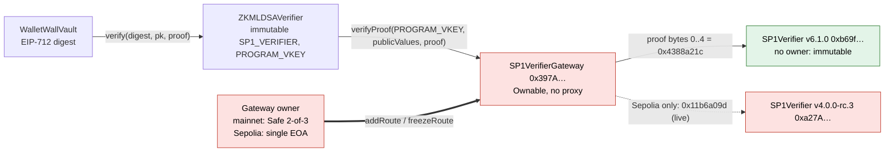

# SP1-P1 — real proof and verifier-gateway provenance: STOP (design issue)

> [!CAUTION]
> Research prototype. Not audited. Testnet/local only. Do not use real funds. This document records an assurance
> **STOP**. It does not make any part of the ZK withdrawal path ready, and nothing in it is a deployment instruction.

**Verdict: `STOP_DESIGN_ISSUE`.** The lane set out to move the SP1 boundary from program-level relation evidence
to a real proof, a reproducible program identity and an independently established verifier gateway. Two hard stop
conditions fired before any proof work:

1. **Program identity (Phase 1).** The repository's normal build and the pinned vendor build produce different
   withdrawal ELFs and vkeys, because the local build embeds the builder's `$CARGO_HOME` path. Neither identity is
   designated canonical.
2. **Verifier gateway (Phase 2).** The verifier the prover runbook directs `ZKMLDSAVerifier` at — Succinct's
   canonical Groth16 `SP1VerifierGateway` — has an owner who can add routes at any time. The accepting relation
   behind `PROGRAM_VKEY` is therefore owner-mutable, outside WalletWall's trust model.

On the owner's decision, no real proof was generated and no verifier was exercised with one. The machine-readable
record is [`evidence/zk/sp1-p1/stop-receipt.json`](../evidence/zk/sp1-p1/stop-receipt.json)
(`npm run validate:sp1-p1-receipt`).

## Claim status

| Claim | Status | Basis (short) |
| --- | --- | --- |
| `WITHDRAWAL_PROGRAM_RELATION` | `PARTIALLY_ESTABLISHED` | native relation tests (3+2+14) on the subject sources; no canonical ELF/vkey, no proof |
| `CROSS_ENVIRONMENT_PROGRAM_REPRODUCIBILITY` | `PARTIALLY_ESTABLISHED` | vendor procedure reproduces on two independent hosts; the repository's local build yields a second identity |
| `REAL_SP1_PROOF_GENERATED` | `NOT_ESTABLISHED` | not attempted after the trust-root STOP |
| `REAL_SP1_PROOF_VERIFIED` | `NOT_ESTABLISHED` | not attempted; no proof exists |
| `SP1_VERIFIER_GATEWAY_PROVENANCE` | `NOT_ESTABLISHED` | bytes attributed, but the gateway's accepting relation is owner-mutable |
| `ACVP_WITHDRAWAL_PROGRAM_ISOLATION` | `PARTIALLY_ESTABLISHED` | distinct ELFs and vkeys everywhere + native isolation tests; real-proof routing not tested |
| `CROSS_VAULT_REPLAY_RESISTANCE` | `NOT_TESTED` | construction present; not executed with a real proof |
| `CROSS_CHAIN_REPLAY_RESISTANCE` | `NOT_TESTED` | construction present; finding F-1 |
| `PRODUCTION_READINESS` | `NOT_ESTABLISHED` | unaudited prototype; no real proof; trust root unresolved |
| `NIST_CONFORMANCE` | `NOT_ESTABLISHED` | six-vector ACVP subset only |

The receipt validator re-derives every status from the raw observations and rejects any upgrade the evidence does
not support (see `test/Sp1P1StopReceipt.test.ts`).

## Subject

Measured at `main` `6463caee352beda7a27009d29f1a48b42b063fd8` (tree `6fea1db98b3404bb1def8aa5621538a6088efd56`).
`zkvm/` is unchanged since the PR #201 merge `40c7c063`. Guest tree `f61fdc6c8785df742857574c5dbf47aa62283c49`,
host tree `30f72596c430974bf8113892bf41c26dce3629f3`; per-file source manifest digest
`877fbcb28bd7f68eecb5ee9b2e4436e6ae069989a83239d4f54d7cee393e320c` (identical in every environment that recorded
one, and recomputed from the working tree by the validator). SP1 pins: `sp1-zkvm` / `sp1-sdk` / `sp1-build` `=6.3.1`,
circuit version `v6.1.0`.

## Phase 1 — withdrawal program identity

Each build ran in a fresh environment with fresh target directories; both values were pre-registered from the
2026-09-16 record before A and B ran. Independence is by physical host only: two containers or two target
directories on one machine never count as two environments.

| Env | Host | Procedure | withdrawal ELF sha256 (bytes) | withdrawal vkey |
| --- | --- | --- | --- | --- |
| A | developer workstation (WSL2, Ubuntu 26.04, sp1up `cargo-prove` 8252c29) | repository host flow, sp1-build local mode | `ce057748f2f26b308e400835218280ed817758d62acaf1330800f2aa2a66513a` (206,600) | `0x00eea6d622ce8cddee6387d922090de9710f844a977332a36c22c2651d040597` |
| B-host | developer workstation (Docker Desktop, AMD Ryzen) | repository host flow inside the pinned vendor image | `2adddae753011fb08e30127e38befe99c0092c956e01bf4486ca81827a632d8a` (206,504) | `0x0001a4c62de43425bce9febc352a74acc01bac70c02d8acedc09085c4eb8c2dc` |
| B-docker | developer workstation | sp1-build 6.3.1 docker-mode replay | same as B-host | (ELF only) |
| C-host | GitHub-hosted runner (Azure VM, Intel Xeon, Docker 28.0.4), run 38682655131 | repository host flow inside the pinned vendor image | same as B-host | same as B-host |
| C-docker | GitHub-hosted runner | sp1-build 6.3.1 docker-mode replay | same as B-host | (ELF only) |

The ACVP program is distinct everywhere: A `c29e31fbf572d4c7c38f0bfaa16515ad407e76aabf7e7f10c922076149c04a89` /
`0x00217f15120057e91d1de1cf672a9c3588aecd098690d96899ee1e09a77f17d5`; B and C
`165883fa8681507d92f97eb879030c41f10d2592c3dce229fa951f8ec91fc8e0` /
`0x00516cd6333c30f52557608680aa5e10e228856610ce7cba616640af56a93bd7`. The vendor-image host binary is identical on both
hosts as well (`fc8eff69e78e39c5c08bfa0eea2f402d5b67341eb27caae7fd34ff6b456abf1b`).

The runner observation came from a separate, non-claiming branch (`observation/sp1-p1-independent-host-vendor-build`,
commit `ad6211c8a20779c984b9ec13adc34adc543b068e`) whose `zkvm/` trees equal the subject's; it adds only the
observation workflow and scripts and was never proposed for `main`.

**Cause of the A/B difference.** Same sources, same succinct toolchain (rustc 1.94.0-dev, LLVM 21.1.8). Each ELF
embeds the same 10 crate-registry source paths in panic `Location` strings, and they differ only in the builder's
`$CARGO_HOME` prefix (`/home/<user>/.cargo` versus `/root/.cargo`). sp1-build 6.3.1 passes no remap or trim-paths
flag in either mode. The repository's local build is therefore bound to whoever builds it — unpinned mutable
external state. Making the binaries agree by rewriting paths was not attempted: that would change the program being
measured.

> [!IMPORTANT]
> **`CROSS_ENVIRONMENT_PROGRAM_REPRODUCIBILITY = PARTIALLY_ESTABLISHED`.** The pinned vendor procedure reproduces one
> withdrawal identity (ELF and vkey) on two independent hosts. The repository's default build — the one
> `docs/ZK_Prover_Runbook.md` documents — does not reproduce it, and yields a second identity that depends on the
> builder's home directory. Which procedure defines `PROGRAM_VKEY` is an owner decision; this lane designates neither.

## Phase 2 — the verifier `ZKMLDSAVerifier` is directed to trust

`ZKMLDSAVerifier` pins `SP1_VERIFIER` and `PROGRAM_VKEY` immutably and forwards every proof to
`ISP1Verifier(SP1_VERIFIER).verifyProof`. `docs/ZK_Prover_Runbook.md` §4 directs `SP1_VERIFIER_ADDRESS` at the
canonical SP1 Groth16 verifier gateway, `0x397A5f7f3dBd538f23DE225B51f532c34448dA9B`.



> [!WARNING]
> **Authority surface.** The gateway owner can, at any time and with no WalletWall action:
> - `addRoute(verifier)` — register a new verifier under `bytes4(VERIFIER_HASH)`. It applies immediately to every
>   caller and every program vkey; the prover selects the route with the proof's first four bytes. This can only
>   **widen** the relation `ZKMLDSAVerifier` accepts.
> - `freezeRoute(selector)` — permanently disable a route; proofs for it revert (a liveness lever over every
>   withdrawal pinned to the gateway).
>
> The owner cannot replace or remove an existing route's verifier, unfreeze a route, or change the gateway's code
> (no proxy; EIP-1967 slots empty). The accepting relation today is the union of the live routes on each chain.

| Measured (read-only) | Ethereum mainnet | Sepolia |
| --- | --- | --- |
| block | 26,195,421 | 11,917,946 |
| gateway runtime keccak | `0x11612dc6695484a4dfcac5ae1a7bcb093f891eb93d8aa9ddeca7f24a1f3b7d57` | same |
| owner | Safe v1.3.0 `0xCafEf00d348Adbd57c37d1B77e0619C6244C6878`, 2-of-3, no modules, no guard | EOA `0xBaB2c2aF5b91695e65955DA60d63aD1b2aE81126` |
| live Groth16 routes | v6.1.0 only | v6.1.0 **and v4.0.0-rc.3** |
| frozen | v3.0.0, v4.0.0-rc.3, v5.0.0, v6.0.0 | v3.0.0, v5.0.0, v6.0.0, a broken first v6.1.0 build |

Route tables come from the complete `RouteAdded` / `RouteFrozen` / `OwnershipTransferred` history (Blockscout) and
were cross-checked by calling `routes()` for every selector the upstream source tree declares.

### What is independently attributed

<details>
<summary>v6.1.0 Groth16 <code>SP1Verifier</code> <code>0xb69f2584CBcFf99a58C4e7002E8b89Af54a6f4e2</code> — five joins</summary>

1. Recompiled from `succinctlabs/sp1-contracts` tag `v6.1.0` (`2ac5ecbbe473421a963d67e55f182e9a36576f7c`) with the
   official solc 0.8.20 binary (sha256 checked against the soliditylang release list): runtime keccak
   `0xcceb864cd8a5a36b2073a8f2b32a773835cd2dd2c78a56f8e6fdb942feff04dd`, equal to mainnet and to Sepolia.
2. The deployment transaction is the deterministic CREATE2 factory called with salt `0x…09` and exactly that initcode.
3. CREATE2 over that initcode yields exactly the deployed address.
4. Sourcify reports an exact match (runtime and creation) on mainnet.
5. All 26 verifying-key constants in `Groth16Verifier.sol` equal an independent arkworks decoding of
   `groth16_vk.bin` shipped in crates.io `sp1-verifier 6.3.1`, and that file's sha256 equals `VERIFIER_HASH`
   `0x4388a21c687fdd5f218d7e3d13190cac4c5355818d3605fd5fb811df468ee696`.

The contract has no owner and no writable storage.
</details>

<details>
<summary>Gateway <code>0x397A5f7f3dBd538f23DE225B51f532c34448dA9B</code> — three joins</summary>

1. Recompiled from Sourcify's source set (whose sp1-contracts files are byte-equal to git): runtime equal on both chains.
2. The deployment transaction is the CREATE2 factory with salt `0x…10` (not the `0x…09` the deployments JSON lists),
   the recompiled initcode and initial owner `0xDEd0000E32f8F40414d3ab3a830f735a3553E18e`; CREATE2 yields the address.
3. Sourcify exact match on mainnet and Sepolia.

Attribution says which code runs. It does not change who can change the routes.
</details>

<details>
<summary>Upstream history worth knowing</summary>

- `a7bb13c`: the v6.0.0 Groth16 verifier first shipped with wrong `DELTA_NEG_*` constants; its address changed after the fix.
- `2ac5ecb` (#75): a first v6.1.0 build carried the wrong `VERIFIER_HASH` and `VK_ROOT`; it was deployed on Sepolia,
  routed and frozen there (`0x2b4aeaf7`).
- sp1-contracts tags are lightweight (unsigned); this provenance rests on byte equality, not on a signed release.
- On mainnet the v5.0.0 and v6.0.0 routes were frozen at blocks 26,152,982 and 26,152,991.
</details>

## Common-mode review

For each green assertion: could one implementation bug produce both the value and the verdict that it matches?

| Assertion | Producer | Independent check | Residual common mode |
| --- | --- | --- | --- |
| ELF identity | `sha256sum` inside each build environment | the ELFs (the runner's taken from its artifact) re-hashed outside every build environment | same algorithm (SHA-256) |
| ELF → vkey | the repository's `mldsa65-host` via `include_elf!` (the identical binary on B and C) | Succinct's released `cargo-prove vkey --elf` on the ELF files: all eight agree | same upstream `sp1-prover` vkey code; no algorithm-level second implementation |
| subject sources | coreutils `sha256sum` manifest in every environment | Node `crypto` manifest of the working tree, recomputed by the validator | none known |
| verifier bytes | Succinct's deployments | own solc 0.8.20 compile, CREATE2 derivation, Sourcify's compile | the gateway's OpenZeppelin files come from Sourcify, not re-fetched from OpenZeppelin |
| VK constants | the sp1-contracts generator | arkworks decode of crates.io `groth16_vk.bin` | none known |
| chain state | one public RPC provider | a second provider at the same pinned blocks (same block hashes) | both are third-party providers |
| route completeness | Blockscout log history | `routes()` probe of every selector the upstream source declares | a route under a selector absent from both would be missed |
| proof encoding, journal parsing, proof serialization, program routing | not exercised | — | `NOT_TESTED`: no proof exists |

## Findings

| Id | Severity | Finding |
| --- | --- | --- |
| F-1 | low (construction) | `ZKMLDSAVerifier.verify` compares `committedChainId != uint64(block.chainid)`; the cast truncates, so the verifier's own chain binding holds only below 2^64. The vault's EIP-712 domain still carries the full `chainid`. |
| F-2 | informational | The journal's `sigHash` is never checked on chain. Not a defect, but not a binding either. |
| F-3 | design (trust model) | `docs/ZK_Verifier_Production.md` calls the SP1 verifier address an immutable trust root while the runbook directs it at an owner-mutable gateway: address immutability is not relation immutability. |
| F-4 | design (testnet) | On Sepolia the gateway owner is one EOA and a release-candidate route frozen on mainnet is still live. |

None of these is fixed here; the lane changes no contract, no deployment script and no trust root.

## Not attempted, and why

- [ ] Phase 3 real proof — stopped by the owner after the Phase 2 STOP (no 6.21 GB circuit download, no Docker/WSL change).
- [ ] Phase 4 verification through any verifier — no proof; substituting the immutable v6.1.0 verifier or an
      upstream-built gateway as the effective authority was explicitly ruled out.
- [ ] Phases 5–6 negative and replay matrices with a real proof.
- [x] Phase 8 mutation campaign — run against this lane's own validator (`scripts/lib/sp1-p1-stop-receipt.ts`), not
      against proof-path code that was never exercised: 36 of 36 non-equivalent code mutants killed by
      `test/Sp1P1StopReceipt.test.ts`, no invalid mutant, and one deliberately equivalent control that survives.
      An earlier round's survivor (a same-environment isolation check masked by the cross-environment one) led to a
      stronger test, not to a weaker check.

## Follow-up (separate lane)

Whether WalletWall should bind `ZKMLDSAVerifier` directly to an immutable SP1 verifier (and accept a redeploy per SP1
circuit release), bind to a WalletWall-governed gateway, or explicitly accept Succinct's gateway owner as a trust
principal (and say so in `Security_Assumptions.md`) is a design decision. A canonical build procedure and
`PROGRAM_VKEY` designation are prerequisites for any of them.

## Reproduce / check

```bash
npm run validate:sp1-p1-receipt          # receipt vs observations, subject sources and lane rules
npx hardhat test test/Sp1P1StopReceipt.test.ts
```

The raw measurements are in `evidence/zk/sp1-p1/observations/`; the build procedures are those of the pinned vendor
image `ghcr.io/succinctlabs/sp1@sha256:0942a27dbe8e38f4b14f3732e779df4027b17bde93e9fbc9e8c773c15eb63400` and of
`docs/ZK_Prover_Runbook.md`.
