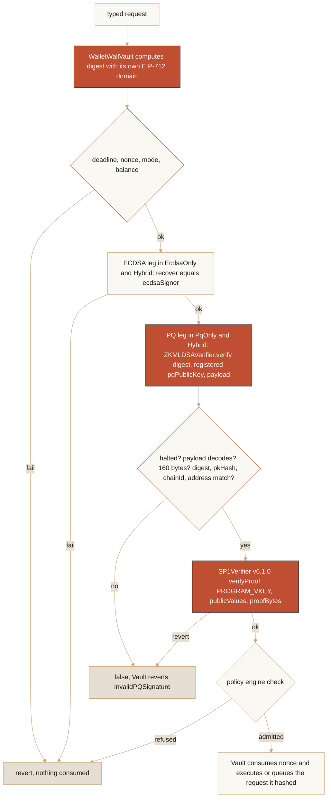
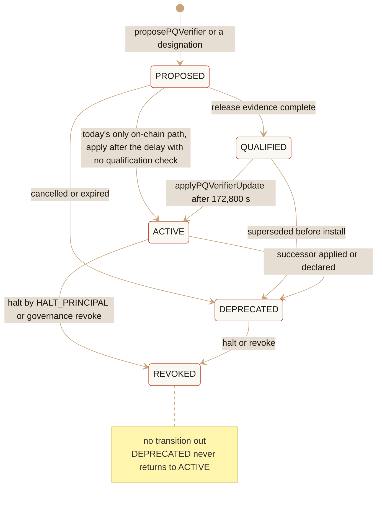

# SP1-PA3E — production binding design review and threat model

> [!CAUTION]
> Research prototype. Not audited. Testnet/local only. Do not use real funds. This document is a design: it changes no
> contract, deploys nothing, generates no proof and activates no verifier. It is not a mainnet write path and it does
> not establish production SP1 binding.

**State: `PA3E_PRODUCTION_BINDING_DESIGN_READY`.** The production statement is precise, the twenty threats are each
bound or honestly left open, replay and substitution are addressed, the program and verifier lifecycle is defined, the
public-values encoding is canonical, every failure fails closed, every PA3D residue is adjudicated, eighteen invariants
are written as future tests, a recommended architecture exists and no blocking design question remains. None of this
is a binding:

`PRODUCTION_SP1_BINDING = NOT_ESTABLISHED`

The machine-readable form of this design is `evidence/zk/sp1-impl/pa3e-production-binding-design.json` (schema
`evidence/zk/schema/sp1-production-binding-design.v1.schema.json`); `npm run validate:sp1-pa3e-design` checks that
manifest for internal consistency, checks it against the committed PA3D record (state, binding, proof digests, residue
counts, determinism statement) and the package version, and checks this document against it in both directions: every
threat, invariant, residue, gate, question, state and layer the manifest declares is named here, and every identifier of
those families named here is declared there. No artifact of this lane may call PA3D hermetic; the validator refuses the
word outside a negation. `test/Sp1Pa3eDesign.test.ts` runs the same checks in the mocha suite and exercises the
validator's refusals. A fresh-context adversarial review of the committed design (24 findings, two blocking) was folded
back into both artifacts; the commit history records what changed.

## 0. Verdict

The question this lane had to answer was: *what exact statement must WalletWall bind, through what components, under
what trust assumptions, so that a valid SP1 proof can safely influence Vault behaviour?*

The answer, in one paragraph. The statement is the one the repository already has: *the holder of the ML-DSA-65
credential registered for a vault owner authorized exactly the operation identified by the consumer's EIP-712 digest*.
The proof replaces an on-chain ML-DSA-65 verification and nothing else: it is the post-quantum conjunct of the Vault's
authorization, never a policy decision or a state transition. The components are the ones built in SP1-TD1, SP1-TD2 and
the SP1 implementation lane: a stateless wrapper (`ZKMLDSAVerifier`) pinned by runtime code hash to SP1Verifier v6.1.0
with an immutable `PROGRAM_VKEY`, behind `IPQCVerifier`, consumed by a Vault that computes the digest itself and consumes
the nonce in the transaction that accepts the proof. What is missing, and what the recommended architecture (Candidate
D) adds, is a memory of deprecated identities, keyed on a code hash the consumer measures rather than on what a target
reports, and a denial-only position for the PQ verdict behind a floor the consumer evaluates itself. The trust assumptions
are SP1's Groth16 soundness, the v6.1.0 trusted setup, the chain's precompiles, the guest's ML-DSA correctness
(provenance, never proven on chain) and honest governance: the two-day rotation delay is notice, not a guaranteed exit,
because the same governance can pause the Vault through it, so against a malicious governance the only on-chain bound in
generation 1 is the ECDSA floor, which is why the production consumer must not offer `PqOnly`.

What this lane did not do: edit Solidity, change the verifier, deploy, prove, use hosted proving, add keys or
infrastructure, or merge. The next lane is a separately authorized implementation lane that begins with the smallest
executable invariant tests (section 17), not a Solidity rewrite.

## 1. Evidence baseline

The design starts from the merged PA3D evidence, not from assumptions.

| Fact | Value |
| --- | --- |
| `main` at the start of the lane (= the #238 merge commit) | `c2c8b691f1f93c409dd7abb1552bdf0e35b91635` |
| merge parents | `c9c13ea21566117421250ee216322594a5e05551` (previous main), `192de911394c4437113d8c0a4bbd535073c5ceb7` (PA3D head) |
| merged | 2026-11-02T16:45:01Z, by the owner, as a merge commit (GitHub's synthetic test-merge SHA was not used anywhere) |
| version on `main` | 0.13.35 |
| PA3D record | `evidence/zk/sp1-impl/pa3d-exercise-record.json`, sha256 `3507f765…90c76`, state `PA3D_V2_PROOF_ATTRIBUTED_AND_VERIFIED`, 15 of 15 chain links hold |
| program | designation `mldsa65-withdrawal-d1`, guest `mldsa65-withdrawal`, ELF sha256 `2adddae7…2d8a` (206,504 B), `PROGRAM_VKEY` `0x0001a4c6…c2dc`, SP1 6.3.1, circuit v6.1.0 |
| verifier | SP1Verifier v6.1.0, runtime code hash `0xcceb864c…04dd`, selector `0x4388a21c` |
| proof | token `45aa26274d265d3f`; public values sha256 `64e08d05…67db` (OBSERVED == expected); proof bytes sha256 `aa3bdb1d…e7a4`; verification `ACCEPTED`; proof-byte determinism `NOT_CLAIMED` |
| qualification | `evidence/zk/sp1-impl/observer-qualification.json`, `OBSERVER_QUALIFIED_FOR_PA3D` |
| attribution residue (record counts) | 162 attempts, 237 refused packets; 19 refused packets that no observed attempt sent, 10 sends of unseen destination, 3 sends or connects from other namespaces to addresses beyond the VM that were never refused, 0 unknown outcomes; assurance `CONTINUOUS_PARTIALLY_ATTRIBUTED`; the record states that whether anything left by a path the inet boundary does not see reached beyond the Windows host is unknown |
| the gate document's reading of the raw events (not record judgements) | the 19 are IPv6 MLD/ND/RS kernel contexts around the gnark container's veth; the 10 are dockerd packet-socket sends inside the container namespace; the 3 are the Docker Desktop service VM (initd, rpc.idmapd, to 192.168.65.x over vsock; one a TCP connect with eight SYN retransmits); `chronyd` made 54 time-sync attempts in the window, every one refused; 646 s of host proving time (`circuit-tooling.json`) against the record's 686 s gate time |

Carried forward without downgrade: one real v2 proof was generated; it was independently verified; the statement
reproduced the expected public values; proof-byte determinism was **not** claimed; the attribution chain validated; the
negative controls passed (the runtime refused NC-V1..V5, the validator refused the NC-R1..R12 mutations); process and
network attribution was only **partial**; Docker Desktop was active during the proof; the measurement tool has a shutdown
defect; `chronyd` activity existed; the acquisition gate does not bind the complete Node dependency tree; the lane
validators are not yet wired into canonical CI. The implementation receipt still reports
`PRODUCTION_SP1_BINDING_STATUS = NOT_ESTABLISHED` with the two-host canonical rebuild, a registered active wrapper and
owner review unmet.

## 2. Production statement

### 2.1 Subject

The proof authorizes nothing by itself. It stands in for one check the Vault already makes at every PQ-gated site:
`pqVerifier.verify(digest, publicKey, pqSignature)`, where `digest` is the Vault's EIP-712 digest of a
`Withdrawal(vaultOwner, recipient, amount, nonce, deadline, vaultMode)` or a `RotateCredentials(vaultOwner,
newEcdsaSigner, newPQPublicKey, nonce, deadline)`, and `publicKey` is the owner's registered `vault.pqPublicKey` at
three of the four call sites and, at the fourth (the second check inside `rotateCredentials`), the incoming
`newPQPublicKey`, whose possession the new credential proves over the same rotation digest. No new Vault semantic is
invented for SP1.

### 2.2 Relation

The guest (`zkvm/guest/src/bin/withdrawal.rs`) proves

> there exists `signature` such that `ML-DSA-65.Verify(publicKey, digest, ctx = "", signature) = true`, with
> `keccak256(publicKey) = pkHash` and `keccak256(signature) = sigHash`,

and commits the 160-byte journal `(digest, pkHash, sigHash, chainId, verifierAddress)`. The guest is **digest-agnostic**:
it never parses the operation, so every operation-specific fact binds through the digest the consumer computes. That
single design fact decides most of the classifications below.

### 2.3 Consumer path (today's code)

### 2.4 Public inputs

Every candidate the spec lists, classified. "via digest" means the value is a field of the typed struct or of the
EIP-712 domain and therefore changes the journal's first word; "journal word" means the wrapper compares it directly.

| Candidate | Class | Bound by | Why |
| --- | --- | --- | --- |
| operation ID (the digest) | MUST | journal word 0 == `digest` | the join between proof and executed operation |
| chain ID | MUST | journal word 3, full-width vs `block.chainid` (F-1); also in the EIP-712 domain | two independent bindings |
| Vault address | MUST | via digest (`verifyingContract`) | another Vault's digest differs; the Vault never accepts a caller-supplied digest |
| verifier address | MUST | journal word 4 == `address(this)` | pins the wrapper deployment; a superseded wrapper's proofs die with it |
| credential (pkHash) | MUST | journal word 1 == `keccak256(publicKey)` as the consumer passes it: `vault.pqPublicKey`, or at rotation also the incoming `newPQPublicKey` | the credential the consumer names (registered, or the new one whose possession is proven), not any key |
| vault owner (user identity) | MUST | via digest | cross-user replay |
| recipient (destination) | MUST | via digest | the Vault pays the field it hashed |
| amount | MUST | via digest | same |
| nonce | MUST | via digest, consumed by the Vault | the replay nullifier |
| deadline (expiry) | MUST | via digest, `block.timestamp <= deadline` | the only affordable time binding |
| vault mode | MUST | via digest | a mode change voids old proofs |
| operation type | MUST | via digest (type hash) | a withdrawal digest is never a rotation digest |
| domain separator | MUST | inside every digest (`EIP712("WalletWallVault","1")`) | what makes 32 bytes a WalletWallVault digest |
| program identity | MUST | `PROGRAM_VKEY`, immutable, the Groth16 public input | a journal word naming its own vkey would be circular |
| verifier version | MUST | code-hash pin at construction; proof selector `0x4388a21c` | excludes the gateway, mocks, accept-all |
| signature hash | MAY | journal word 2, bound by the proof, unchecked (F-2) | an audit handle; no consumer may rely on it |
| asset, token contract, source wallet | N/A | — | the v1 Vault holds one asset; a multi-asset consumer MUST put the asset into its digest (PB-12) |
| policy engine identity, policy snapshot | MUST NOT | — | policy is admission, decided live at `check`/`revalidate`; in the proof it would be stale and a false assurance |
| block number or hash, state root, issue timestamp, version string | MUST NOT | — | proving takes about eleven minutes; the statement attests a signature, not state or time |

### 2.5 Private inputs

The ML-DSA-65 public key (1,952 B) and signature (3,309 B). Only their keccak hashes are public; the consumer already
holds the key and recomputes the hash. Zero knowledge is used for **succinctness**, not secrecy: the key is public on
chain, and what the proof saves is the cost of verifying the signature there.

### 2.6 What verification means, and what it does not

A `true` from the wrapper means: under the soundness of SP1's Groth16 wrap and the v6.1.0 setup, on this chain's
precompiles, the program whose verifying key is `PROGRAM_VKEY` committed exactly these 160 bytes (the verifier's second
public input is a digest of the public values; per the upstream `SP1VerifierGroth16` source, which is not vendored in
this repository, sha256 masked to 253 bits), and in them the wrapper found this digest, the credential hash it was
given, this chain and itself; so, if the guest implements ML-DSA-65 correctly, someone holding a valid signature over
this Vault's digest for this operation produced the proof.

It does **not** mean the operation is admitted (deadline, nonce, mode, balance, policy, queue delay and pause are the
Vault's); that the signer is the owner in any sense beyond holding the registered credential (credential compromise is
outside the statement, which is why generation 1 keeps the ECDSA floor); that the program is correct (`PROGRAM_VKEY`
identifies the ELF; soundness is `NOT_ESTABLISHED_BY_PROVENANCE`); which prover, host or checkout made the proof
(production binding never consults prover provenance); or that WalletWall offers quantum-safe custody.

## 3. Trust layers

| Layer | Question | Established by | Transition to the next |
| --- | --- | --- | --- |
| Layer A — proof validity | did the Groth16 proof verify? | `verifyProof` on the pinned v6.1.0 code, the chain's precompiles | valid *for a vkey and a digest*; without B it says only that some program committed some bytes |
| Layer B — program identity | was it the designated program? | `PROGRAM_VKEY` immutable, equal to the designation (CI subject check) | knowing the relation is not knowing the values; only their sha256 is bound |
| Layer C — statement identity | were the intended values proven? | length 160, ABI-validated decode, four words compared; the verifier binds the proof to a digest of the public values | the on-chain path ends here with true or false |
| Layer D — provenance | which source, program, input made it? | designation, canonical build (two-host rebuild unmet), registry, PA3D record | tells reviewers what is behind the vkey; never an input to `verify()` |
| Layer E — freshness | can it be reused where it should not? | nonce, deadline, mode in the digest; chain and verifier words | an unreplayed authorization is still only an authorization |
| Layer F — policy | does the Vault admit it? | `check`, `revalidate` (fail-closed), queue delay, quorum, pause | admission decides whether; G decides that what runs is what was proven |
| Layer G — execution binding | does the executed operation match the proven one? | the Vault executes the fields it hashed; queued operations finalize from the stored request | terminal |

A valid proof at Layer A is never sufficient for Layer G: six transitions separate them, each with its own check and its
own failure.

## 4. Threat model

Each threat names the concrete binding that prevents it or is marked open. Status: RESOLVED (a binding exists in the
code and is tested), PARTIAL (bound by construction or in part, with a stated residual), UNRESOLVED (no binding today;
the design names the one to build).

| # | Threat | Status | Binding / residual |
| --- | --- | --- | --- |
| T01 | proof replay | RESOLVED | nonce in the digest, advanced in the accepting transaction; `withdraw` and `queueWithdrawal` fail `InvalidNonce` before the verifier is consulted; `rotateCredentials` has no nonce parameter and hashes the current nonce into the digest, so a replay fails at the signature and verifier comparisons |
| T02 | cross-chain replay | RESOLVED | journal `chainId` full-width vs `block.chainid` (F-1) **and** the EIP-712 domain's chain id |
| T03 | cross-Vault replay | RESOLVED | `verifyingContract` in the digest; consumer-computed digest (PB-11). The `verifierAddress` word is the wrapper's own address, shared by every consumer of that wrapper: it separates wrapper deployments, not consumers |
| T04 | cross-user replay | RESOLVED | `vaultOwner` in the struct; `pkHash` against the owner's registered credential |
| T05 | cross-operation replay | RESOLVED | distinct type hashes (withdrawal vs rotation); both carry the nonce |
| T06 | stale policy replay | RESOLVED | policy is excluded from the statement; `check` and `revalidate` decide live |
| T07 | stale state replay | RESOLVED | balance, mode, nonce, deadline read at execution; mode in the digest |
| T08 | altered destination | RESOLVED | `recipient` in the digest; the Vault pays the field it hashed |
| T09 | altered amount | RESOLVED | `amount` in the digest |
| T10 | altered asset | PARTIAL | the v1 Vault holds one asset; a multi-asset consumer must bind the asset in its digest (PB-12), not yet frozen anywhere |
| T11 | verifier/program substitution | PARTIAL | within a wrapper: immutable `PROGRAM_VKEY`, code-hash pin, `pqVerifierIdentity` and the 172,800 s guarded rotation. Residual: nothing binds the Vault to a `ZKMLDSAVerifier`; after the delay governance can install any code-bearing verifier, an accept-all one included (the Vault's own comment calls the verifier the sole gate in `PqOnly`); bounded by the floor where it is mandatory and, once built, by the register for honest process |
| T12 | old-program downgrade | **UNRESOLVED** | only a *halted* identity is refused today, the guard identity is self-reported, and a target without the SP1 identity surface has identity zero and is admitted without any identity check; a superseded wrapper, a fresh wrapper of an old vkey, or any code-bearing contract can be installed through governance. The identity register (section 10), keyed on the measured code hash and refusing identity zero, and PB-7 close the honest-process part; against a malicious governance the floor is the bound, and the delay is notice, not an exit, because governance can pause through it |
| T13 | development proof reused in production | RESOLVED | chain id and verifier address words; a development program has another vkey; prover environment is irrelevant to validity |
| T14 | valid proof, wrong public values | RESOLVED | the verifier binds the proof to a digest of the public values as a Groth16 public input (upstream source: sha256 masked to 253 bits), so altered values fail, as NC-V3 observed on the pinned runtime; the wrapper compares four words |
| T15 | proof under another policy version | RESOLVED | the guest has no policy input |
| T16 | stale or forked chain data | PARTIAL | no chain data in the statement; a chain-id fork voids the proof; a same-id fork replays it exactly as it replays the owner's ECDSA signature, bounded by the deadline — an accepted boundary equal to the floor's exposure |
| T17 | source-commit substitution | PARTIAL | on chain only the vkey matters; source → ELF → vkey is designation evidence; the two-host rebuild that would make it reproducible is unmet (PB-18) |
| T18 | malformed encoding ambiguity | RESOLVED | length 160 or empty proof → `InvalidProof` → false; ABI decoder rejects dirty `uint64`/`address` words; bad offsets caught |
| T19 | canonicalization differences | RESOLVED | one static ABI layout shared by guest, TypeScript and Solidity; PA3D reproduced the expectation through the guest; G-02 makes that a standing fixture test |
| T20 | verifier upgrade ambiguity | PARTIAL | one `pqVerifier` at a time, delay, code re-check at apply, 14-day expiry, clean cutover by the verifier word; lifecycle states are not on chain, and a compromised governance can install any code-bearing verifier after the delay while pausing the Vault through it (`pause()` is `onlyOwner` and uncapped), so the delay is notice, not an exit; the ECDSA floor is the bound where it is mandatory |

## 5. Candidate architectures

**Candidate A — direct stateless adapter (the current path).** A tightly scoped stateless wrapper behind `IPQCVerifier`
verifies the proof and binds four journal words; the Vault binds the operation through its own digest and consumes the
nonce atomically. No key, no attester, no registry. Gas: one Groth16 verification plus two ABI decodes per PQ-gated
operation (not measured in this lane). Lifecycle: per-consumer timelocked rotation, halt as the only emergency control,
**no memory of deprecated identities**, and **nothing binds the Vault to a `ZKMLDSAVerifier`**: after the delay
governance can install any code-bearing verifier, and in `PqOnly` that verifier is the sole gate. Calldata: 160-byte
journal plus about 260 bytes of proof plus framing. Every failure is false at the wrapper and a revert at the Vault.
Verdict: VIABLE; contained in D.

**Candidate B — adapter with an on-chain evidence registry.** An isolated verifier validates the proof and records an
evidence commitment the Vault consumes later. Separation is clean on paper, but the Vault already separates verification
from authorization; the registry becomes a second nullifier on top of the nonce; anyone with a valid proof can write
entries (poisoning by accumulation); verification and consumption are two transactions, so identity, policy and mode can
change in between and the Vault must re-check all of them anyway; registry state outlives identities and needs tagging
and migration; a second contract's storage decides authorization. Verdict: REJECTED for authorization. (The repository's
hosted evidence endpoint is an *audit* side-channel, not an authorization input, and stays that.)

**Candidate C — off-chain verification with on-chain attestation.** The existing `AttestationPQCVerifier` /
`ImmutableAttestationPQCVerifier` path: an off-chain service verifies and signs. The attester is a sole external
authenticator for the PQ conjunct; its key compromise is total for that leg; its liveness is custody liveness; its
attestations need their own nonce and domain; it is runtime infrastructure with key custody. Above all it defeats the
purpose: an attester trusted to verify a proof could verify the ML-DSA signature directly, and the proof buys nothing on
chain. Verdict: REJECTED; ease is not a reason.

**Candidate D — stateless adapter as the PQ conjunct of the vNext Hybrid floor, with an identity register
(repository-suggested).** Candidate A's wrapper, consumed as the post-quantum conjunct behind an `ecrecover` floor the
consumer evaluates itself (Vault vNext §4.3a, `I-NO-SOLE-EXTERNAL-AUTHENTICATOR`; the kernel prototype's K-5 floor),
under the denial-only verifier plane (§11) and the delayed lifecycle, plus a consumer-side **identity register**. The
register keys on an identity the consumer *measures*, `target.codehash` (a `ZKMLDSAVerifier` embeds `SP1_VERIFIER`,
`PROGRAM_VKEY` and `HALT_PRINCIPAL` as immutables, so one runtime code hash is one such triple and a fresh deployment
of an old wrapper carries the old hash), paired with the guard's self-reported identity; it gives every identity one of
five lifecycle states, refuses `DEPRECATED` and `REVOKED` identities and a zero guard identity (a target without the
SP1 identity surface, admitted today) at proposal and apply, never returns from `DEPRECATED` to `ACTIVE`, and records
the admitting wrapper for each queued operation. Its scope is honest process: it refuses re-installation of superseded
programs and process drift; against a malicious governance the floor is the only bound. The verification path is A's;
the additions are one register read at proposal and apply and one address per queued operation. Not built: the register,
the admitting-wrapper record, gates G-16, G-17 and G-24.

## 6. Decision matrix

Qualitative by design: the evidence does not support numbers (gas is unmeasured in this lane; the register is unbuilt).

| Dimension | A | B | C | D |
| --- | --- | --- | --- | --- |
| trust minimization | ACCEPTABLE | ACCEPTABLE | **BLOCKING** | STRONG |
| proof/operation atomicity | STRONG | WEAK | ACCEPTABLE | STRONG |
| replay resistance | STRONG | ACCEPTABLE | ACCEPTABLE | STRONG |
| downgrade resistance | WEAK | WEAK | **BLOCKING** | ACCEPTABLE |
| verifier upgrade safety | WEAK | WEAK | WEAK | ACCEPTABLE |
| program identity binding | STRONG | STRONG | **BLOCKING** | STRONG |
| public-input binding | STRONG | STRONG | WEAK | STRONG |
| operational complexity | STRONG | WEAK | WEAK | ACCEPTABLE |
| gas/cost | ACCEPTABLE | WEAK | STRONG | ACCEPTABLE |
| failure isolation | STRONG | ACCEPTABLE | WEAK | STRONG |
| auditability | ACCEPTABLE | STRONG | WEAK | ACCEPTABLE |
| rollback safety | STRONG | WEAK | ACCEPTABLE | STRONG |
| reproducibility | ACCEPTABLE | ACCEPTABLE | WEAK | ACCEPTABLE |
| CI enforceability | STRONG | ACCEPTABLE | WEAK | ACCEPTABLE |
| compatibility with the current Vault | STRONG | WEAK | ACCEPTABLE | ACCEPTABLE |

D's ACCEPTABLE scores on downgrade resistance, upgrade safety, complexity, auditability and CI enforceability are the
parts not yet built; they are the implementation lane's work, named in section 17. A's trust minimization and upgrade
safety are scored for what the Vault is today: `PqOnly` offered, any code-bearing verifier installable after the delay.
A's reproducibility and D's are the same ACCEPTABLE for the same reason: the two-host rebuild is unmet for every
candidate.

## 7. Recommended architecture

**Candidate D.** It keeps everything A already binds (one verification, one nonce, one transaction, immutable program
identity, code-hash-pinned verifier) and adds the two things A lacks: a denial-only position for the PQ verdict behind a
floor the consumer evaluates itself, which is the only on-chain bound on a malicious governance, and a memory of
deprecated identities, keyed on a measured code hash, so that old programs cannot return through honest process. It
introduces no key, no attester, no evidence registry and no second nullifier. Its scores are never BLOCKING.

Rejected: A alone (without the register a deprecated program can be re-installed through governance, T12; without the
floor the PQ verdict could become a sole authenticator in `PqOnly`, which generation 1 rejects); B (non-atomic by
construction; nothing in the Vault needs an evidence commitment it did not compute itself); C (BLOCKING on trust
minimization, downgrade resistance and program identity).

Where the binding lives is a consumer decision (U-2): `IPQCVerifier` for `WalletWallVault` today, `IKernelPQVerifier`
for the vNext kernel. PB-13 requires the floor rule wherever it goes live; `WalletWallVault` still offers `PqOnly`, which
the production candidate must not.

## 8. Public-values contract

**Layout (v1, unchanged by this lane).** A static ABI tuple `(bytes32, bytes32, bytes32, uint64, address)`: five 32-byte
words, big-endian, left-padded, no length prefix, no dynamic part; 160 bytes.

| Offset | Word | ABI type | Semantics | Checked by |
| --- | --- | --- | --- | --- |
| 0 | `withdrawalDigest` | `bytes32` | the consumer's EIP-712 digest (operation ID) | wrapper: `== digest` |
| 32 | `pkHash` | `bytes32` | `keccak256(publicKey)` | wrapper: `== keccak256(registered credential)` |
| 64 | `sigHash` | `bytes32` | `keccak256(signature)`, non-authoritative | nobody, by design (F-2) |
| 96 | `chainId` | `uint64` | routing chain; upper 192 bits zero (ABI validation) | wrapper: `uint256(word) == block.chainid` |
| 128 | `verifierAddress` | `address` | the wrapper deployment; upper 96 bits zero | wrapper: `== address(this)` |

**Digest.** `keccak256(0x1901 ‖ domainSeparator ‖ structHash)` with `EIP712Domain(name "WalletWallVault", version "1",
chainId, verifyingContract)` and the type hashes `Withdrawal(address vaultOwner,address recipient,uint256 amount,uint256
nonce,uint256 deadline,uint8 vaultMode)` and `RotateCredentials(address vaultOwner,address newEcdsaSigner,bytes
newPQPublicKey,uint256 nonce,uint256 deadline)`. The consumer computes it from the caller's typed request and its own
domain; it is both the guest's private message and the journal's first word; the guest signs it with an empty ML-DSA
context.

**Proof payload.** `abi.encode(bytes publicValues, bytes proofBytes)` as the `IPQCVerifier` `proof` argument, decoded by
an external pure function so malformed offsets become `false`; `proofBytes[0:4]` must equal the v6.1.0 selector
`0x4388a21c` or the verifier reverts. The payload is not canonical and need not be: any ABI-valid `(bytes, bytes)`
encoding decodes (trailing bytes included) and Groth16 proof bytes are re-randomizable (determinism `NOT_CLAIMED`);
nothing keys on payload or proof bytes, so canonical form is required of the public values alone (PB-16).

**Verifier binding.** `verifyProof(PROGRAM_VKEY, publicValues, proofBytes)`: the vkey is the first Groth16 public input
and `sha256(publicValues)` masked to 253 bits is the second (Succinct's `SP1VerifierGroth16.hashPublicValues`; the
verifier source is not vendored in this repository, so this is an upstream-source statement, consistent with the
pinned runtime's observed refusal of altered public values in NC-V3), so the proof binds the exact 160 bytes and the
wrapper's word comparisons bind those bytes to its context.

**Domain separation, in layers.** Programs by `PROGRAM_VKEY`; consumers, chains and typed-data versions by the EIP-712
domain inside the digest; operations by the type hash; deployments by the chain and verifier words.

**Forbidden.** JSON or any self-describing serialization; dynamic or length-prefixed fields; implicit or by-name field
order; human-readable concatenation or decimal integers; locale-, endian- or platform-dependent encodings; a journal word
naming its own program or version (circular, unverifiable); any consumer accepting a caller-supplied digest.

**Next generation (not proposed now).** If the program changes for another reason, generation 2 prepends
`bytes32 JOURNAL_DOMAIN = keccak256("walletwall.sp1.mldsa65-withdrawal.journal.v2")` (192 bytes) and may drop
`sigHash`. A new layout is a new vkey and so a new identity entering the lifecycle at `PROPOSED`. The v1 layout's
separation by vkey is sufficient; no change is made or needed by this lane (U-3).

## 9. Replay model

Precise enough to become tests:

- **Nullifier.** The per-owner nonce inside the digest. No consumed-proof registry, operation-hash set, one-time
  authorization ID, block range or state root: a digest with a consumed nonce can never be recomputed by the Vault.
- **Where state lives.** In the consumer: `VaultOwner.nonce` per owner; for queued operations one `PendingWithdrawal`
  per owner (`pendingWithdrawals[owner]`) storing the `operationId` (the digest), the request fields, the admitting
  policy engine and, by design, the admitting wrapper.
- **When consumed.** In the transaction that accepts the proof. `withdraw` consumes at execution with the nonce checked
  before the verifier; `rotateCredentials` consumes at execution with the current nonce inside the digest and no separate
  check; `queueWithdrawal` consumes at queue, and `finalizeWithdrawal` later executes the stored request matched by
  `operationId` without re-verifying the proof.
- **Atomicity.** Verification, nonce advance and execution (or queue write) are one transaction; a revert anywhere
  undoes all of them.
- **On revert.** Nothing is consumed; the same proof remains usable.
- **Retry.** A proof may be resubmitted until its nonce is consumed or its deadline passes; it is never retried after a
  success because the nonce has advanced.
- **Cross-chain.** `chainId` in the journal (wrapper) and in the EIP-712 domain (digest).
- **Cross-contract.** `verifyingContract` in the domain and the consumer-computed digest (PB-11); `verifierAddress` in
  the journal separates wrapper deployments.
- **Cross-user.** `vaultOwner` in the struct and `pkHash` against the owner's registered credential.
- **Deadline.** `request.deadline`, checked `block.timestamp <= deadline` before the verifier is called; the only time
  binding.

## 10. Verifier and program lifecycle

**Identities.** Program identity is `PROGRAM_VKEY`, SP1's commitment to the designated ELF, immutable per wrapper. Two
verifier identities are kept apart. The *guard identity* is what `VerifierRotationGuard.identityOf` computes:
`keccak256(codehash of the SP1 verifier address the target reports, the PROGRAM_VKEY the target reports)`, stored by the
Vault in `pqVerifierIdentity` at install. It is self-reported, and it is zero for a target without the
`IHaltableVerifier` surface (a mock, an attestation verifier, an accept-all contract), which the guard admits today
without any identity check. The *measured identity* is `target.codehash`, the wrapper's own runtime code hash, which
embeds `SP1_VERIFIER`, `PROGRAM_VKEY` and `HALT_PRINCIPAL` as immutables; no impostor can carry a genuine wrapper's
code hash without being that wrapper's bytecode. The register keys on the measured identity paired with the guard
identity. Each consumer holds one `pqVerifier` at a time; identity *state* lives in the consumer's register, never in the
wrapper, and is per consumer (U-6).

**Who may add.** Governance (the contract owner) proposes; the guard refuses the halt principal as owner or caller only
when the addresses are identical, so its independence from governance is assumed, not enforced. Release evidence
qualifies (designation, append-only registry fact, two-host canonical rebuild, per-chain execution check, a fixture
proof verified by the designated runtime, host qualification); on chain, `QUALIFIED` can exist only as a governance
attestation carrying the evidence digest, asserted by the same authority that proposes, so it adds auditability, not
trust. `applyPQVerifierUpdate` activates after 172,800 s and a code re-check; today it does so with no qualification
check at all (the on-chain path is `PROPOSED` straight to `ACTIVE`), which the register is designed to refuse. **Who may
remove.** Governance deprecates at its own consumer (timelocked, one-way). `HALT_PRINCIPAL` revokes the wrapper
*instance* immediately and alone through `halt()`, after which `verify()` is false for every consumer of that instance;
the guard's identity refusal, by contrast, is per consumer and covers only the identity this consumer verified through
and left while halted, so a fresh wrapper of a halted identity is admissible today at a consumer that never verified
through the halted instance. The design closes that with a permissionless `recordHalt(wrapper)` on each consumer's
register, which probes `halted()` and records the wrapper's measured and guard identities as `REVOKED` there.
**Emergency revoke:** needed; present for new operations, absent for queued admissions. `halt()` stops the
permissionless immediate-withdraw path and `PqOnly` credential rotation through that instance; it does not reach
`finalizeWithdrawal`, which never consults the verifier and is owner-gated, so a queued admission by a later-revoked
identity is still finalizable by its owner today (U-1). **Downgrade:** today possible to any non-halted identity and,
indeed, to any code-bearing target (the guard's own header: its checks stop an honest mistake, not a malicious owner).
The register makes `DEPRECATED` and `REVOKED` measured identities, and a zero guard identity, inadmissible at proposal
and apply, so honest re-installation and process drift are refused; against a malicious governance the register is no
bound, the Hybrid floor is (PB-13), and the delay is notice rather than a guaranteed exit because governance can pause
through it. **Old proofs after an upgrade:** unconsumed proofs addressed to the old wrapper fail its verifier word (no
grace period; re-prove against the new wrapper); consumed, queued authorizations finalize unless their admitting
wrapper is `REVOKED` (U-1). **Evidence per change:** proposal and apply events with the new identity (existing);
`VerifierHalted` and the guard's refusal (existing); a designation record and a registry fact before `QUALIFIED`
(existing formats, 0 facts today); the `QUALIFIED` attestation, `IdentityDeprecated` / `IdentityRevoked` events, the
`recordHalt` path and the admitting wrapper recorded at queue (design).

| State | may prove | may verify | may authorize new | may authorize existing | history auditable | a proof made before the next transition |
| --- | --- | --- | --- | --- | --- | --- |
| PROPOSED | yes | no | no | no | yes | nothing executes through a proposed identity |
| QUALIFIED | yes | yes (tests) | no | no | yes | executes once ACTIVE, if deadline and nonce still hold |
| ACTIVE | yes | yes | **yes** | yes | yes | unconsumed proofs fail the successor's verifier word; re-prove |
| DEPRECATED (at this consumer) | yes | yes (audit) | no | yes (already queued) | yes | queued operations finalize; unconsumed proofs cannot execute |
| REVOKED (at this consumer; by design also for queued admissions, U-1) | no | no | no | no | yes | never: neither unconsumed proofs nor queued admissions execute |

Today's contracts implement `PROPOSED`, `ACTIVE` and (through `halt()`, for the current or a left-while-halted identity)
`REVOKED`, and the on-chain path runs `PROPOSED` to `ACTIVE` with no qualification check; `QUALIFIED` is a process state
(release evidence), on chain at most a governance attestation; `DEPRECATED`, the register, `recordHalt` and the
admitting-wrapper record are design.

## 11. PA3D residue disposition

PA3D is not called hermetic anywhere in this design. Each residue is adjudicated into one of the four classes.

| Residue | Finding | Disposition | Why |
| --- | --- | --- | --- |
| PA3D-F1 | the measurement tool keeps a readline on stdin after writing; the observer's 600 s guard kills it with a misleading stderr line | ACCEPTABLE WITH DOCUMENTED BOUNDARY | a tooling defect after the observation is written; touches no proof byte, verification or on-chain component. Boundary: no further attributed exercise runs with the unfixed tool |
| PA3D-F4 | Docker Desktop ran during the proof. The record counts 3 sends or connects from other namespaces to addresses beyond the VM, never refused, and states that whether they reached beyond the Windows host is unknown; the gate document's reading of the raw events (not a record judgement) attributes them to the Docker Desktop service VM (initd, rpc.idmapd, 192.168.65.x over vsock; one a TCP connect with eight SYN retransmits) | ACCEPTABLE WITH DOCUMENTED BOUNDARY | production binding never relies on prover-host hermeticity (T13); the 3 attempts were observed and counted, their attribution is the review's reading, and the record's "unknown beyond the Windows host" is carried forward unchanged. Boundary: `CONTINUOUS_PARTIALLY_ATTRIBUTED`, never hermetic; reproducibility is the two-host rebuild, not host hygiene |
| PA3D-ATTRIBUTION-PARTIAL | record counts: 19 refused packets no observed attempt sent, 10 sends of unseen destination, 3 other-namespace sends or connects beyond the VM never refused, 0 unknown outcomes; the gate document's reading: IPv6 kernel contexts, dockerd packet sockets, the Docker Desktop VM | ACCEPTABLE WITH DOCUMENTED BOUNDARY | bears on Layer D only, not on Layers A to C, which the on-chain verifier establishes without reference to any host. Every count is bounded; the 3 other-namespace attempts left the VM by a path the inet boundary does not see and were never refused, and whether they reached beyond the Windows host is unknown, as the record states; every other attempt was refused or attributed. Boundary: attribution is release evidence, never an input to `verify()`; a stricter host gate is a host-qualification decision |
| PA3D-CHRONYD | 54 refused time-sync attempts; the host clock ran free | IRRELEVANT TO PRODUCTION BINDING | the statement has no time input; record timestamps order the manifest before the proof on one monotone clock |
| PA3D-ACQUISITION-NODE-TREE | the lock file and installed `node_modules` are outside the manifest's digests | MUST FIX BEFORE PRODUCTION | a supply-chain path into the *evidence* (expected values, verification observations, validator verdicts), not into the verifier; bind the lock digest and the integrity-verified install before release evidence is trusted for `QUALIFIED` (G-20) |
| PA3D-VALIDATORS-NOT-IN-CI | `validate:sp1-pa3d-manifest` and `-record` are not in `ci.yml`; their logic runs only through the mocha suite | MUST FIX BEFORE IMPLEMENTATION | the implementation lane's baseline would drift without a red check; an owner act, since workflow edits are outside the publishing App's permission. Add `validate:sp1-pa3e-design` at the same time |
| PA3D-TWO-HOST-REBUILD | `CANONICAL_RELEASE_REBUILD_TWO_HOSTS` unmet (`INSUFFICIENT_HOSTS`) | MUST FIX BEFORE PRODUCTION | T17 is closed only by reproducibility; a lifecycle condition on `QUALIFIED` (PB-18) |

## 12. CI and release gates

What a future production verifier change must pass before merge, where each check belongs, and whether it exists today
(EXISTS / PARTIAL / MISSING, from the test and workflow inventory at the baseline).

| Gate | Check | Where | Today |
| --- | --- | --- | --- |
| G-01 | program/vkey allowlist; DEPRECATED/REVOKED refused | unit, Solidity, canonical CI | PARTIAL (designation check and program-identity tests exist; register refusal missing) |
| G-02 | public-values schema; three-way encoding fixture (guest, TypeScript, Solidity) | unit, Solidity, canonical CI | PARTIAL (length and ABI checks exist; the committed three-way fixture test does not) |
| G-03 | consumer resolves digest, credential and verifier from its own storage or from a digest-bound consumer; no caller-supplied digest anywhere (the policy-control bridge resolves the verifier from the digest-bound `consumer`) | Solidity, unit (structural) | PARTIAL (true of the Vault by inspection; no structural test over all consumers, the bridge included) |
| G-04 | chain id full-width; per-chain execution check | Solidity, release evidence, canonical CI | EXISTS |
| G-05 | nonce and replay | Solidity | EXISTS |
| G-06 | stale proof (deadline) | Solidity | EXISTS |
| G-07 | verifier version pin parity; EOA refused | unit, Solidity, canonical CI | EXISTS |
| G-08 | fixture proof accepted, tampered copy refused | integration, release evidence | PARTIAL (in the mocha suite; validator not in `ci.yml`) |
| G-09 | corrupted proof (flip, truncation, foreign selector) | integration, Solidity | EXISTS |
| G-10 | wrong public values | integration, Solidity | EXISTS |
| G-11 | wrong program | Solidity | EXISTS |
| G-12 | wrong chain | Solidity | EXISTS |
| G-13 | wrong Vault (two-Vault test) | Solidity | MISSING |
| G-14 | wrong nonce | Solidity | EXISTS |
| G-15 | expired operation; expired rotation proposal | Solidity | EXISTS |
| G-16 | downgrade attempt refused | Solidity | MISSING (needs the register) |
| G-17 | deprecated/revoked program; REVOKED refuses finalization | Solidity | PARTIAL (halt refusal exists) |
| G-18 | unapproved verifier at construction and rotation | Solidity | EXISTS |
| G-19 | provenance/evidence schema validators | unit, canonical CI | PARTIAL (PA3D and PA3E validators not in `ci.yml`) |
| G-20 | dependency lock integrity bound into manifests and host qualification | host qualification, release evidence, canonical CI | PARTIAL |
| G-21 | host qualification; measurement tool exits cleanly | host qualification, release evidence | PARTIAL (PA3D-F1) |
| G-22 | two-host canonical rebuild | release evidence | MISSING |
| G-23 | gas measurement of the full PQ-gated path on the target chain | integration, release evidence | MISSING |
| G-24 | identity-zero target (no SP1 identity surface) refused at proposal and apply; the register keys on the measured `target.codehash` | Solidity | MISSING (the guard admits such a target today) |

No production code is wired by this lane.

## 13. Failure semantics

Fail closed, always. No path converts an indeterminate verification state into authorization.

| Failure | Outcome | Where |
| --- | --- | --- |
| malformed payload (offsets, journal length, empty proof) | false → Vault reverts | `decodeProofPayload` → `InvalidProof`, caught |
| SP1 verifier reverts (invalid proof, foreign selector, wrong vkey, wrong values) | false → Vault reverts | `verifyProof` in try/catch |
| unauthorized vkey | false → Vault reverts | vkey is the Groth16 public input |
| stale nonce | revert, nothing consumed | `InvalidNonce` before the verifier (`withdraw`, `queueWithdrawal`); at `rotateCredentials` the stale nonce changes the digest, so the signature and verifier comparisons fail instead |
| expired statement | revert, proof dead for good | `DeadlineExpired`, before the verifier |
| wrong chain | false → revert | full-width comparison; digest also differs |
| wrong Vault, destination or amount | false → revert | `committedDigest != digest` |
| policy mismatch | revert | `check`; `revalidate` fails closed on STATICCALL failure |
| deprecated program | revert at proposal/apply (design) | the register; today only halted identities are refused |
| revoked program | false → revert for new operations through that instance; `finalizeWithdrawal` untouched today (owner-gated, never consults the verifier): refusal is design (U-1) | `halted` first in `verify()`; the guard's per-consumer refusal |
| verifier unavailable (no code) | revert | high-level call to a code-less address; rotation re-checks code at apply |
| any exception or out-of-gas inside verification | false → revert | every non-success path of `verify()` is false |
| ECDSA leg fails in Hybrid | revert | `InvalidEcdsaSignature`, regardless of the PQ verdict (PB-13) |

## 14. Security invariants

Written as future executable tests; tiers follow Vault vNext §16 (T0 custody-critical, T1 authorization and lifecycle,
T2 integration, T3 ordinary).

| Invariant | Statement | Tier | Closes | Enforced today |
| --- | --- | --- | --- | --- |
| PB-1 | a proof for another chain cannot authorize this Vault | T1 | T02, T13 | F-1 check; chain-id mismatch test |
| PB-2 | a proof for another Vault cannot authorize this Vault | T1 | T03 | mechanism; explicit two-Vault test missing (G-13) |
| PB-3 | a proof for another recipient cannot authorize the intended transaction | T1 | T08 | relation-consumer tests |
| PB-4 | a proof for another amount cannot authorize the intended transaction | T1 | T09 | relation-consumer tests |
| PB-5 | a proof against an unauthorized program cannot authorize execution | T1 | T11, T13 | program-identity tests; designation check |
| PB-6 | a valid proof cannot execute more than once | T1 | T01 | nonce tests |
| PB-7 | a DEPRECATED or REVOKED identity cannot authorize new operations at this consumer; keyed on the measured code hash, with zero guard identities refused; DEPRECATED never returns to ACTIVE; scope is honest process (a malicious governance is bounded by PB-13) | T1 | T12, T20 | halt and the guard's per-consumer refusal exist; the measured-identity register and the identity-zero refusal are design (G-16, G-17, G-24) |
| PB-8 | changing any security-relevant public input invalidates authorization | T1 | T14, T18 | NC-V3; word-mismatch tests |
| PB-9 | verifier failure or ambiguity fails closed | T0 | T18, T20 | try/catch; malformed-payload tests |
| PB-10 | the operation consumed is cryptographically bound to the statement proven | T0 | T05, T08, T09, T10 | execution from hashed fields; queued-path tests |
| PB-11 | every consumer resolves digest, credential and verifier from its own typed data and storage, or from a consumer address bound in the digest; none accepts a caller-supplied digest, credential or verifier | T1 | T03, T05 | by inspection (the bridge resolves from the digest-bound consumer); structural test missing (G-03) |
| PB-12 | every executed operation field is a field of the hashed struct | T0 | T08, T09, T10 | true of both structs; a requirement on multi-asset consumers |
| PB-13 | the PQ verdict is never the sole authenticator in generation 1 | T0 | T11, T20 | vNext §4.3a; the kernel prototype's K-5 floor; `WalletWallVault` still offers `PqOnly`, which the production consumer must not |
| PB-14 | the verifier plane is denial-only | T0 | T20 | NOT enforced in `WalletWallVault`: `PqOnly` is offered (the Vault's own comment calls the verifier the sole gate there) and any code-bearing verifier is installable after the delay, so a substituted verifier widens authorization today; `halt()` itself only denies; enforced only where the floor is mandatory (kernel prototype K-5; vNext §11) |
| PB-15 | policy is not a proof input | T2 | T06, T15 | no policy word; fail-closed `revalidate` |
| PB-16 | public values are a fixed-width static tuple, length- and word-validated before verification, canonical across three implementations; canonical form is required of the public values only, not of the payload or the re-randomizable proof bytes | T1 | T18, T19 | checks exist; three-way fixture test partial (G-02) |
| PB-17 | every identity change is observable (event and evidence record) | T2 | T20, T12 | proposal, apply, halt events; register events are design |
| PB-18 | no identity becomes QUALIFIED before a two-host rebuild reproduces the ELF and vkey | T2 | T17 | receipt prerequisite, unmet (G-22) |

## 15. Unresolved questions

None blocking. Each is a confirmation or a measurement, not an open security question.

| # | Question | Owner | Design position |
| --- | --- | --- | --- |
| U-1 | should a REVOKED identity refuse finalization of large withdrawals it admitted while ACTIVE? Today `finalizeWithdrawal` never consults the verifier and is owner-gated, so a forged-proof queued admission is finalizable only by that owner while the live forged-proof exposure is the immediate path | owner | yes: record the admitting wrapper address at queue (like `policyEngineAtQueue`), probe its `halted()` live at finalize and refuse if halted or REVOKED |
| U-2 | which consumer contract is the generation-1 production candidate: `WalletWallVault` behind `IPQCVerifier` or the vNext kernel behind `IKernelPQVerifier`? | owner | the same statement binds through either. Not part of the question: `PqOnly` is excluded from the production consumer as a requirement (PB-13), since a governance that can pause through the rotation delay leaves the floor as the only bound on a substituted verifier |
| U-3 | does the next program generation drop `sigHash` and add the journal domain word? | implementation lane | only when another change forces a new vkey; nothing for v1 |
| U-4 | measured gas of the full PQ-gated path on Base and Ethereum? | implementation lane | not measured here; release evidence before any ACTIVE identity (G-23) |
| U-5 | which second host performs the canonical rebuild? | owner | a resource decision; a condition on QUALIFIED (G-22) |
| U-6 | does the register live in each consumer or in one shared contract? | implementation lane | in the consumer: a shared register would be a shared authority the vNext planes forbid |

## 16. Non-goals

No Solidity is modified and no production verifier behaviour changes. SP1 verification is not activated; no identity
becomes QUALIFIED or ACTIVE by this lane. No custody or withdrawal-authorization semantic changes: the statement is the
existing `IPQCVerifier.verify` contract. Nothing is deployed; no proof was generated (no design question needed one); no
hosted proving. No secrets, signing keys, runtime infrastructure or telemetry. No claim of quantum-safe production
custody and no claim of production SP1 binding. The PR is a draft, auto-merge off, never merged by this lane; the
implementation lane is not begun. PA3D is not called hermetic and no PA3D fact is downgraded.

## 17. Implementation-lane prerequisites

In order, for a separately authorized lane:

1. **Owner act:** wire `validate:sp1-pa3d-manifest`, `validate:sp1-pa3d-record` and `validate:sp1-pa3e-design` into
   `ci.yml` (PA3D-VALIDATORS-NOT-IN-CI; the publishing App cannot push workflow edits).
2. **Owner decisions:** U-1 (REVOKED refuses finalization), U-2 (production consumer), U-5 (second rebuild host).
3. **Smallest executable invariant tests first,** against the existing contracts: PB-1..PB-6 and PB-8..PB-12 as Solidity
   tests, including the missing two-Vault test (G-13) and the structural consumer-computed-digest test (G-03).
4. **Then the register** interface and its tests (PB-7, PB-17, G-16, G-17) and the identity-at-queue record, without
   touching the wrapper.
5. The committed three-way encoding fixture test (G-02, PB-16).
6. Bind the Node dependency tree into exercise manifests and host qualification (PA3D-ACQUISITION-NODE-TREE, G-20)
   before any release evidence is trusted for QUALIFIED.
7. Fix PA3D-F1 before the next attributed proving exercise; the two-host canonical rebuild (G-22, PB-18) and the gas
   measurement (G-23) before any identity is QUALIFIED.
8. No broad Solidity rewrite: the wrapper and the Vault's authorization semantics are unchanged by the recommended
   architecture.

---

Reproduce the checks: `npm run validate:sp1-pa3e-design` and `npx hardhat test test/Sp1Pa3eDesign.test.ts`. Related:
[SP1_Circuit_Install_And_Archive_Only_Prove_Gate.md](SP1_Circuit_Install_And_Archive_Only_Prove_Gate.md) (PA3B, PA3D),
[SP1_Implementation_Pin_Designation_Registry.md](SP1_Implementation_Pin_Designation_Registry.md),
[SP1_TD2_Verifier_Halt_And_Multisig_Rotation.md](SP1_TD2_Verifier_Halt_And_Multisig_Rotation.md),
[Vault_vNext_Architecture.md](Vault_vNext_Architecture.md) (§4.3a, §11, §12, §16),
[ZK_PQ_Status_Matrix.md](ZK_PQ_Status_Matrix.md).

`PRODUCTION_SP1_BINDING = NOT_ESTABLISHED`
