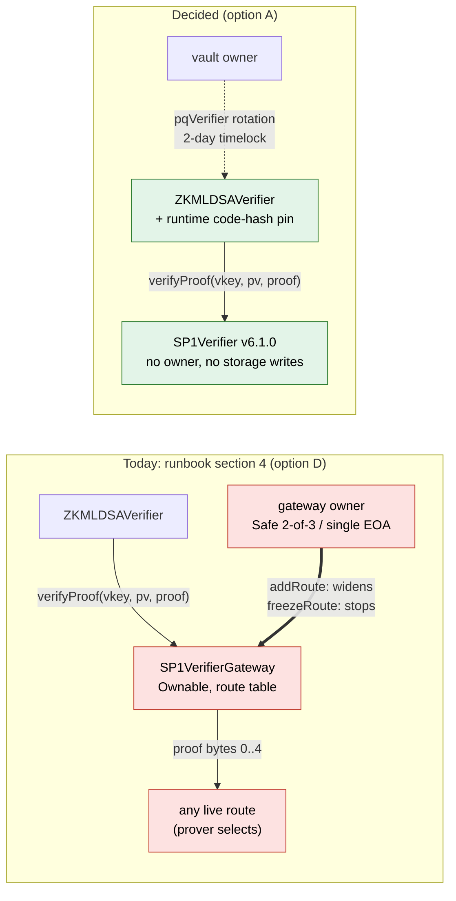

# SP1-TD1 — verifier trust target and canonical program identity

> [!CAUTION]
> Research prototype. Not audited. Testnet/local only. Do not use real funds. This document records a design
> decision and the evidence for it. It changes no contract, deployment script, trust root or guest program, and
> nothing in it is a deployment instruction. The production changes it calls for are frozen for the next lane.

**Verdict: `DESIGN_DECIDED`.** SP1-P1 (PR #212) stopped on two open questions: which verifier `ZKMLDSAVerifier`
should trust, and which build defines `PROGRAM_VKEY`. Both are now decided on evidence, with authorization and
liveness kept apart:

1. **Trust target: `DIRECT_IMMUTABLE_VERIFIER`.** Bind `ZKMLDSAVerifier` directly to Succinct's Groth16
   `SP1Verifier` v6.1.0, pinned by its **runtime code hash**, not to the `SP1VerifierGateway`. Nobody outside
   WalletWall can then widen the accepted relation or stop valid proofs from verifying; widening happens only through
   WalletWall's timelocked `pqVerifier` rotation.
2. **Program identity: `PINNED_VENDOR_BUILD`.** The digest-pinned vendor-image procedure defines the withdrawal
   ELF, and `PROGRAM_VKEY` is the vkey computed from that ELF:
   `0x0001a4c62de43425bce9febc352a74acc01bac70c02d8acedc09085c4eb8c2dc`.

The machine-readable record is [`evidence/zk/sp1-td1/decision-receipt.json`](../evidence/zk/sp1-td1/decision-receipt.json)
(`npm run validate:sp1-td1-receipt`). Every decision in it is derived by
[`scripts/lib/sp1-td1-decision.ts`](../scripts/lib/sp1-td1-decision.ts) from raw observations and from probe
facts that [`test/Sp1Td1TrustTargetProbes.test.ts`](../test/Sp1Td1TrustTargetProbes.test.ts) re-executes against
the exact mainnet verifier and gateway bytes.

## Decisions

| Output | Value | Basis (short) |
| --- | --- | --- |
| `SP1_TRUST_TARGET_DECISION` | `DIRECT_IMMUTABLE_VERIFIER` | option A: no external authorization or liveness lever; the pinned gateway (B) is viable but keeps the gateway owner's freeze |
| `PROGRAM_IDENTITY_DECISION` | `PINNED_VENDOR_BUILD` | one ELF and vkey on two independent hosts, image pinned by verified digest, fresh subject |
| `UPGRADE_MODEL` | `EXPLICIT_REDEPLOY_AND_TIMELOCKED_ROTATION` | a new verifier or guest means a new wrapper and the vault's 2-day rotation |
| `CROSS_CHAIN_MODEL` | `CODE_HASH_PINNED_SAME_IDENTITY_ON_EVERY_CHAIN` | one runtime code hash at one CREATE2 address on Ethereum, Base, Sepolia and Base Sepolia, and the same real-proof verdicts from the deployed template on each |
| `REAL_PROOF_LANE_UNBLOCKED` | `true` | trust prerequisites established; starting it is still an owner decision (the circuit download) |
| `IMPLEMENTATION_REQUIRED` | `true` | the pins, the designation file and the tooling are frozen for the next lane |

`AUTHORIZATION_AUTHORITY_DELTA` (against what the runbook directs today, option D): **removed** the gateway
owner's `addRoute` on every measured chain — the Safe `0xCafEf00d348Adbd57c37d1B77e0619C6244C6878` (2-of-3) on
Ethereum and Base, and the single EOA `0xBaB2c2aF5b91695e65955DA60d63aD1b2aE81126` on Sepolia and Base Sepolia;
**added** none; **retained** the vault owner's timelocked `pqVerifier` rotation (172,800 s delay).
`LIVENESS_DEPENDENCY`: no external on-chain lever remains (the owners' `freezeRoute` is removed); off chain, proof
generation needs Succinct's v6.1.0 circuit artifacts or prover network, and rebuilding the ELF needs the vendor
image and crates.io — integrity is pinned, availability is not.

## Claim status

| Claim | Status | Basis (short) |
| --- | --- | --- |
| `TRUST_TARGET_CODE_IDENTITY` | `ESTABLISHED` | one runtime hash on four chains via two providers each; CREATE2-authenticated initcode; SP1-P1's own compile, Sourcify and VK join; no reachable state- or code-changing opcode; the same proof verdicts on every chain |
| `DIRECT_AND_GATEWAY_VERIFICATION_EQUIVALENT` | `ESTABLISHED` | the gateway forwards the consumer's tuple unchanged; a real upstream v6 proof verifies on both paths, tampering is rejected identically |
| `UNPINNED_GATEWAY_OWNER_CAN_WIDEN` | `ESTABLISHED` | executed: one `addRoute` by the owner drains a PqOnly vault through the unmodified `ZKMLDSAVerifier` |
| `DECIDED_TARGET_HAS_NO_EXTERNAL_LEVER` | `ESTABLISHED` | option A has no authorization or liveness lever outside WalletWall's rotation |
| `CANONICAL_PROGRAM_IDENTITY` | `ESTABLISHED` | the vendor procedure; the default local build embeds the builder's `CARGO_HOME` |
| `PROGRAM_VKEY_DESIGNATED` | `ESTABLISHED` | the vendor ELF's vkey, cross-checked outside the build by the released `cargo-prove` |
| `IDENTITY_REPRODUCED_OUTSIDE_VENDOR_IMAGE` | `ESTABLISHED` | a WSL build with a separately installed toolchain and one remap flag reproduced it byte for byte |
| `VKEY_DERIVATION_ALGORITHM_INDEPENDENT` | `NOT_ESTABLISHED` | every vkey comes from Succinct's `sp1-prover`; a verified real proof is the next join |
| `GATEWAY_ROUTE_HISTORY_COMPLETE` | `NOT_ESTABLISHED` | the indexer SP1-P1 used missed a `RouteFrozen`; under a code pin no route needs enumerating |
| `REAL_SP1_PROOF_GENERATED` | `NOT_ESTABLISHED` | out of scope: no circuit download, no prover run |
| `REAL_SP1_PROOF_VERIFIED` | `NOT_ESTABLISHED` | no WalletWall proof exists; the only real proof run is upstream's v6 fixture, as a control |
| `PRODUCTION_READINESS` | `NOT_ESTABLISHED` | design lane; implementation, real proof and audit outstanding |

## Subject

Measured at `main` `72b6554632335bfc7487f7dc7e9b3f44cdde0c0b` (tree `e83e83d6de28b5e66897f0244645e2ee288473c8`), the
merge of #212 (head `4cd5cfb45b8b0bee28599fc166a7e26b58696757`). The zkvm sources are unchanged since SP1-P1 measured
them: guest tree `f61fdc6c8785df742857574c5dbf47aa62283c49`, host tree `30f72596c430974bf8113892bf41c26dce3629f3`,
per-file manifest digest `877fbcb28bd7f68eecb5ee9b2e4436e6ae069989a83239d4f54d7cee393e320c`. SP1 pins `=6.3.1`
(sp1-zkvm, sp1-sdk, sp1-build), circuit `v6.1.0`. The SP1-P1 receipt validator and the native relation tests
(3 + 2 + 14) were re-run first and pass; with the relation executor built, all 15 relation-consumer tests run and pass.

## The invariants a design must keep

- **Authorization integrity.** No actor can widen the relation WalletWall accepts without a WalletWall-authorized,
  timelocked change. "Widen" means: some proof that was rejected becomes accepted.
- **Program identity.** `PROGRAM_VKEY` is derived mechanically from a pinned, reproducible build — never typed,
  chosen by inspection, read from mutable state, or established only by the code that consumes it.
- **No silent authority expansion.** A gateway, registry, Safe, EOA or upstream operator becomes a principal only
  explicitly.
- **Fail closed.** Unknown verifier code, unknown program, drift, an unsupported route or conflicting build
  evidence all refuse.
- **Upgrade legibility.** A new verifier, guest, toolchain, ELF, vkey or proof format is an explicit, versioned
  transition — never something an existing route starts accepting.
- **Liveness is not integrity.** A lever that can only stop valid proofs is a liveness dependency; it is never
  scored together with one that can make invalid proofs pass.
- **Independent authority.** WalletWall's own declaration is never the only evidence for its trust root.

## Options, executed

Each option ran against the exact mainnet bytes: the initcode of the gateway and of the v6.0.0 and v6.1.0
verifiers is taken from their deployment transactions (both providers return the same input), CREATE2 derives
each mainnet address from it, and the runtimes the tests deploy hash to the mainnet code hashes
(`0x11612dc6695484a4dfcac5ae1a7bcb093f891eb93d8aa9ddeca7f24a1f3b7d57`,
`0xdf34e327244216e855305a1b40f911e42644fca8d97f2cdbcedfc447c70469f2`,
`0xcceb864cd8a5a36b2073a8f2b32a773835cd2dd2c78a56f8e6fdb942feff04dd`). The positive control is a real Groth16 proof:
upstream's v6 fixture from `contracts/test/SP1VerifierGroth16V6.sol` at tag `v6.1.1`. It targets v6.0.0, whose
wrapper shares every non-constant statement with v6.1.0 (only `VERSION`, `VERIFIER_HASH`, `VK_ROOT` and the order of
two pre-checks differ).



| Probe (all on the mainnet bytes) | Result |
| --- | --- |
| The gateway passes `ZKMLDSAVerifier`'s `(vkey, publicValues, proofBytes)` through unchanged | yes: only the registered tuple verifies behind it |
| A real upstream v6 proof, directly and through the gateway | verifies on both |
| One public-value bit flipped, or another program vkey | `ProofInvalid()` on both, identical revert data |
| v6.1.0 pre-checks (exit code, vk root, invalid points), directly and through the gateway | identical revert data |
| v6.1.0 runtime: reachable `SSTORE`/`TSTORE`/`LOG`/`CALL`/`CALLCODE`/`DELEGATECALL`/`CREATE`/`CREATE2`/`SELFDESTRUCT` | none (the gateway has `SSTORE`) |
| On chain, read-only `eth_call` on Ethereum, Base, Sepolia and Base Sepolia (two providers each): the deployed v6.0.0 verifier with the real proof and with a tampered copy; v6.1.0 with an invalid proof | real proof accepted, tampered and invalid proofs `ProofInvalid()` — the same verdicts on every chain, so the chains' BN254 and modexp precompiles agree on these paths |
| **D** — owner adds an accept-all route, forged journal, unmodified consumer, PqOnly `WalletWallVault` | **the vault pays the attacker** |
| **D** — owner freezes the route of a valid proof | the gateway rejects it, the verifier still accepts it; nothing new is accepted |
| **D** — non-owner `addRoute`; owner replaces an existing route | both revert |
| **C** — WalletWall-owned gateway: admin `addRoute`, then forged withdrawal | paid in the **next block**; the vault's own rotation of the same verifier needs 172,800 s |
| **B0** — selector-only pin on a gateway where the selector is not yet routed | the owner squats the selector with an accept-all verifier; the forged proof passes |
| **B** — selector + route + both code-hash pins | a squatted route fails at construction; other selectors are refused; the pinned route cannot be replaced; a freeze stops valid proofs |
| **A** — code-hash pin | accepts the canonical code at any address; refuses the gateway, v6.0.0 and an accept-all verifier with the v6.1.0 selector |
| **A** — unmodified consumer bound directly | refuses every forged proof shape; the verifier exposes no owner or route administration |

<details>
<summary>Why a selector check alone "looks right" and is not</summary>

`VERIFIER_HASH()` is a value a contract returns, not a measurement of its code. On any chain where the gateway
has no route under `0x4388a21c` yet, its owner can register a verifier that returns a hash beginning with those four
bytes. A consumer that checks only the selector then forwards to that verifier. Routes are write-once, so the fix is
to check, at construction, that the route already points at the expected verifier and that both the gateway's and the
verifier's code hashes are the expected ones — at which point the gateway contributes nothing but its owner's freeze.
</details>

### Authority matrix

Authorization ("widen") and liveness ("disable") are separate columns and are never combined.

| | A — direct, code-pinned | B — gateway, fully pinned | B0 — gateway, selector only | C — WalletWall gateway | D — gateway, unpinned |
| --- | --- | --- | --- | --- | --- |
| verifier code mutable | no | no | no | no | no |
| accepted relation mutable outside WalletWall's timelock | **no** | **no** | yes (squat) | yes | yes |
| who can widen | vault owner, after 172,800 s | vault owner, after 172,800 s | + gateway owner where the selector is unrouted | + WalletWall gateway admin, 0 s | + gateway owner per chain, 0 s |
| who can stop valid proofs (liveness) | none external | gateway owner per chain | gateway owner per chain | WalletWall gateway admin | gateway owner per chain |
| proxy / admin | none | upstream Ownable (no proxy) | upstream Ownable | WalletWall Ownable | upstream Ownable |
| route registry | no | yes | yes | yes | yes |
| upstream governance dependency | none | liveness | authorization | none | authorization |
| WalletWall governance dependency | timelocked rotation | timelocked rotation | timelocked rotation | rotation **and** an instant admin | timelocked rotation |
| upgrade needs a redeploy | yes | yes | yes | no | no |
| trust root independently reproducible | yes | yes | no | no | no |
| cross-chain identity | one code hash on every chain | per-chain owner and routes | per-chain owner and routes | per-deployment admin | per-chain owner and routes; v4.0.0-rc.3 live on both testnets |
| new attack surface | none | pin layer + routing code | fails open on unrouted chains | a second, instant replacement path | every live route, any chain |
| viable | **decided** | viable, ranked second | rejected | rejected | rejected |

The rule that ranks them is in the validator: (1) an option is viable only if nobody outside WalletWall's
timelocked rotation can widen it; (2) among viable options, fewer distinct external liveness principals win; (3) then
fewer components in the accepted path. A and B tie on authorization; A wins on authority minimisation.

| Criterion (in priority order) | A — direct, code-pinned | B — gateway, fully pinned | Better |
| --- | --- | --- | --- |
| 1. authorization integrity | only the timelocked rotation widens | the same | tie |
| 2. authority minimisation | no external principal | gateway owner on every chain (freeze) | **A** |
| 3. independent provenance | CREATE2, four-chain code hash, own compile, Sourcify, VK join | the same, plus the gateway to attribute | tie |
| 4. reproducibility | the same verifier bytes | the same | tie |
| 5. fail closed | code pin fails on any other code, any chain | construction checks fail on a squatted or foreign route | tie |
| 6. upgrade legibility | new wrapper + rotation | the same | tie |
| 7. cross-chain consistency | one code hash at one address | per-chain owners and routes (upstream also lists other gateway addresses on some chains) | **A** |
| 8. liveness | nothing external can stop valid proofs | the gateway owner can | **A** |
| 9. operational complexity | one constant | per-chain gateway address and route checks | **A** |
| 10. implementation complexity | one `EXTCODEHASH` comparison | a pinning layer | **A** |

> [!WARNING]
> **D in practice.** Upstream published a High-severity soundness advisory for SP1 6.0.0–6.0.2 on 2026-04-11
> (GHSA-63x8-x938-vx33, CVE-2026-40323; fixed in 6.1.0). The mainnet gateway froze the v6.0.0 route on
> 2026-10-09 — **181 days later** (both providers agree on the timestamps). For those six months an unpinned
> consumer's accepted relation still included that route. The advisory does not say whether the on-chain verifier
> was affected and TD1 claims no exploitability; the point is that the freeze lever is not a safety control
> WalletWall can count on, while it remains a liveness lever over WalletWall.

> [!NOTE]
> **Why not keep B for Succinct's "emergency brake"?** The brake fired six months after the advisory. WalletWall
> already owns an immediate brake (`pause()` on both vaults, owner-only, liveness only) and the timelocked rotation.
> Under A, WalletWall watches upstream advisories and gateway `RouteFrozen` events as **signals** and pulls its own
> levers; it does not hand the timing of its liveness to another operator.

## Program identity

| Candidate | Result | Why |
| --- | --- | --- |
| `PINNED_VENDOR_BUILD` | **established** | ELF `2adddae753011fb08e30127e38befe99c0092c956e01bf4486ca81827a632d8a` (206,504 B) and vkey `0x0001a4c62de43425bce9febc352a74acc01bac70c02d8acedc09085c4eb8c2dc` on the developer workstation (AMD) and a GitHub-hosted runner (Intel); both procedure forms agree; `cargo-prove` agrees 3/3 outside the build |
| `REPRODUCIBLE_REPO_BUILD` | not established | the default local build embeds the builder's own `CARGO_HOME` (`/home/sirmrdrgod/.cargo`), so its identity is per builder: ELF `ce057748f2f26b308e400835218280ed817758d62acaf1330800f2aa2a66513a`, vkey `0x00eea6d622ce8cddee6387d922090de9710f844a977332a36c22c2651d040597` (re-measured here, identical to SP1-P1) |
| `OTHER_ESTABLISHED_PROCEDURE` | cross-check only | the same local build plus `--rustflags=--remap-path-prefix=$HOME/.cargo=/root/.cargo` (sp1-build's own `BuildArgs.rustflags`) reproduced the vendor ELF and vkey byte for byte — pre-registered as a cross-check, never the definition |

sp1-build's own Docker mode (`cargo prove build --docker`, sp1-build 6.3.1 source) pulls
`ghcr.io/succinctlabs/sp1:<tag>` **by tag**. The canonical procedure runs the same build inside the image referenced
by digest instead, which is what the two-host evidence measured; the tag currently resolves to the pinned index, but
a tag is not a pin.

**The canonical procedure, pinned:**

- image index `sha256:0942a27dbe8e38f4b14f3732e779df4027b17bde93e9fbc9e8c773c15eb63400` (the registry body hashes to
  it) → `linux/amd64` manifest `sha256:7c1c8201de6f63e3f1fb9075bd9a67a4c5fc8c2d546d11a5ff71587bb51e6eb3` → config
  `sha256:aedac539617deeb11fb7fbac9270de9f8d0b021214eab05db672b2f0b181f796`;
- inside it: succinct `rustc 1.94.0-dev` (LLVM 21.1.8), host `rustc`/`cargo` 1.96.0, `CARGO_HOME=/root/.cargo`, no
  `RUSTFLAGS`, fresh target directories, target `riscv64im-succinct-zkvm-elf`, default features;
- `cargo build --release --locked` in `zkvm/host` (`build.rs` → `sp1_build::build_program`), then the host's own
  `vkey`; both lockfiles are part of the subject;
- the exact scripts, preserved byte for byte from the SP1-P1 observation branch (commit
  `ad6211c8a20779c984b9ec13adc34adc543b068e`): [`host-build-in-container.sh`](../evidence/zk/sp1-td1/canonical-procedure/host-build-in-container.sh)
  (`dd0384751156b5e61d59c166ff09a80b3abdfcab576080b9f7be3603ac520f2d`) and
  [`observe.sh`](../evidence/zk/sp1-td1/canonical-procedure/observe.sh)
  (`cf650fd0b4890751f65ea43260c15cf68c5ce8a99ea9faf4723a62050d7252b1`).

`mldsa65-acvp` (ELF `165883fa8681507d92f97eb879030c41f10d2592c3dce229fa951f8ec91fc8e0`, vkey
`0x00516cd6333c30f52557608680aa5e10e228856610ce7cba616640af56a93bd7`) is recorded only as a program a verifier must
never pin.

## The designation contract (frozen for the implementation lane)

```text
zkvm subject (manifest digest) → canonical procedure (image by digest) → ELF sha256 → vkey (recomputed outside the build) → designation file → compile-time constant
```

- **Where it lives.** One designation file per program, generated from the build observations by a script — never
  typed. It records the subject digest, the procedure (image digest, SP1 pins, script hashes), the ELF sha256 and
  size, the vkey, the hosts and the cross-check. The receipt here is the first such record.
- **What CI checks on every PR (cheap).** The zkvm subject on disk equals the designation's subject; otherwise CI
  fails until a new designation exists. This is the stale-vkey tripwire, and `validate:sp1-td1-receipt` already
  behaves this way.
- **What a release checks (expensive, gated).** The canonical procedure on **two physically independent hosts**,
  each producing the designated ELF and vkey, and the vkey recomputed from the ELF file by a different binary
  outside every build environment.
- **What deployment may consume.** Only a designation whose subject matches the tree being deployed, with the vkey
  compiled into the wrapper or read from the designation — never an environment variable on a non-local chain.
- **What is not evidence.** A vkey that a human pasted, which CI then finds in two places. Agreement between
  declarations is not a measurement; every value above traces to a build or a chain read.

## Upgrades and rollback

| Change | New ELF | New vkey | New wrapper | How it takes effect |
| --- | --- | --- | --- | --- |
| guest source, lockfile, SP1 crates or toolchain | yes | yes | yes (vkey is immutable) | new designation on two hosts → deploy → vault `proposePQVerifier` → 2 days → `applyPQVerifierUpdate` within 14 days |
| SP1 verifier/circuit release (e.g. after v6.1.0) | re-measure | usually | yes (new code-hash pin) | the same; the old wrapper keeps working until rotated away |
| F-1 fix (contract only) | no | no | yes | the same rotation |

An existing `WalletWallVault` changes verifier only through that rotation, for every vault at once; it should not
change by any other path. `WalletWallMultiSigVault` fixes its verifier at construction, so it moves only by
redeploying and migrating. **Rollback** is the same transition pointed back at a previously designated wrapper (still
deployed, still immutable) — never a mutable route, so it adds no authority. In an emergency the owner pauses
(liveness only) while a rotation matures.

## Findings intersecting this design

| Id | Disposition | Before real proof? | Guest/vkey change? | Plan |
| --- | --- | --- | --- | --- |
| F-1 `uint64(block.chainid)` | `NO_AUTHORIZATION_IMPACT` | no | no | compare `uint256(committedChainId)` with `block.chainid` |
| F-2 `sigHash` unchecked | `NON_AUTHORITATIVE_INFORMATIONAL` | no | no | document as non-authoritative |
| F-3 "immutable trust root" | `RESOLVED_BY_DEFINITION` | no | no | rewrite the two docs in these terms |
| F-4 testnet owner + RC route | `TESTNET_POSTURE_NOT_PRODUCTION` | no | no | testnets bind directly too |
| TD1-N1 indexer gap | `EVIDENCE_QUALITY_CORRECTION` | no | no | recorded; SP1-P1's receipt is not rewritten |
| TD1-N2 `v6.1.1` tag type | `EVIDENCE_QUALITY_CORRECTION` | no | no | recorded |
| TD1-N3 one key, two roles | `COMMON_MODE_NOTED` | no | no | none under A |
| TD1-N4 SP1-P1 tripwire | `PROCESS_CONSTRAINT` | no | no | supersede, do not restamp |
| TD1-N5 Base Sepolia | `TESTNET_POSTURE_NOT_PRODUCTION` | no | no | as F-4 |
| TD1-N6 181-day freeze | `UPSTREAM_BRAKE_NOT_RELIABLE` | no | no | watch advisories, use WalletWall's own levers |

<details>
<summary>F-1 and F-2: what the proof actually binds</summary>

The withdrawal program reads five values from prover-controlled stdin and verifies only one relation: ML-DSA-65
over `withdrawal_digest` under the empty context, with the key whose keccak becomes `pkHash`. `chain_id` and
`verifier_address` are committed **unverified** — whoever holds the signature can prove any value for them — so
they are proof-routing tags, not authorization bindings. The authorization facts are `pkHash` (checked against the
vault's registered key) and the digest, and every consumer's EIP-712 digest already binds the full 256-bit
`chainid` and the consumer's address. Truncating the tag to 64 bits (F-1) therefore cannot let one chain's
authorization act on another; it only makes the verifier's own tag check compare modulo 2^64.

`sigHash` (F-2) is `keccak256` of the signature the prover chose. Any valid signature over the digest authorizes,
and replay is prevented by the digest's nonce and deadline, so nothing depends on which signature was used. No
document claims the ZK path binds it; the "binds the PQ signature hash" sentences describe `AttestationPQCVerifier`.
Removing the field would change the guest, ELF, vkey and journal ABI for no security gain.
</details>

<details>
<summary>F-3 and F-4: the terms, and the testnets</summary>

"Immutable" now means three separate things, recorded separately: the verifier's **code** cannot change (no proxy,
no state-changing opcode); the **address** is fixed in the wrapper; and the **accepted relation** cannot be widened
by anyone outside WalletWall's timelocked rotation. Option D had the first two and not the third.

On Sepolia and Base Sepolia the gateway owner is one EOA, and v4.0.0-rc.3 — frozen on mainnet in June 2025 — is
still a live route. A testnet experiment may accept that key as an authority only if it says so and holds no value.
It never needs to: the same v6.1.0 code is at the same address on both testnets, so testnets bind directly like
production.
</details>

## Common-mode review

For each failure: what independent observation catches it before WalletWall accepts a proof?

| Failure | Caught by |
| --- | --- |
| upstream releases a new verifier | nothing changes: the wrapper accepts only the pinned code; adopting it is a new designation and a timelocked rotation |
| gateway owner adds a malicious verifier | not in the path (executed: the code pin refuses the gateway and any other code) |
| gateway owner freezes the v6.1.0 route | not in the path; the freeze is read as an advisory signal |
| a soundness bug in v6.1.0 itself | **not by the design** — WalletWall's watcher and `pause()`; this is the residual every option shares |
| the vendor image disappears | the remapped local procedure reproduces the identity without the image; mirror the image by digest |
| a mutable tag drifts | the procedure never uses the tag; the registry body hash pins the index |
| the same digest behaves differently on another CPU | measured on AMD and Intel hosts, plus a third environment outside the image |
| crates disappear from the registry | `--locked` checksums keep integrity; availability needs a vendored crate set |
| a developer's local build differs | expected and explained (embedded `CARGO_HOME`); it can never be designated |
| a human pastes the wrong vkey | the vkey is derived from build observations; the validator rejects any vkey that is not the canonical family's |
| the guest changes without the evidence moving | `validate:sp1-td1-receipt` fails on the subject digest |
| the verifier version changes without the vkey changing | the code pin is part of the designation; a new verifier is a new wrapper either way |
| a proof selector routes somewhere unexpected | there is no routing; the verifier checks its own selector |
| chain identity differs across deployments | the code-hash pin fails closed on any chain whose code differs |
| same code, different precompile behaviour on a chain | the per-chain execution check (real proof accepted, tampered refused); a chain not measured here needs it before deployment |
| one ELF, two vkeys | a contradiction that unresolves the decision |
| vkey derivation is wrong in `sp1-prover` itself | **not caught here** (one implementation); a real proof verifying on the pinned verifier is the next join |
| the probe facts are hand-edited | the probe suite re-executes every fact on the mainnet bytes and fails on disagreement |

## Residuals

> [!IMPORTANT]
> - The vkey derivation has binary- and machine-level independence only (one upstream implementation).
> - No WalletWall proof exists: ELF → vkey → circuit → on-chain VK is joined only by a real proof (the next lane).
> - A v6.1.0 soundness bug would pass the pin; WalletWall's response is detection plus `pause()` and rotation.
> - The SP1-P1 runner observation used the same vendor image as the workstation; the third, image-free
>   reproduction was on the workstation itself.
> - The per-chain execution check used upstream's v6.0.0 proof against the shared template; a valid v6.1.0 proof
>   (from the real-proof lane) and every chain not measured here still need it.
> - `pause()` and the rotation are held by the vault owner — an existing principal this lane does not narrow.

## Next lane (implementation, frozen here)

- [ ] `ZKMLDSAVerifier`: compile-time pin of the SP1 verifier's runtime code hash, checked in the constructor;
      record `VERIFIER_HASH`, `VK_ROOT`, `VERSION`; `verify()` unchanged.
- [ ] `ZKMLDSAVerifier`: `uint256(committedChainId) != block.chainid` (F-1); document `sigHash` (F-2).
- [ ] A generated designation file for `mldsa65-withdrawal` and the CI subject check.
- [ ] A gated canonical-build workflow plus a second-host release rebuild; both must reproduce the designation.
- [ ] `scripts/deploy-zk-verifier.ts`: vkey and verifier only from the designations; `EXTCODEHASH` check; a
      per-chain execution check (a known-valid proof accepted, a tampered one refused, by `eth_call`); no overrides on
      non-local chains; read back after deployment.
- [ ] Rewrite runbook section 4 and `docs/ZK_Verifier_Production.md` (F-3); mark the SP1-P1 STOP receipt
      superseded rather than restamping it (TD1-N4).
- [ ] An advisory and `RouteFrozen` watcher that pages the vault owner.

The real-proof lane does not wait for this list: it needs the designated ELF and the pinned verifier bytes, both
established here, and the owner's approval of the circuit download.

## Reproduce / check

```bash
npm run validate:sp1-td1-receipt
npx hardhat test test/Sp1Td1DecisionReceipt.test.ts test/Sp1Td1TrustTargetProbes.test.ts
```

The raw measurements are in `evidence/zk/sp1-td1/observations/`; the SP1-P1 observations they build on are
referenced by hash and unchanged.
