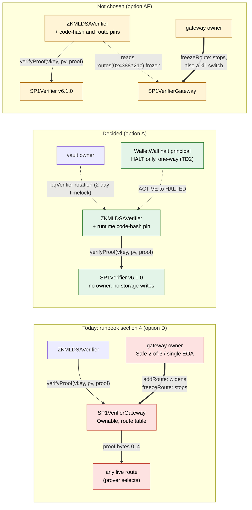

# SP1-TD1 — verifier trust target and canonical program identity

> [!CAUTION]
> Research prototype. Not audited. Testnet/local only. Do not use real funds. This document records a design
> decision and the evidence for it. It changes no contract, deployment script, trust root or guest program, and
> nothing in it is a deployment instruction. The production changes it calls for are frozen for the next lane.

**Verdict: `DESIGN_DECIDED`; the owner has decided the defect response; real value waits for TD2.** SP1-P1 (PR #212)
stopped on two open questions: which verifier `ZKMLDSAVerifier` should trust, and which build defines
`PROGRAM_VKEY`. Both are now decided on evidence, with authorization and liveness kept apart:

1. **Trust target: `DIRECT_IMMUTABLE_VERIFIER`.** Bind `ZKMLDSAVerifier` directly to Succinct's Groth16
   `SP1Verifier` v6.1.0, pinned by its **runtime code hash** and checked by executing proofs on each chain, not to
   the `SP1VerifierGateway`. No principal outside WalletWall can then widen the accepted relation or stop valid
   proofs from verifying — beyond each chain's own governance, which every option inherits (TD1-N8). WalletWall keeps
   both powers: widening only through the vault's timelocked `pqVerifier` rotation, stopping through its own pauses,
   one per consumer of the verifier.
2. **Program identity: `PINNED_VENDOR_BUILD`.** The digest-pinned vendor-image procedure defines the withdrawal
   ELF, and `PROGRAM_VKEY` is the vkey computed from that ELF:
   `0x0001a4c62de43425bce9febc352a74acc01bac70c02d8acedc09085c4eb8c2dc`.
3. **Owner decision (2026-10-15): `DEFECT_RESPONSE_COUPLING = WALLETWALL_DETECT_AND_FAIL_CLOSED`, as a
   `LOCAL_ONE_WAY_VERIFIER_HALT`.** Binding directly gives up upstream's freeze, which is a liveness cost while
   v6.1.0 is sound and a kill switch if it is not. The owner chose WalletWall's own kill switch: a one-way circuit
   breaker at the WalletWall verifier wrapper (ACTIVE → HALTED only), held by a principal that can do nothing but
   halt, which fails every consumer in its scope closed through one mechanism; recovery only by a new wrapper and
   the timelocked rotation. AF is not chosen, and upstream signals are detection evidence only. **The owner's
   amendment:** the halt is applied only to consumers that can recover from it. `WalletWallMultiSigVault` cannot
   yet (TD1-N11), so it is bound to no part of the SP1 path until `TD2-MULTISIG-ROTATION` gives it a delayed verifier
   rotation, which is itself a new authorization capability for its owner, accounted apart. TD1 freezes the design;
   TD2 builds and tests it, and real value — for every consumer — waits for both requirements
   (`REAL_VALUE_BLOCKER`, `REAL_VALUE_REQUIREMENTS`; see
   [the decided defect response](#the-decided-defect-response-a-local-one-way-verifier-halt)).

The machine-readable record is [`evidence/zk/sp1-td1/decision-receipt.json`](../evidence/zk/sp1-td1/decision-receipt.json)
(`npm run validate:sp1-td1-receipt`). Every decision in it is derived by
[`scripts/lib/sp1-td1-decision.ts`](../scripts/lib/sp1-td1-decision.ts) from raw observations and from probe
facts that [`test/Sp1Td1TrustTargetProbes.test.ts`](../test/Sp1Td1TrustTargetProbes.test.ts) re-executes against
the exact mainnet verifier and gateway bytes.

## Decisions

| Output | Value | Basis (short) |
| --- | --- | --- |
| `SP1_TRUST_TARGET_DECISION` | `DIRECT_IMMUTABLE_VERIFIER` | option A: no external authorization or liveness lever; AF and B are viable too, but each gives the gateway owners a freeze lever |
| `PROGRAM_IDENTITY_DECISION` | `PINNED_VENDOR_BUILD` | one ELF and vkey on two hosts, image pinned by verified digest, fresh subject |
| `UPGRADE_MODEL` | `EXPLICIT_REDEPLOY_AND_TIMELOCKED_ROTATION` | a new verifier or guest means a new wrapper and the vault's 2-day rotation |
| `CROSS_CHAIN_MODEL` | `CODE_HASH_PIN_WITH_PER_CHAIN_EXECUTION_CHECK` | one runtime code hash at one CREATE2 address on Ethereum, Base, Sepolia and Base Sepolia; the hash is necessary, not sufficient, so each chain must also accept a real v6.1.0 proof and refuse a tampered copy and an odd-word canary |
| `DEFECT_RESPONSE_COUPLING` | `WALLETWALL_DETECT_AND_FAIL_CLOSED` | decided by the owner on 2026-10-15; AF (`UPSTREAM_FREEZE_FAIL_CLOSED`) is not chosen |
| `DEFECT_RESPONSE_MECHANISM` | `LOCAL_ONE_WAY_VERIFIER_HALT` | a circuit breaker at the WalletWall verifier wrapper, applied to the three consumers that can recover from it; `WalletWallMultiSigVault` waits for `TD2-MULTISIG-ROTATION` |
| `AUTHORIZATION_AUTHORITY_DELTA` | `NO_NEW_AUTHORIZATION_PRINCIPAL` | the halt principal holds no widening power; nothing outside the timelocked rotation can widen. Proposed for TD2 and accounted apart: the multisig vault owner's `pqVerifier` rotation, `NEW_AUTHORIZATION_CAPABILITY_FOR_AN_EXISTING_PRINCIPAL` |
| `LIVENESS_AUTHORITY_DELTA` | `WALLETWALL_EMERGENCY_HALT_PRINCIPAL_ADDED_HALT_ONLY` | one WalletWall principal that can only halt; the upstream owners' freeze is removed |
| `HALT_REVERSIBILITY` | `ONE_WAY` | ACTIVE → HALTED; nothing leaves HALTED in place |
| `RECOVERY` | `NEW_WRAPPER_PLUS_TIMELOCKED_ROTATION_WITHIN_HALT_SCOPE` | a new wrapper with independently established identity, the normal evidence gates, the timelocked rotation — for the consumers in the halt's scope only; not claimed for `WalletWallMultiSigVault`, which cannot rotate yet (TD1-N11) |
| `UPSTREAM_GATEWAY_OWNER` | `NOT_A_WALLETWALL_AUTHORITY` | no lever in the decided path; `RouteFrozen` and advisories are detection evidence only |
| `REAL_VALUE_BLOCKER` | `TD2_IMPLEMENTATION_NOT_YET_BUILT` | closing the decision lifts nothing: real value waits for both requirements below |
| `REAL_VALUE_REQUIREMENTS` | `TD2-COMMON-VERIFIER-HALT`, `TD2-MULTISIG-ROTATION` | the common halt, built and tested through every consumer in its scope; the multisig vault's delayed verifier rotation, after which the halt may reach it. TD1 builds neither |
| `REAL_PROOF_LANE_UNBLOCKED` | `true` | for a no-value lane: trust target and program identity established; starting it is the owner's call (the circuit download), under the preconditions below |
| `IMPLEMENTATION_REQUIRED` | `true` | the pins, the designation file, the halt and the tooling are frozen for the next lane |

`AUTHORIZATION_AUTHORITY_DELTA` (against what the runbook directs today, option D): **removed** the gateway
owner's `addRoute` on every measured chain — the Safe `0xCafEf00d348Adbd57c37d1B77e0619C6244C6878` (2-of-3) on
Ethereum and Base, and the single EOA `0xBaB2c2aF5b91695e65955DA60d63aD1b2aE81126` on Sepolia and Base Sepolia;
**added** none; **retained** the vault owner's timelocked `pqVerifier` rotation (172,800 s delay); **proposed for
TD2, not decided**: a `pqVerifier` rotation for the multisig vault's owner, a new authorization capability for an
existing principal (`proposedForTd2`; see [the authority accounting](#the-owners-amendment-the-multisig-vault-needs-a-way-out-first-td1-n11)).
`LIVENESS_DEPENDENCY`: no external on-chain lever remains. The owners' `freezeRoute` is removed, and with it
upstream's ability to fail WalletWall closed; the decided halt gives that ability to one WalletWall principal that
can do nothing else (`LIVENESS_AUTHORITY_DELTA`). Off chain, proof generation needs
Succinct's v6.1.0 circuit artifacts or prover network, and rebuilding the ELF needs the vendor image and crates.io;
integrity is pinned, availability is not. A PqOnly user's exit during a 2-day rotation also needs a proof, so the
timelock protects them only while proving is available (TD1-N9). Both records also name what every option
inherits: each chain's own governance (its precompile semantics; on an L2, its upgrade keys), which no pin can see.

## Claim status

| Claim | Status | Basis (short) |
| --- | --- | --- |
| `TRUST_TARGET_CODE_IDENTITY` | `ESTABLISHED` | one runtime hash on four chains via two providers each; CREATE2-authenticated initcode; SP1-P1's own compile, Sourcify and VK join; no reachable state- or code-changing opcode, no state or environment read but its own code size, constant call targets only the BN254/modexp precompiles; the same verdicts on every measured chain, for calls rebuilt byte for byte, with a canary that has a positive control |
| `PINNED_VERIFYING_KEY_REAL_PROOF` | `ESTABLISHED` | a real v6.1.0 proof from a mainnet transaction (a third party's program) verifies on the pinned bytes in the probe suite and by `eth_call` on all four chains; its tampered copy and an odd-word canary are refused |
| `DIRECT_AND_GATEWAY_VERIFICATION_EQUIVALENT` | `ESTABLISHED` | the gateway forwards the consumer's tuple unchanged; real v6.0.0 and v6.1.0 proofs verify on both paths, tampering is rejected identically |
| `UNPINNED_GATEWAY_OWNER_CAN_WIDEN` | `ESTABLISHED` | executed: one `addRoute` by the owner drains a PqOnly vault through the unmodified `ZKMLDSAVerifier` |
| `DECIDED_TARGET_HAS_NO_EXTERNAL_LEVER` | `ESTABLISHED` | option A has no authorization or liveness lever outside WalletWall's own rotation and pauses, beyond each chain's own governance |
| `CANONICAL_PROGRAM_IDENTITY` | `ESTABLISHED` | the vendor procedure; the default local build embeds the builder's `CARGO_HOME` |
| `PROGRAM_VKEY_DESIGNATED` | `ESTABLISHED` | the vendor ELF's vkey; the released `cargo-prove`, run outside the build, computes the same vkey (three agreeing results from one binary on one machine) |
| `IDENTITY_REPRODUCED_OUTSIDE_VENDOR_IMAGE` | `ESTABLISHED` | on the same workstation, a separately installed toolchain plus one remap flag reproduced it byte for byte (corroboration, not a second CPU or a second distribution) |
| `VKEY_DERIVATION_ALGORITHM_INDEPENDENT` | `NOT_ESTABLISHED` | every vkey comes from Succinct's `sp1-prover`; a WalletWall proof verifying on the pinned verifier is the next join |
| `GATEWAY_ROUTE_HISTORY_COMPLETE` | `NOT_ESTABLISHED` | the indexer SP1-P1 used missed a `RouteFrozen`, and an indexer's history is no completeness proof; under a code pin no route needs enumerating |
| `DEFECT_RESPONSE_PATH` | `NOT_ESTABLISHED` | decided (a local one-way verifier halt), not built: until TD2 builds it, only WalletWall's manual pauses, one per consumer, fail a defect closed; TD2 tests it through every consumer in its scope, and `WalletWallMultiSigVault` is bound to no part of the SP1 path until `TD2-MULTISIG-ROTATION` |
| `REAL_SP1_PROOF_GENERATED` | `NOT_ESTABLISHED` | out of scope: no circuit download, no prover run |
| `REAL_SP1_PROOF_VERIFIED` | `NOT_ESTABLISHED` | no WalletWall proof exists; the real proofs run are third parties' (upstream's v6 fixture, a v6.1.0 proof from mainnet), as controls |
| `PRODUCTION_READINESS` | `NOT_ESTABLISHED` | design lane; implementation, defect response, real proof and audit outstanding |

## Subject

Measured at `main` `72b6554632335bfc7487f7dc7e9b3f44cdde0c0b` (tree `e83e83d6de28b5e66897f0244645e2ee288473c8`), the
merge of #212 (head `4cd5cfb45b8b0bee28599fc166a7e26b58696757`). The zkvm sources are unchanged since SP1-P1 measured
them: guest tree `f61fdc6c8785df742857574c5dbf47aa62283c49`, host tree `30f72596c430974bf8113892bf41c26dce3629f3`
(the validator checks both against `git rev-parse HEAD:zkvm/guest` and `HEAD:zkvm/host`), per-file manifest digest
`877fbcb28bd7f68eecb5ee9b2e4436e6ae069989a83239d4f54d7cee393e320c`. SP1 pins `=6.3.1` (sp1-zkvm, sp1-sdk,
sp1-build), circuit `v6.1.0`. The SP1-P1 receipt validator and the native relation tests (3 + 2 + 14) were re-run
first and pass; with the relation executor built, all 15 relation-consumer tests run and pass.

## The invariants a design must keep

- **Authorization integrity.** No actor can widen the relation WalletWall accepts without a WalletWall-authorized,
  timelocked change. "Widen" means: some proof that was rejected becomes accepted.
- **Program identity.** `PROGRAM_VKEY` is derived mechanically from a pinned, reproducible build — never typed,
  chosen by inspection, read from mutable state, or established only by the code that consumes it.
- **No silent authority expansion.** A gateway, registry, Safe, EOA or upstream operator becomes a principal only
  explicitly.
- **Fail closed.** Unknown verifier code, unknown program, drift, an unsupported route or conflicting build
  evidence all refuse.
- **Upgrade legibility.** A new verifier, guest, toolchain, ELF, vkey or proof format is an explicit, versioned
  transition — never something an existing route starts accepting.
- **Liveness is not integrity.** A lever that can only stop valid proofs is a liveness dependency; it is never
  scored together with one that can make invalid proofs pass. A freeze is dual-use — when the verifier itself is
  unsound it stops forged proofs too — and that is recorded on the lever, not netted against authorization.
- **Independent authority.** WalletWall's own declaration is never the only evidence for its trust root.

## Options, executed

Each option ran against the exact mainnet bytes: the initcode of the gateway and of the v6.0.0 and v6.1.0
verifiers is taken from their deployment transactions (both providers return the same input), CREATE2 derives
each mainnet address from it, and the runtimes the tests deploy hash to the mainnet code hashes
(`0x11612dc6695484a4dfcac5ae1a7bcb093f891eb93d8aa9ddeca7f24a1f3b7d57`,
`0xdf34e327244216e855305a1b40f911e42644fca8d97f2cdbcedfc447c70469f2`,
`0xcceb864cd8a5a36b2073a8f2b32a773835cd2dd2c78a56f8e6fdb942feff04dd`).

Two real Groth16 proofs are the positive controls. Upstream's v6 fixture (`contracts/test/SP1VerifierGroth16V6.sol`
at tag `v6.1.1`) targets v6.0.0, whose wrapper `SP1VerifierGroth16.sol` shares every non-constant statement with
v6.1.0's; that comparison does not reach `Groth16Verifier.sol`, which holds the verifying-key constants and the
pairing code. The second control does: a real v6.1.0 proof taken from an internal call into the pinned verifier in
mainnet transaction `0x508db9c61a70400710d883241e83b42f9544ba363c5a82959e0db184d5cef3f4` (program
`0x006cd47fd23937a6d247696cace28c22d2c6a8280447e6ac45a3571de232d6e3`, not WalletWall's; exit code 0, the v6.1.0
selector and vk root), located through Blockscout's raw trace. The trace is only a pointer: the proof authenticates
itself by verifying on the CREATE2-authenticated v6.1.0 bytes.



| Probe (all on the mainnet bytes) | Result |
| --- | --- |
| The gateway passes `ZKMLDSAVerifier`'s `(vkey, publicValues, proofBytes)` through unchanged | yes: only the registered tuple verifies behind it |
| A real upstream v6 proof (v6.0.0 bytes) and a real v6.1.0 proof from mainnet, directly and through the gateway | both verify on both paths |
| One public-value bit flipped, or another program vkey | `ProofInvalid()` on both paths, identical revert data |
| v6.1.0 pre-checks (exit code, vk root, invalid points), directly and through the gateway | identical revert data |
| v6.1.0 runtime: reachable `SSTORE`/`TSTORE`/`LOG`/`CALL`/`CALLCODE`/`DELEGATECALL`/`CREATE`/`CREATE2`/`SELFDESTRUCT` | none (the gateway has `SSTORE`) |
| v6.1.0 runtime: reachable reads of state or environment; `STATICCALL` targets | only `EXTCODESIZE` (its own, before the self-call); 13 sites call the constant precompiles 0x05–0x08, two compute their target (sha256 and the self-call in the attributed source); the trailing metadata is solc's CBOR, so it cannot hide code |
| On chain, read-only `eth_call` on Ethereum, Base, Sepolia and Base Sepolia (two providers each): the real v6.1.0 proof, its tampered copy, an odd-word canary; the v6.0.0 template with the fixture proof and a tampered copy | the same verdicts on every chain: real proofs accepted, the rest `ProofInvalid()`. The observation records each call's exact calldata, and the validator rebuilds every one from the real proofs and the canary recipe and compares them byte for byte; the verdicts required are the validator's, not the observation's |
| The canary's positive control: the same v6.1.0 runtime with both pairing calls pointed at an empty account, as on a chain without the precompile | the canary verifies there and is refused by the pinned code: a call to an empty account succeeds and writes nothing, so the verifier reads the canary's own odd word as the pairing result |
| **D** — owner adds an accept-all route, forged journal, unmodified consumer, PqOnly `WalletWallVault` | **the vault pays the attacker** |
| **D** — owner freezes the route of a valid proof | the gateway rejects it, the verifier still accepts it; nothing new is accepted |
| **D** — non-owner `addRoute`; owner replaces an existing route | both revert |
| **C** — WalletWall-owned gateway: admin `addRoute`, then forged withdrawal | paid in the **next block**; the vault's own rotation of the same verifier needs 172,800 s |
| **B0** — selector-only pin on a gateway where the selector is not yet routed | the owner squats the selector with an accept-all verifier; the forged proof passes |
| **B** — selector + route + both code-hash pins | a squatted route fails at construction; other selectors are refused; the pinned route cannot be replaced; a freeze stops valid proofs |
| **A** — code-hash pin | accepts the canonical code at any address; refuses the gateway, v6.0.0 and an accept-all verifier with the v6.1.0 selector |
| **A** — unmodified consumer bound directly | refuses four forged proof shapes (a foreign selector, two v6.1.0-shaped non-proofs, a one-byte proof); the verifier exposes no owner or route administration |
| **AF** — A's direct binding plus a read-only check of upstream's freeze bit for `0x4388a21c` | a squatted route fails at construction; the real v6.1.0 proof verifies; a route under another selector grants nothing; after the owner's freeze the same real proof fails closed (`PinnedRouteFrozen`) |

<details>
<summary>Why a selector check alone "looks right" and is not</summary>

`VERIFIER_HASH()` is a value a contract returns, not a measurement of its code. On any chain where the gateway
has no route under `0x4388a21c` yet, its owner can register a verifier that returns a hash beginning with those four
bytes. A consumer that checks only the selector then forwards to that verifier. Routes are write-once, so the fix is
to check, at construction, that the route already points at the expected verifier and that both the gateway's and the
verifier's code hashes are the expected ones — at which point the gateway contributes nothing but its owner's freeze.
</details>

### Authority matrix

Authorization ("widen") and liveness ("disable") are separate rows and are never combined. The defect-response row
records what each freeze also does when the verifier itself is unsound. Every cell is beyond each chain's own
governance (precompile semantics; on an L2, its upgrade keys), which every option inherits and no pin can see.

| | A — direct, code-pinned | AF — A + upstream freeze bit | B — gateway, fully pinned | B0 — gateway, selector only | C — WalletWall gateway | D — gateway, unpinned |
| --- | --- | --- | --- | --- | --- | --- |
| verifier code mutable | no | no | no | no | no | no |
| accepted relation mutable outside WalletWall's timelock | **no** | **no** | **no** | yes (squat) | yes | yes |
| who can widen | vault owner, after 172,800 s | vault owner, after 172,800 s | vault owner, after 172,800 s | + gateway owner where the selector is unrouted | + WalletWall gateway admin, 0 s | + gateway owner per chain, 0 s |
| who outside WalletWall can stop valid proofs | nobody | gateway owner per chain | gateway owner per chain | gateway owner per chain | WalletWall gateway admin | gateway owner per chain |
| who fails verification closed if v6.1.0 proves unsound | **decided:** WalletWall's halt principal, one-way, at the wrapper, every consumer in its scope at once (built in TD2; the multisig vault only after `TD2-MULTISIG-ROTATION`); today one pause per consumer | + upstream's freeze, at once, for every consumer | + upstream's freeze, at once, for every consumer | + upstream's freeze | + the gateway admin's freeze | + upstream's freeze |
| proxy / admin | none | upstream Ownable, read for its freeze bit only | upstream Ownable (no proxy) | upstream Ownable | WalletWall Ownable | upstream Ownable |
| route registry in the accepted path | no | no | yes | yes | yes | yes |
| upstream governance dependency | none | liveness | liveness | authorization | none | authorization |
| WalletWall governance dependency | timelocked rotation | timelocked rotation | timelocked rotation | timelocked rotation | rotation **and** an instant admin | timelocked rotation |
| upgrade needs a redeploy | yes | yes | yes | yes | no | no |
| trust root independently reproducible | yes | yes | yes | no | no | no |
| cross-chain identity | one code hash plus the per-chain execution check | as A, plus each chain's gateway route and owner | per-chain owner and routes | per-chain owner and routes | per-deployment admin | per-chain owner and routes; v4.0.0-rc.3 live on both testnets |
| new attack surface | none | one route-table read per verification | pin layer + routing code | fails open on unrouted chains | a second, instant replacement path | every live route, any chain |
| viable | **decided** | viable, not chosen by the owner | viable, dominated by AF | rejected | rejected | rejected |

The rule that ranks them is in the validator: (1) an option is viable only if nobody outside WalletWall's
timelocked rotation can widen it; (2) among viable options, fewer distinct external liveness principals win; (3) then
fewer components in the accepted path. A, AF and B tie on authorization; A wins on authority minimisation; AF ranks
above B on path length.

| Criterion (in priority order) | A — direct, code-pinned | AF — freeze-coupled | Better |
| --- | --- | --- | --- |
| 1. authorization integrity (no actor widens) | only the timelocked rotation widens | the same | tie |
| 2. authority minimisation | no external principal | the gateway owner on every chain (freeze) | **A** |
| 3. independent provenance | CREATE2, four-chain code hash, own compile, Sourcify, VK join, a real v6.1.0 proof | the same, plus the gateway to attribute | tie |
| 4. reproducibility | the same verifier bytes | the same | tie |
| 5. fail closed on foreign code or routes | the code pin refuses any other code, on any chain | construction checks refuse a squatted or foreign route | tie |
| 5a. fail closed on a defect in v6.1.0 itself | decided: WalletWall's one-way halt at the wrapper, every consumer that can recover at once (four separate pauses until TD2 builds it; the multisig vault keeps only its owner's pause until `TD2-MULTISIG-ROTATION`) | at once, for every consumer, **if** upstream freezes | owner's decision: **A + halt** |
| 6. upgrade legibility | new wrapper + rotation | the same | tie |
| 7. cross-chain consistency | one code hash at one address, checked by execution per chain | the same plus per-chain gateway routes and owners | **A** |
| 8. liveness | nothing external can stop valid proofs | any freeze of the pinned route stops PqOnly withdrawals until rotation | **A** |
| 9. operational complexity | one constant and a fail-closed path to build | per-chain gateway address and route checks | **A** |
| 10. implementation complexity | one `EXTCODEHASH` comparison | a freeze read | **A** |

> [!NOTE]
> This table is not a score. Rows 2, 7, 8 and 9 and row 5a are faces of one lever, the gateway owners' freeze:
> counting its cost four times against one protective entry would overweight it. The decision rule ranks
> lexicographically (viability, then external liveness principals, then path length), and row 5a was left to the
> owner as `DEFECT_RESPONSE_COUPLING`, who decided it for A with a local one-way halt.

### What option A gives up: upstream's kill switch

The decision rule ranks authority minimisation above liveness, and on that rule A wins. It does not settle row
5a, so the receipt records it as `DEFECT_RESPONSE_COUPLING` instead of folding it into a score. What the route
timeline shows (two providers per event), and what it does not:

- **The freeze of an advised version was a batch.** Upstream published a High-severity soundness advisory for SP1
  6.0.0–6.0.2 on 2026-04-11 (GHSA-63x8-x938-vx33, CVE-2026-40323; fixed in 6.1.0). The mainnet gateway froze the
  v6.0.0 route on 2026-10-09 — 181 days later, and 108 s after freezing v5.0.0 in the same batch. The advisory does
  not say whether the on-chain verifier was affected, and TD1 claims no exploitability.
- **One fast freeze, on a testnet.** The first v6.1.0 build carried the wrong `VERIFIER_HASH` and `VK_ROOT`. It was
  routed on Sepolia and frozen 21.4 h later, before the corrected build was routed — measured from routing to
  freeze, not from any disclosure.
- **The cost side.** Four mainnet routes have been frozen so far (v3.0.0 and v4.0.0-rc.3 in 2025, not joined to any
  advisory here; v5.0.0 and v6.0.0 in the batch above). Under AF, any freeze of the pinned route stops PqOnly
  withdrawals until WalletWall rotates (at least 172,800 s), and on both testnets one EOA holds that lever.
- **The protective side.** Under A, a public `RouteFrozen` for `0x4388a21c` would tell everyone that v6.1.0 is broken
  while every consumer keeps accepting until its own pause holder acts. There are four consumers of the verifier:
  `WalletWallVault`, `WalletWallMultiSigVault` and `StablecoinVaultSimulator` (each deployment's owner-held `pause()`
  gates its PQ-verifying entrypoints) and `PolicyControlBridge`, which verifies through the consumer's `pqVerifier()`,
  ignores the vault's pause, and has its own one-way `pause()` held by `EMERGENCY_PAUSER` (TD1-N10). Under AF,
  verification fails closed in the freeze's block, for every consumer at once.

| Choice | Realized by | What it needs | Owner |
| --- | --- | --- | --- |
| `WALLETWALL_DETECT_AND_FAIL_CLOSED` | A | WalletWall detection, and one fail-closed mechanism across all four consumers (the multisig vault's once it can rotate) | **decided 2026-10-15**, as a local one-way verifier halt, amended the same day |
| `UPSTREAM_FREEZE_FAIL_CLOSED` | AF | the gateway owners as a liveness principal on every chain; a route in place on each chain before deployment; a coupling to one gateway instance, so an upstream migration to a new gateway silently ends the protection | not chosen |

B realizes the same coupling by routing every proof through the pinned gateway: the same external principals, a
longer path, and choosing it would change the trust-target decision. It was not offered; the rules accept an
unoffered alternative only when an offered one has the same principals and a shorter path.

### The decided defect response: a local one-way verifier halt

The owner decided `WALLETWALL_DETECT_AND_FAIL_CLOSED` and refined it as `LOCAL_ONE_WAY_VERIFIER_HALT`. The trust
model does not change: the direct, code-pinned v6.1.0 binding; no dependency on the Succinct gateway for
authorization or automatic liveness control; the pinned vendor build defines `PROGRAM_VKEY`; an explicit wrapper
replacement plus the timelocked rotation is the upgrade and recovery path. The halt design, frozen in the receipt
(`DEFECT_RESPONSE_COUPLING.haltDesign`) and held by the validator's rules:

| Requirement | Frozen as | The rules refuse |
| --- | --- | --- |
| where | `location: VERIFIER_WRAPPER`, which the consumers in its scope verify through | a halt anywhere else |
| scope | applied to every consumer that can leave a halted wrapper: `WalletWallVault` and `StablecoinVaultSimulator` (each by its own owner-gated rotation of at least 172,800 s, scanned) and `PolicyControlBridge` (it reads the `pqVerifier()` of the consumer an intent names; the only WalletWall contracts that can serve as one, those keeping `policyControlEpoch`, both rotate; a contract outside WalletWall's is outside this claim). `WalletWallMultiSigVault` waits for its own gate, `TD2-MULTISIG-ROTATION`, bound meanwhile to no part of the SP1 path; TD2's deployment tooling refuses it a haltable wrapper | a consumer the source scan finds but the scope does not name; the halt applied to a consumer that cannot recover, or to one whose gate is unbuilt; a consumer that can recover (the bridge included) left outside; an exclusion under a gate that is not its own and frozen; any other interim; a rotating consumer whose delay is below the repository's |
| state | `ACTIVE → HALTED`, the only transition | any transition out of `HALTED` (`HALT_REVERSIBILITY` must be `ONE_WAY`) |
| who | a halt principal with the single power `HALT` | any other power: unhalt, restore, bypass, change `SP1_VERIFIER` or `PROGRAM_VKEY`, select a verifier, add or remove a route, widen the relation, rotate, upgrade |
| identity | `SP1_VERIFIER` and `PROGRAM_VKEY` immutable, halted or not | a wrapper whose verifier or vkey can change |
| triggers | only the halt principal's call; `RouteFrozen`, advisories, CVEs, verifier-repository disclosures and watcher findings are detection evidence | a signal that moves the state, which would make the upstream gateway owner a WalletWall authority again |
| recovery | a new wrapper with an independently established identity, never a fresh deployment of the halted one (`INDEPENDENTLY_ESTABLISHED_NEVER_THE_HALTED_ONE`), and the timelocked rotation; recorded as `NEW_WRAPPER_PLUS_TIMELOCKED_ROTATION_WITHIN_HALT_SCOPE` until every consumer can recover | any in-place recovery; a rotation back to the halted identity; a recovery claim for every consumer while one cannot recover |
| authority | `NO_NEW_AUTHORIZATION_PRINCIPAL`; `WALLETWALL_EMERGENCY_HALT_PRINCIPAL_ADDED_HALT_ONLY`; the principals accounted apart (below) | an authorization-neutral classification for a principal with widening power |

The principal: an existing WalletWall emergency-security authority if one already satisfies the separation (the
`PolicyControlBridge` `EMERGENCY_PAUSER` role is the pattern: halt-only and one-way); otherwise a new authority
scoped to the halt, under threshold or multisig control rather than one online EOA. Never the vault owner, who holds
the rotation and a reversible pause, and never the upstream gateway owner.

#### The owner's amendment: the multisig vault needs a way out first (TD1-N11)

`WalletWallMultiSigVault` sets its `pqVerifier` once in the constructor and has no rotation, and its only exit,
`withdraw`, needs `pqThreshold` (at least one) PQ signatures through that verifier. A one-way halt of its wrapper
would lock its funds: the decided recovery path does not exist for it. So the halt **must not** be applied to it
until it has a recoverable verifier transition. Until then it is bound to no part of the SP1 path — TD2's deployment
tooling refuses it a haltable wrapper, with a negative test; any other interim, such as a non-haltable pinned
wrapper, is an owner decision — and its owner's `pause()` is its only fail-closed lever. `RECOVERY` is not claimed
for all four consumers. Like every consumer, it holds no real value until both TD2 requirements are built and tested.

> [!WARNING]
> **TD1-N11 is a prerequisite, not a note.** The rules refuse a halt scope that applies the halt to a consumer that
> cannot recover, or to one whose gate is unbuilt (even if a scan someday finds it a rotation: the gate's delay,
> target gating and proofs are what make it recoverable); one that leaves a recoverable consumer outside; and a
> recovery claim for every consumer while one cannot recover. The scope's narrowing is the owner's amendment, on
> record in the receipt (`amendments`).

The principals, accounted apart (`DEFECT_RESPONSE_COUPLING.authorityAccounting`):

| Principal | Holds | Scope | Widens what verifies | Status |
| --- | --- | --- | --- | --- |
| `WALLETWALL_EMERGENCY_HALT_PRINCIPAL` | `HALT` | liveness | no | decided; built in TD2 |
| `WALLETWALL_VAULT_OWNER` | `PQ_VERIFIER_ROTATION`, `pause`, `unpause` — each `WalletWallVault` and `StablecoinVaultSimulator` deployment's owner: the timelocked rotation (the recovery path in the halt's scope) and a reversible pause | authorization | **yes** | `RETAINED`: the governed lever the decision keeps |
| `WALLETWALL_MULTISIG_VAULT_OWNER`, today | `pause`, `unpause` — the only `onlyOwner` functions the contract declares (scanned); the inherited ownership transfer hands over only these | liveness | no | in the code |
| `WALLETWALL_MULTISIG_VAULT_OWNER`, proposed | `PQ_VERIFIER_ROTATION` | authorization | **yes** | `PROPOSED_FOR_TD2`, classified `NEW_AUTHORIZATION_CAPABILITY_FOR_AN_EXISTING_PRINCIPAL`; needs separate authority accounting and executable review |

The halt principal is none of the other three: the rules refuse it the vault owner's or the multisig vault owner's
label, and refuse the proposed rotation any capability beyond `PQ_VERIFIER_ROTATION`.

The proposed rotation is not authority-neutral just because its holder already exists. The contract has one owner
for every tenant. After the delay, that owner could point the vault at an accept-all verifier, which voids every
tenant's p-of-q PQ signatures at once and leaves each withdrawal guarded by the tenant's m-of-n ECDSA signatures
alone. And the delay is no safeguard during recovery: while the old wrapper is halted, no tenant can withdraw at all,
so nobody can leave before the rotation lands, and the target gating (item 3) is the only check (TD1-N12; the same
holds for the vaults in scope, whose PqOnly and Hybrid tenants cannot exit while halted). The receipt carries the
rotation in `AUTHORIZATION_AUTHORITY_DELTA.proposedForTd2`, and no rule lets it be classified otherwise.

**`TD2-MULTISIG-ROTATION`**, frozen for TD2 (the owner's ten items); the halt may reach the multisig vault only after
it:

1. an explicit delayed `pqVerifier` replacement path for `WalletWallMultiSigVault`;
2. at least the repository's 172,800 s rotation delay, unless independent review establishes a stronger compatible
   mechanism;
3. the rotation targets only a new wrapper whose verifier code hash and `PROGRAM_VKEY` designation have already
   passed the SP1 evidence gates;
4. no instantaneous replacement;
5. no halt principal may invoke the rotation;
6. no `HALTED → ACTIVE` on the old wrapper;
7. an executable proof that once the old wrapper is halted the multisig vault cannot withdraw through it, and that
   after the delay and a rotation to a fresh valid wrapper the same valid authorization succeeds
   (`HALTED_THEN_ROTATED_WITHDRAWAL_SUCCEEDS`);
8. an executable proof that a malicious or accept-all replacement cannot be activated outside the delayed path
   (`MALICIOUS_REPLACEMENT_BLOCKED_OUTSIDE_DELAYED_PATH`);
9. the authorization cut recalculated, never labelled authority-neutral because the principal already existed;
10. real value stays blocked until this path and the common halt are both built and tested.

> [!IMPORTANT]
> **Stop condition.** If adding verifier rotation to `WalletWallMultiSigVault` creates an unacceptable authorization
> cut, TD2 stops `TD2-MULTISIG-ROTATION` and returns to design rather than weakening the one-way halt. (Frozen as
> structured fields — `UNACCEPTABLE_AUTHORIZATION_CUT` → `STOP_AND_RETURN_TO_DESIGN`, never
> `WEAKEN_THE_ONE_WAY_HALT` — which the rules read.)

What the adversarial review of this amendment added, recorded apart from the owner's items (`reviewAdditions`), each
an executable proof the rules require:

- **The exclusion is enforced, not only stated** (`TD2-COMMON-VERIFIER-HALT`): deployment tooling refuses a haltable
  wrapper to any consumer kept outside the halt (`EXCLUDED_CONSUMER_REFUSED_A_HALTABLE_WRAPPER`).
- **One-way for the identity, not only the wrapper instance**: a fresh deployment of the halted identity (the same
  verifier code hash and `PROGRAM_VKEY`) is refused as a recovery or rotation target
  (`HALTED_IDENTITY_REFUSED_AS_A_RECOVERY_TARGET`, `..._AS_A_ROTATION_TARGET`) — the evidence gates measure identity,
  not soundness, so they would pass the halted one again.
- **The halt principal cannot rotate, also after any ownership transfer** (item 5 made executable:
  `HALT_PRINCIPAL_CANNOT_ROTATE_EVEN_AFTER_AN_OWNERSHIP_TRANSFER`); TD2 states whether code or an operational check
  enforces it.
- **TD1-N12**: since nobody can exit while halted, TD2 states whether recovery-target gating is enforced on chain or
  by process — today's rotation accepts any code-bearing target — and counts the answer in the authorization cut, for
  the multisig rotation (against the stop condition) and for the vaults in scope (reported to the owner).

TD2 must executable-test the halt (`TD2-COMMON-VERIFIER-HALT`) through every consumer in its scope:
`WalletWallVault`, `StablecoinVaultSimulator` and `PolicyControlBridge`. A valid verification must succeed while
`ACTIVE` (positive control); after `HALTED` the same otherwise-valid verification must fail closed through each; and
no action of the halt principal may make an invalid proof valid. `WalletWallMultiSigVault` joins the scope only
through `TD2-MULTISIG-ROTATION`, with its own halted-then-rotated proof. Until both are built, a defect in v6.1.0 is
stopped only by manual pauses, one per consumer. `REAL_VALUE_BLOCKER` stays `TD2_IMPLEMENTATION_NOT_YET_BUILT`, and
`REAL_VALUE_REQUIREMENTS` names both requirements: no consumer holds real value before both are built and tested.

## Program identity

| Candidate | Result | Why |
| --- | --- | --- |
| `PINNED_VENDOR_BUILD` | **established** | ELF `2adddae753011fb08e30127e38befe99c0092c956e01bf4486ca81827a632d8a` (206,504 B) and vkey `0x0001a4c62de43425bce9febc352a74acc01bac70c02d8acedc09085c4eb8c2dc` on the developer workstation (AMD) and a GitHub-hosted runner (Intel), both inside the pinned image, from the same source archive and operator; both procedure forms agree; the released `cargo-prove` agrees outside the build (three results, one binary, one machine) |
| `REPRODUCIBLE_REPO_BUILD` | not established | the default local build embeds the builder's own `CARGO_HOME` (`/home/sirmrdrgod/.cargo`), so its identity is per builder: ELF `ce057748f2f26b308e400835218280ed817758d62acaf1330800f2aa2a66513a`, vkey `0x00eea6d622ce8cddee6387d922090de9710f844a977332a36c22c2651d040597` (re-measured here, identical to SP1-P1) |
| `OTHER_ESTABLISHED_PROCEDURE` | cross-check only | on the same workstation, the local build plus `--rustflags=--remap-path-prefix=$HOME/.cargo=/root/.cargo` (sp1-build's own `BuildArgs.rustflags`) reproduced the vendor ELF and vkey byte for byte. The flag was chosen after the vendor result was known and the sp1up toolchain binaries were not hashed, so this corroborates the identity, not a second CPU or a second distribution. Its role was pre-registered as a cross-check, never the definition; the pre-registration's hash is in the observation, its timing is self-attested |

sp1-build's own Docker mode (`cargo prove build --docker`, sp1-build 6.3.1 source) pulls
`ghcr.io/succinctlabs/sp1:<tag>` **by tag**. The canonical procedure runs the same build inside the image referenced
by digest instead, which is what the two-host evidence measured; the tag currently resolves to the pinned index, but
a tag is not a pin.

**The canonical procedure, pinned:**

- image index `sha256:0942a27dbe8e38f4b14f3732e779df4027b17bde93e9fbc9e8c773c15eb63400` (the registry body hashes to
  it) → `linux/amd64` manifest `sha256:7c1c8201de6f63e3f1fb9075bd9a67a4c5fc8c2d546d11a5ff71587bb51e6eb3` → config
  `sha256:aedac539617deeb11fb7fbac9270de9f8d0b021214eab05db672b2f0b181f796`;
- inside it: succinct `rustc 1.94.0-dev` (LLVM 21.1.8), host `rustc`/`cargo` 1.96.0, `CARGO_HOME=/root/.cargo`, no
  `RUSTFLAGS`, fresh target directories, target `riscv64im-succinct-zkvm-elf`, default features;
- `cargo build --release --locked` in `zkvm/host` (`build.rs` → `sp1_build::build_program`), then the host's own
  `vkey`. `--locked` there locks the host's dependencies only: sp1-build 6.3.1 builds the guest with
  `locked: false`, so the canonical workflow must leave `zkvm/guest/Cargo.lock` unchanged by the build (or pass
  `BuildArgs.locked = true`; TD1-N7). The measured host-flow ELFs equal the `--locked` docker-mode ELFs on both
  hosts, so the designated identity is unaffected;
- the exact scripts: the in-container [`host-build-in-container.sh`](../evidence/zk/sp1-td1/canonical-procedure/host-build-in-container.sh)
  (`dd0384751156b5e61d59c166ff09a80b3abdfcab576080b9f7be3603ac520f2d`) and the runner driver
  [`observe.sh`](../evidence/zk/sp1-td1/canonical-procedure/observe.sh)
  (`cf650fd0b4890751f65ea43260c15cf68c5ce8a99ea9faf4723a62050d7252b1`), both preserved byte for byte from the SP1-P1
  observation branch (commit `ad6211c8a20779c984b9ec13adc34adc543b068e`), and the workstation driver
  [`workstation-driver-envB-run.sh`](../evidence/zk/sp1-td1/canonical-procedure/workstation-driver-envB-run.sh)
  (`3c46287adadca8ee87f80dad85ea17530c555248ffc100e10763baec00d39e63`), which SP1-P1 never committed; it is
  recovered from that lane's working directory, last modified 8 s before the measured run's output, and it copies in
  the same in-container script.

`mldsa65-acvp` (ELF `165883fa8681507d92f97eb879030c41f10d2592c3dce229fa951f8ec91fc8e0`, vkey
`0x00516cd6333c30f52557608680aa5e10e228856610ce7cba616640af56a93bd7`) is recorded only as a program a verifier must
never pin.

## The designation contract (frozen for the implementation lane)

```text
zkvm subject (manifest digest) → canonical procedure (image by digest) → ELF sha256 → vkey (recomputed outside the build) → designation file → compile-time constant
```

- **Where it lives.** One designation file per program, generated from the build observations by a script — never
  typed. It records the subject digest, the procedure (image digest, SP1 pins, script hashes), the ELF sha256 and
  size, the vkey, the hosts and the cross-check. The receipt here is the first such record.
- **What CI checks on every PR (cheap).** The zkvm subject on disk, and the trees `HEAD` records for it, equal the
  designation's subject; otherwise CI fails until a new designation exists. This is the stale-vkey tripwire, and
  `validate:sp1-td1-receipt` already behaves this way.
- **What a release checks (expensive, gated).** The canonical procedure on two hosts, each producing the designated
  ELF and vkey with the guest lockfile unchanged, and the vkey recomputed from the ELF file outside every build
  environment.
- **What deployment may consume.** Only a designation whose subject matches the tree being deployed, with the vkey
  compiled into the wrapper or read from the designation — never an environment variable on a non-local chain.
- **What is not evidence.** A vkey that a human pasted, which CI then finds in two places. Agreement between
  declarations is not a measurement; every value above traces to a build or a chain read.

## Upgrades and rollback

| Change | New ELF | New vkey | New wrapper | How it takes effect |
| --- | --- | --- | --- | --- |
| guest source, lockfile, SP1 crates or toolchain | yes | yes | yes (vkey is immutable) | new designation on two hosts → deploy → vault `proposePQVerifier` → 2 days → `applyPQVerifierUpdate` within 14 days |
| SP1 verifier/circuit release (e.g. after v6.1.0) | re-measure | usually | yes (new code-hash pin) | the same; the old wrapper keeps working until rotated away |
| a defect in v6.1.0 itself | — | — | yes (fixed verifier) | the halt principal halts the wrapper (one-way, every consumer in its scope at once, once TD2 builds it); recovery is a new wrapper of an independently established identity (never a fresh deployment of the halted one) and the rotation — the multisig vault is bound to no part of the SP1 path until `TD2-MULTISIG-ROTATION` gives it one (TD1-N11); nobody can exit during the rotation while halted (TD1-N12) |
| F-1 fix (contract only) | no | no | yes | the same rotation |

An existing `WalletWallVault` changes verifier only through that rotation, for every vault at once; it should not
change by any other path. `WalletWallMultiSigVault` fixes its verifier at construction, so today it moves only by
redeploying and migrating; `TD2-MULTISIG-ROTATION` would give it a delayed rotation, which is new authorization
for its owner (accounted above). **Rollback** is the same transition pointed back at a previously designated wrapper (still
deployed, still immutable) — never a mutable route, so it adds no authority. The 2-day window protects PqOnly users
only while they can prove: proving availability (the v6.1.0 artifacts, archived by hash, and a self-hosted path) is
part of the next lane (TD1-N9).

## Findings intersecting this design

| Id | Disposition | Before real proof? | Guest/vkey change? | Plan |
| --- | --- | --- | --- | --- |
| F-1 `uint64(block.chainid)` | `NO_AUTHORIZATION_IMPACT` | no | no | compare `uint256(committedChainId)` with `block.chainid` |
| F-2 `sigHash` unchecked | `NON_AUTHORITATIVE_INFORMATIONAL` | no | no | document as non-authoritative |
| F-3 "immutable trust root" | `RESOLVED_BY_DEFINITION` | no | no | rewrite the two docs in these terms |
| F-4 testnet owner + RC route | `TESTNET_POSTURE_NOT_PRODUCTION` | no | no | testnets bind directly too |
| TD1-N1 indexer gap | `EVIDENCE_QUALITY_CORRECTION` | no | no | recorded; SP1-P1's receipt is not rewritten |
| TD1-N2 `v6.1.1` tag type | `EVIDENCE_QUALITY_CORRECTION` | no | no | recorded |
| TD1-N3 one key, two roles | `COMMON_MODE_NOTED` | no | no | none under A |
| TD1-N4 SP1-P1 tripwire | `PROCESS_CONSTRAINT` | no | no | supersede, do not restamp |
| TD1-N5 Base Sepolia | `TESTNET_POSTURE_NOT_PRODUCTION` | no | no | as F-4 |
| TD1-N6 upstream freezes | `UPSTREAM_FREEZE_IS_DISCRETIONARY` | no | no | decided: a local one-way verifier halt; upstream signals are evidence only |
| TD1-N7 guest built unlocked | `PROCEDURE_GAP` | no | no | the canonical workflow keeps `zkvm/guest/Cargo.lock` unchanged |
| TD1-N8 same code, other precompiles | `PER_CHAIN_CHECK_REQUIRED` | no | no | per-chain execution check before deploying, and after a chain changes its precompiles |
| TD1-N9 rotation vs proving | `LIVENESS_INTERACTION_NOTED` | no | no | archive the circuit artifacts by hash; a self-hosted proving path |
| TD1-N10 four consumers | `DEFECT_RESPONSE_IS_MULTI_CONSUMER` | no | no | decided: one halt at the verifier wrapper, applied to every consumer that can recover from it (built and tested in TD2) |
| TD1-N11 multisig vault | `PREREQUISITE_FOR_THE_HALT` | no | no | `TD2-MULTISIG-ROTATION`: a delayed `pqVerifier` rotation (new authority for its owner, accounted apart) before the halt may reach it; until then bound to no part of the SP1 path; real value stays blocked for every consumer until both TD2 requirements are built |
| TD1-N12 no exit while halted | `RECOVERY_TARGET_UNCHECKED_BY_EXIT` | no | no | while a wrapper is halted no PQ-gated withdrawal works, so the rotation delay gives no exit and the recovery target is the vault owner's alone; TD2 states whether target gating is on chain or by process and counts it in the authorization cut |

<details>
<summary>F-1 and F-2: what the proof actually binds</summary>

The withdrawal program reads five values from prover-controlled stdin and verifies only one relation: ML-DSA-65
over `withdrawal_digest` under the empty context, with the key whose keccak becomes `pkHash`. `chain_id` and
`verifier_address` are committed **unverified** — whoever holds the signature can prove any value for them — so
they are proof-routing tags, not authorization bindings. The authorization facts are `pkHash` (checked against the
vault's registered key) and the digest, and every consumer's EIP-712 digest — `WalletWallVault`,
`WalletWallMultiSigVault`, `PolicyControlBridge` and `StablecoinVaultSimulator`, all through OpenZeppelin's
`_hashTypedDataV4` — already binds the full 256-bit `chainid` and the consumer's address. Truncating the tag to 64
bits (F-1) therefore cannot let one chain's authorization act on another; it only makes the verifier's own tag
check compare modulo 2^64.

`sigHash` (F-2) is `keccak256` of the signature the prover chose. Any valid signature over the digest authorizes,
and replay is prevented by the digest's nonce and deadline, so nothing depends on which signature was used. No
document claims the ZK path binds it; the "binds the PQ signature hash" sentences describe `AttestationPQCVerifier`.
Removing the field would change the guest, ELF, vkey and journal ABI for no security gain.
</details>

<details>
<summary>F-3 and F-4: the terms, and the testnets</summary>

"Immutable" now means three separate things, recorded separately: the verifier's **code** cannot change (no proxy,
no state-changing opcode); the **address** is fixed in the wrapper; and the **accepted relation** cannot be widened
by anyone outside WalletWall's timelocked rotation. Option D had the first two and not the third.

On Sepolia and Base Sepolia the gateway owner is one EOA, and v4.0.0-rc.3 — frozen on mainnet in June 2025 — is
still a live route. A testnet experiment may accept that key as an authority only if it says so and holds no value.
It never needs to: the same v6.1.0 code is at the same address on both testnets, so testnets bind directly like
production.
</details>

## Common-mode review

For each failure: what independent observation catches it before WalletWall accepts a proof?

| Failure | Caught by |
| --- | --- |
| upstream releases a new verifier | nothing changes: the wrapper accepts only the pinned code; adopting it is a new designation and a timelocked rotation |
| gateway owner adds a malicious verifier | not in the path (executed: the code pin refuses the gateway and any other code) |
| gateway owner freezes the v6.1.0 route | under A, not in the path: a signal for WalletWall's watcher, nothing more — the trade-off recorded as `DEFECT_RESPONSE_COUPLING` |
| a soundness bug in v6.1.0 itself | **not by the code pin.** Decided: WalletWall's one-way halt at the verifier wrapper fails every consumer in its scope closed at once, on detection evidence; until TD2 builds it, only the pauses, one per consumer, the bridge's one-way and separately held |
| one consumer's pause holder does not act | today, not caught (each consumer fails closed only on its own holder's pause, TD1-N10); with the decided halt, one call reaches every consumer in its scope, and the multisig vault after `TD2-MULTISIG-ROTATION` |
| a halted wrapper strands a consumer | the scope: the halt is not applied to `WalletWallMultiSigVault`, which has no rotation (TD1-N11), and the rules refuse a scope that applies it to a consumer that cannot recover or whose gate is unbuilt; in TD2, deployment tooling refuses it a haltable wrapper (a negative test) |
| the multisig rotation becomes a back door | `TD2-MULTISIG-ROTATION`: at least 172,800 s, only to a wrapper that passed the evidence gates, never by the halt principal (also after an ownership transfer), never to the halted identity, proven unable to activate a malicious or accept-all replacement outside the delayed path; accounted as new authorization, and stopped rather than weakened if its cut is unacceptable. Through the delayed path, while halted, only the target gating checks it (TD1-N12) |
| recovery rotates back to the halted identity | refused: recovery is to an independently established identity; a fresh deployment of the halted one is refused as a target (an executable TD2 proof), since the evidence gates measure identity, not soundness |
| users cannot leave while recovery runs | not caught: every PQ-gated withdrawal fails while halted, so the rotation delay gives no exit (TD1-N12); TD2 states whether target gating is on chain or by process and counts it in the authorization cut |
| the halt principal is compromised | it can only stop verification (liveness), never make an invalid proof valid: no rotation, vkey, upgrade, unhalt or route power (the rules refuse any) |
| the vendor image disappears | the remapped local procedure reproduced the identity without the image (same workstation, same distribution); mirror the image by digest |
| a mutable tag drifts | the procedure never uses the tag; the registry body hash pins the index |
| the same digest behaves differently on another CPU | measured on an AMD workstation and an Intel runner, both inside the same image; the image-free build ran on the AMD workstation |
| crates disappear from the registry | `--locked` checksums keep integrity; availability needs a vendored crate set |
| the guest lockfile re-resolves during the build | not by `--locked` on the host (sp1-build builds the guest unlocked); the canonical workflow must check `zkvm/guest/Cargo.lock` unchanged (TD1-N7) |
| a developer's local build differs | expected and explained (embedded `CARGO_HOME`); it can never be designated |
| a human pastes the wrong vkey | the vkey is derived from build observations; the validator rejects any vkey that is not the canonical family's |
| the guest changes without the evidence moving | `validate:sp1-td1-receipt` fails on the subject digest and on the `HEAD` tree ids |
| the verifier version changes without the vkey changing | the code pin is part of the designation; a new verifier is a new wrapper either way |
| a proof selector routes somewhere unexpected | there is no routing; the verifier checks its own selector |
| chain identity differs across deployments | the code-hash pin fails closed on any chain whose code differs |
| same code, different precompile behaviour on a chain | the per-chain execution check: the real v6.1.0 proof accepted, its tampered copy and the odd-word canary refused, for calldata the validator rebuilds; the canary's positive control is executed. Required on every chain before deploying, and again after that chain changes its precompiles |
| one ELF, two vkeys | a contradiction that unresolves the decision |
| vkey derivation is wrong in `sp1-prover` itself | **not caught here** (one implementation); a WalletWall proof verifying on the pinned verifier is the next join |
| the probe facts are hand-edited | the probe suite re-executes every fact on the mainnet bytes and fails on disagreement |
| proving is unavailable during a rotation | not caught; archived artifacts and a self-hosted proving path (TD1-N9) |

## Residuals

> [!IMPORTANT]
> - A v6.1.0 soundness bug passes the pin. The decided response is WalletWall's one-way halt at the verifier
>   wrapper; until TD2 builds and tests it, only manual pauses do, one per consumer, and the policy bridge's is
>   one-way and separately held. `WalletWallMultiSigVault` cannot recover from a halt yet (TD1-N11), so the halt
>   does not reach it, and only its owner's pause fails it closed, until `TD2-MULTISIG-ROTATION`.
> - The multisig rotation `TD2-MULTISIG-ROTATION` requires is itself new authorization: the vault's one owner could,
>   after the delay, void every tenant's PQ factor. TD2 must recalculate that cut and stop if it is unacceptable.
> - While any wrapper is halted, the rotation delay gives no one an exit (TD1-N12): recovery's target is the vault
>   owner's choice, checked only by target gating that today's rotation does not enforce on chain.
> - The consumer scan covers WalletWall's own contracts. The bridge reads `pqVerifier()` from whatever consumer an
>   intent names; a third party's contract is outside the halt's claims.
> - The vkey derivation has binary- and machine-level independence only (one upstream implementation).
> - No WalletWall proof exists: ELF → vkey → circuit → on-chain VK is joined only by a real proof (the next lane).
>   The pinned key itself is exercised by a third party's real v6.1.0 proof.
> - The two build hosts share the image, toolchain, source archive and operator; the image-free reproduction ran
>   on the workstation, with a flag chosen after the vendor result.
> - The per-chain execution check covers the four measured chains at the measured blocks. A chain's governance can
>   change its precompiles later, which no code hash shows; the check must be repeated.
> - AF's coupling, if chosen, is to one gateway instance: an upstream migration to a new gateway ends its protection
>   silently.
> - Two of the verifier's call sites compute their target; the scan does not resolve them, the attributed source does
>   (sha256 and the self-call).
> - Each option's pins are checked against its probe contract's constructor parameters (B0's selector is checked at
>   each call) and its components against a listed mapping of the contracts its probe deployed; the findings'
>   dispositions and the implementation plan are authored inputs, reviewed rather than derived.
> - The JavaScript measurement scripts are not committed (they would add CodeQL alerts); their exact bytes are
>   published on the pull request. The chain-state, deployment, chain-execution, route-timeline and remap
>   observations record the sha256 of the script that produced them, and chain-execution names the mainnet-proof
>   observation it wrote; the upstream fixture's extractor is identified by hash on the pull request only, and the
>   image digests are re-derivable from the public registry.

## Next lane (implementation, frozen here)

- [ ] `ZKMLDSAVerifier`: compile-time pin of the SP1 verifier's runtime code hash, checked in the constructor;
      record `VERIFIER_HASH`, `VK_ROOT`, `VERSION`; `verify()` unchanged.
- [ ] `ZKMLDSAVerifier`: `uint256(committedChainId) != block.chainid` (F-1); document `sigHash` (F-2).
- [ ] `TD2-COMMON-VERIFIER-HALT` (`LOCAL_ONE_WAY_VERIFIER_HALT`): at the verifier wrapper; `ACTIVE → HALTED` only; a
      halt-only principal (an existing emergency-security authority if it already satisfies the separation, else a
      new threshold or multisig; no rotation, vkey, upgrade or unhalt power, also after any ownership transfer);
      upstream signals as detection evidence only; recovery only by a new wrapper of an independently established
      identity (never a fresh deployment of the halted one) and the timelocked rotation; applied to
      `WalletWallVault`, `StablecoinVaultSimulator` and `PolicyControlBridge`; deployment tooling refuses a haltable
      wrapper to `WalletWallMultiSigVault`.
- [ ] Executable tests of the halt through every consumer in its scope: a valid verification succeeds while
      `ACTIVE`; the same verification fails closed after `HALTED` through `WalletWallVault`,
      `StablecoinVaultSimulator` and `PolicyControlBridge`; the halt principal cannot make an invalid proof valid or
      rotate; the halted identity is refused as a recovery target; the multisig vault is refused a haltable wrapper.
      TD2 states whether recovery-target gating is on chain or by process (TD1-N12) and reports the cut.
- [ ] `TD2-MULTISIG-ROTATION`, before the halt may reach `WalletWallMultiSigVault`: the ten frozen requirements
      [above](#the-owners-amendment-the-multisig-vault-needs-a-way-out-first-td1-n11) — at least 172,800 s, only to
      a wrapper that passed the evidence gates, never instant, never by the halt principal, no unhalt of the old
      wrapper, the halted-then-rotated and malicious-replacement proofs, the authorization cut recalculated — plus the
      review's additions, or STOP and return to design rather than weaken the one-way halt. Until then the multisig
      vault is bound to no part of the SP1 path; no consumer holds real value until both requirements are built.
- [ ] A generated designation file for `mldsa65-withdrawal` and the CI subject check.
- [ ] A gated canonical-build workflow (guest lockfile unchanged) plus a second-host release rebuild; both must
      reproduce the designation.
- [ ] `scripts/deploy-zk-verifier.ts`: vkey and verifier only from the designations; `EXTCODEHASH` check; the
      per-chain execution check (real proof accepted, tampered proof and odd-word canary refused, by `eth_call`);
      no overrides on non-local chains; read back after deployment.
- [ ] Rewrite runbook section 4 and `docs/ZK_Verifier_Production.md` (F-3); mark the SP1-P1 STOP receipt
      superseded rather than restamping it (TD1-N4).
- [ ] Proving availability: archive the v6.1.0 circuit artifacts by hash, and a self-hosted proving path (TD1-N9).

The real-proof lane does not wait for this list, and it moves no value. Its preconditions, recorded in the receipt:
the owner approves the circuit download; the proof is generated for the designated ELF (sha256 checked before
proving); verification targets only the designated verifier (the CREATE2-authenticated bytes locally, or a chain
deployment checked by `EXTCODEHASH` and the per-chain execution check), never a gateway route; the downloaded
`groth16_vk.bin` hashes to `VERIFIER_HASH` `0x4388a21c687fdd5f218d7e3d13190cac4c5355818d3605fd5fb811df468ee696`
(two different "v6.1.0" keys have existed); and real value additionally needs the decided `DEFECT_RESPONSE_COUPLING`
built and tested in TD2 — `TD2-COMMON-VERIFIER-HALT` through every consumer in its scope, and
`TD2-MULTISIG-ROTATION` before the halt may reach the multisig vault — and the implementation lane. Closing the
owner decision unblocks no real value.

## Reproduce / check

```bash
npm run validate:sp1-td1-receipt
npx hardhat test test/Sp1Td1DecisionReceipt.test.ts test/Sp1Td1TrustTargetProbes.test.ts
```

The raw measurements are in `evidence/zk/sp1-td1/observations/`, and the committed measurement inputs (the remap
build script and its pre-registration) in `evidence/zk/sp1-td1/measurement/`, each bound to the hash its
observation recorded. The SP1-P1 observations they build on are referenced by hash and unchanged.
