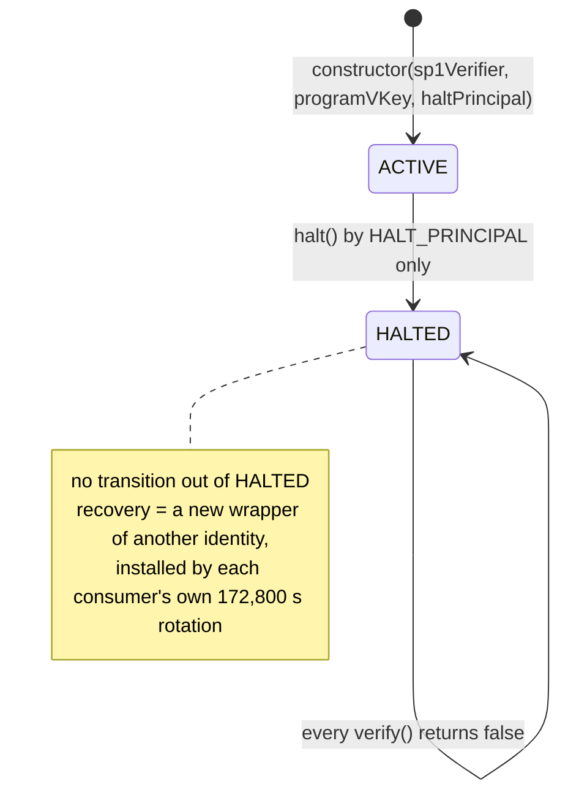

# SP1-TD2 — the local one-way verifier halt and the multisig vault's delayed rotation

> [!CAUTION]
> Research prototype. Not audited. Testnet/local only. Do not use real funds. This lane builds and tests what
> SP1-TD1 froze. It deploys nothing, downloads no circuit, generates no proof and unblocks no real value.

**Verdict: `BUILT_AND_TESTED_AWAITING_OWNER_REVIEW`.** Both requirements SP1-TD1 named as the real-value gate
(`REAL_VALUE_REQUIREMENTS`) are built and tested against the frozen design, with nothing re-decided:

1. **`TD2-COMMON-VERIFIER-HALT`.** `ZKMLDSAVerifier` now carries a local, one-way circuit breaker: `ACTIVE → HALTED`,
   called by an immutable halt principal whose only function is `halt()`. Once halted, `verify()` returns false for
   every consumer that verifies through the wrapper — `WalletWallVault`, `StablecoinVaultSimulator` and
   `PolicyControlBridge` — in the same block. Recovery is a new wrapper of an independently established identity
   through each consumer's own 172,800 s rotation; the halted wrapper and any fresh deployment of its identity are
   refused on chain.
2. **`TD2-MULTISIG-ROTATION`.** `WalletWallMultiSigVault` gets `WalletWallVault`'s delayed `pqVerifier` rotation
   (172,800 s delay, 14-day apply window), so a halt would no longer lock its funds (TD1-N11). That rotation is
   **new authorization for the multisig vault's owner**, recalculated below. TD2 does not find the cut unacceptable
   on its face, so it did not stop; the owner decides. Until the owner accepts the cut and admits the multisig
   vault, it stays outside the halt's scope and the tooling refuses it any part of the SP1 path.

Real value stays blocked (`realValue` in the record): the owner's review of both requirements, the owner's decision
on the multisig cut, the frozen implementation lane (the code-hash pin and the rest of SP1-TD1's plan) and a real
WalletWall proof all remain.

The machine-readable record is [`evidence/zk/sp1-td2/implementation-record.json`](../evidence/zk/sp1-td2/implementation-record.json)
(`npm run validate:sp1-td2-record`). It is checked against SP1-TD1's receipt, never against itself: the requirement
ids, the proof lists, the stop condition and the halt's scope must be TD1's exactly, the TD1 receipt must be the
bytes the record bound, and every cited test file must exist and name the proof it is cited for. The SP1-TD1
receipt is unchanged and still validates (`npm run validate:sp1-td1-receipt`).

## What was built



| Piece                            | Where                                                                                                                                                      | What it does                                                                                                                                                                                                                                                             |
| -------------------------------- | ---------------------------------------------------------------------------------------------------------------------------------------------------------- | ------------------------------------------------------------------------------------------------------------------------------------------------------------------------------------------------------------------------------------------------------------------------ |
| the halt                         | [`contracts/verifiers/ZKMLDSAVerifier.sol`](../contracts/verifiers/ZKMLDSAVerifier.sol)                                                                    | `HALT_PRINCIPAL` (immutable, non-zero), `halted` (false = ACTIVE), `halt()` (halt principal only, once, emits `VerifierHalted`); `verify()` returns false first thing once halted; `SP1_VERIFIER` and `PROGRAM_VKEY` stay immutable; the rest of `verify()` is unchanged |
| the halt surface                 | [`contracts/verifiers/IHaltableVerifier.sol`](../contracts/verifiers/IHaltableVerifier.sol)                                                                | what consumers and tooling probe; nothing requires it, so a mock or an attestation verifier still works                                                                                                                                                                  |
| the on-chain rotation guard      | [`contracts/verifiers/VerifierRotationGuard.sol`](../contracts/verifiers/VerifierRotationGuard.sol)                                                        | an internal library every rotating consumer calls in five places (constructor, ownership transfer, propose, apply, and the halted-identity record before the switch)                                                                                                     |
| the multisig rotation            | [`contracts/WalletWallMultiSigVault.sol`](../contracts/WalletWallMultiSigVault.sol)                                                                        | `proposePQVerifier`, `cancelPQVerifierUpdate`, `applyPQVerifierUpdate`, with `WalletWallVault`'s constants and checks plus the guard                                                                                                                                     |
| the vaults in scope              | [`contracts/WalletWallVault.sol`](../contracts/WalletWallVault.sol), [`contracts/StablecoinVaultSimulator.sol`](../contracts/StablecoinVaultSimulator.sol) | the same guard in their existing rotation and ownership transfer                                                                                                                                                                                                         |
| the binding gate                 | [`scripts/lib/verifier-binding.ts`](../scripts/lib/verifier-binding.ts)                                                                                    | refuses excluded consumers any SP1-path verifier, requires a haltable wrapper in scope, gates targets by process (TD1-N12); used by `deploy.ts`, the new `deploy-multisig.ts` and `propose-verifier-update.ts` (now for all three rotating consumers)                    |
| the halt principal at deployment | [`scripts/deploy-zk-verifier.ts`](../scripts/deploy-zk-verifier.ts)                                                                                        | `HALT_PRINCIPAL_ADDRESS` required on every non-local chain (a local chain defaults to the second account, never the deployer); an EOA is reported, since the design prefers threshold or multisig control                                                                |

The guard enforces two things on chain, for `WalletWallVault`, `StablecoinVaultSimulator` and
`WalletWallMultiSigVault` alike:

- **A halt principal never governs a consumer.** An account that can halt the consumer's current or pending verifier
  can never complete an ownership transfer to itself (Ownable2Step's acceptance runs through `_transferOwnership`,
  which the consumers override), the deployer cannot be the initial wrapper's halt principal, and the owner cannot
  propose or apply a wrapper it could halt. So the owner — the only account that can rotate — is never a halt
  principal of the current wrapper. One key holding both levers could halt the wrapper, leaving no PQ-gated exit
  (TD1-N12), and then install a verifier of its choosing after the delay.
- **A halt is one-way for the identity.** A halted wrapper is never a rotation target, and neither is a fresh
  deployment of its identity — the SP1 verifier's runtime code hash (measured by `EXTCODEHASH`) and `PROGRAM_VKEY` —
  while the current wrapper is halted. Leaving a halted wrapper records its identity in `haltedVerifierIdentities`,
  refused for good.

It also guarantees what TD2 must never introduce: **no verifier can veto its own replacement.** A rotation never asks
the current verifier for its halt principal (the invariant above already holds), every probe is a static call capped
at 50,000 gas that reads one word of return data, and a failed or malformed probe reads as "not haltable" rather than
reverting. The tests install a verifier through the delayed path that then claims the owner as its halt principal,
burns every probe's gas, or returns a mebibyte, and the owner still rotates away from it.

## The executable proofs

Every proof SP1-TD1 froze, with the test that runs it and its positive control (the same step with the one
disqualifying fact removed).

| Requirement   | Proof                                                           | Enforced by      | Tests                                                                                                                                                                                                                                                                                                                                                                  | Positive control                                                                                                            |
| ------------- | --------------------------------------------------------------- | ---------------- | ---------------------------------------------------------------------------------------------------------------------------------------------------------------------------------------------------------------------------------------------------------------------------------------------------------------------------------------------------------------------- | --------------------------------------------------------------------------------------------------------------------------- |
| common halt   | `VALID_VERIFICATION_WHILE_ACTIVE`                               | code             | [`Sp1Td2VerifierHalt`](../test/Sp1Td2VerifierHalt.test.ts): at the wrapper, and through `WalletWallVault` (PqOnly and Hybrid withdrawal, credential rotation), `StablecoinVaultSimulator` (PqOnly, Hybrid) and `PolicyControlBridge` (PqOnly, Hybrid tenants)                                                                                                          | it is the positive control: each proof is a journal an honest execution commits, registered on a program-bound SP1 stand-in |
| common halt   | `FAILS_CLOSED_AFTER_HALT_THROUGH_EVERY_CONSUMER_IN_SCOPE`       | code             | the same paths after `halt()`, each refused with the consumer's own `InvalidPQSignature`; and one wrapper behind all three consumers, refused by every one after one halt call                                                                                                                                                                                         | the identical call succeeds the moment before; an EcdsaOnly withdrawal is unaffected                                        |
| common halt   | `HALT_PRINCIPAL_CANNOT_MAKE_AN_INVALID_PROOF_VALID`             | code             | the wrapper's only state-changing function is `halt()` (from the ABI); seven invalid proofs stay invalid after everything the halt principal can send; the identity does not move                                                                                                                                                                                      | the valid proof verifies while ACTIVE                                                                                       |
| common halt   | `HALT_PRINCIPAL_CANNOT_ROTATE_EVEN_AFTER_AN_OWNERSHIP_TRANSFER` | code             | [`Sp1Td2VerifierRotation`](../test/Sp1Td2VerifierRotation.test.ts), for each vault: the halt principal cannot propose, apply or cancel; a transfer to it never completes, before or after the halt; the owner cannot propose a wrapper it could halt; a pending owner who could halt the pending verifier cannot accept; the halt principal cannot deploy the consumer | a transfer to anyone else completes and that owner rotates                                                                  |
| common halt   | `HALTED_IDENTITY_REFUSED_AS_A_RECOVERY_TARGET`                  | code and process | the halted wrapper and two fresh deployments of its identity are refused; a target halted during the delay, and a same-identity target once the current wrapper is halted, are refused at apply; after recovery the identity stays refused; the binding gate refuses it too ([`Sp1Td2VerifierBinding`](../test/Sp1Td2VerifierBinding.test.ts))                         | recovery to another identity succeeds after the delay; while ACTIVE a same-identity redeploy applies                        |
| common halt   | `EXCLUDED_CONSUMER_REFUSED_A_HALTABLE_WRAPPER`                  | process          | the deployment and rotation tooling refuse `WalletWallMultiSigVault` a haltable wrapper and any other SP1-path verifier; the scripts go through the gate before deploying                                                                                                                                                                                              | the same wrapper for `WalletWallVault` and `StablecoinVaultSimulator`; the multisig vault on the mock                       |
| multisig gate | `HALTED_THEN_ROTATED_WITHDRAWAL_SUCCEEDS`                       | code             | a 2-of-3 ECDSA, 2-of-3 ML-DSA-65 tenant: halted, the authorization is refused through the old wrapper (and a proof for another wrapper too); after the delay and a rotation to a fresh wrapper, the same request, the same ECDSA signatures and the same ML-DSA-65 signatures pay — only the proof wrapping differs, since a proof commits the wrapper it was made for | a withdrawal pays through the ACTIVE wrapper first                                                                          |
| multisig gate | `MALICIOUS_REPLACEMENT_BLOCKED_OUTSIDE_DELAYED_PATH`            | code             | an accept-all verifier is not active at any instant before the full delay; nobody but the owner can propose, apply or cancel; every state-changing function from every principal leaves `pqVerifier` alone; the source assigns it only in the constructor and in apply; a matured proposal expires                                                                     | the delayed path itself, executed: the cut below                                                                            |
| multisig gate | `HALT_PRINCIPAL_CANNOT_ROTATE_EVEN_AFTER_AN_OWNERSHIP_TRANSFER` | code             | as for the vaults, on the multisig vault                                                                                                                                                                                                                                                                                                                               | as above                                                                                                                    |
| multisig gate | `HALTED_IDENTITY_REFUSED_AS_A_ROTATION_TARGET`                  | code and process | as for the vaults, on the multisig vault; while excluded, the tooling refuses it every SP1 target                                                                                                                                                                                                                                                                      | as above                                                                                                                    |

The frozen design's own tests run too: no transition out of `HALTED` exists (the source writes `halted` in exactly
one place, to `true`), and no upstream signal moves the state — a real `RouteFrozen` for `0x4388a21c` on the mainnet
gateway bytes leaves a wrapper bound directly to v6.1.0 `ACTIVE` and answering as before.

## TD1-N12: is recovery-target gating enforced on chain or by process?

**By process, with on-chain identity and principal checks.** Recovery-target gating — only a wrapper whose verifier
code hash and `PROGRAM_VKEY` designation passed the SP1 evidence gates — splits like this:

|                                                                                                                                                                                                                                                                              | Enforced                                                                                                                     |
| ---------------------------------------------------------------------------------------------------------------------------------------------------------------------------------------------------------------------------------------------------------------------------- | ---------------------------------------------------------------------------------------------------------------------------- |
| the 172,800 s delay and the 14-day apply window; owner-only; a code-bearing target at proposal and at apply                                                                                                                                                                  | on chain (every rotating consumer)                                                                                           |
| the target is not `HALTED`; its identity is not the halted current wrapper's, nor one the consumer recorded                                                                                                                                                                  | on chain                                                                                                                     |
| the owner is never a halt principal of the current, pending or target verifier                                                                                                                                                                                               | on chain                                                                                                                     |
| the target is an `ACTIVE`, haltable `ZKMLDSAVerifier`; its SP1 verifier's runtime code hash is SP1-TD1's trust-target designation for the chain; its `PROGRAM_VKEY` is SP1-TD1's program designation; no override off a local chain; an excluded consumer gets no SP1 target | by process ([`scripts/lib/verifier-binding.ts`](../scripts/lib/verifier-binding.ts), designations read from the TD1 receipt) |
| the per-chain execution check (TD1-N8); the generated designation file and its CI subject check                                                                                                                                                                              | not yet — the frozen implementation lane                                                                                     |

Why not on chain: a consumer cannot recognise "passed the evidence gates" without some authority to say so, which
would be a new authorization principal; and pinning a code hash or a vkey in the consumer would refuse exactly the
recovery targets the design needs (a fixed verifier has new code, a fixed guest a new vkey). What a target reports
about itself is self-reported, so the on-chain identity check stops an honest mistake — redeploying the halted
wrapper — not a malicious owner. And because no PQ-gated exit works while a wrapper is halted, **the delay protects
no one during a recovery: the recovery target is checked only by the owner's own tooling.**

## The authorization cut (for the owner)

Authorization ("can make a previously rejected proof accepted") and liveness ("can stop valid proofs") are separate
rows, as in SP1-TD1.

| Principal                                                                     | Holds                                                 | Widens what verifies                                               | Delay     | While a wrapper is halted                                                                                                                                                                                                                                                                             |
| ----------------------------------------------------------------------------- | ----------------------------------------------------- | ------------------------------------------------------------------ | --------- | ----------------------------------------------------------------------------------------------------------------------------------------------------------------------------------------------------------------------------------------------------------------------------------------------------- |
| `WALLETWALL_EMERGENCY_HALT_PRINCIPAL` (per wrapper)                           | `HALT`, one-way                                       | **no** (proved)                                                    | 0 s       | it has already used its one power; it can never own or rotate any consumer (code); losing its key loses the halt, never value (each consumer's pause remains)                                                                                                                                         |
| `WALLETWALL_VAULT_OWNER` (each `WalletWallVault`, `StablecoinVaultSimulator`) | `PQ_VERIFIER_ROTATION` (retained), `pause`, `unpause` | **yes**                                                            | 172,800 s | nobody in PqOnly or Hybrid mode can exit, so the delay protects no one; afterwards any code-bearing verifier, an accept-all one included — anyone could then drain PqOnly vaults, and Hybrid vaults fall back to ECDSA. Unchanged by TD2 except for the guard                                         |
| `WALLETWALL_MULTISIG_VAULT_OWNER`                                             | `PQ_VERIFIER_ROTATION` (**new**), `pause`, `unpause`  | **yes** — `NEW_AUTHORIZATION_CAPABILITY_FOR_AN_EXISTING_PRINCIPAL` | 172,800 s | no tenant can withdraw, so the delay protects no one; afterwards an accept-all verifier voids every tenant's p-of-q PQ signatures at once, and each withdrawal is guarded by the tenant's m-of-n ECDSA signatures alone — executed in the suite, including that one ECDSA signature short still fails |
| `PolicyControlBridge` `EMERGENCY_PAUSER`                                      | one-way bridge pause                                  | no                                                                 | 0 s       | unchanged; the bridge recovers through its consumers' rotations                                                                                                                                                                                                                                       |
| upstream gateway owner                                                        | nothing in the path                                   | no                                                                 | —         | unchanged from SP1-TD1: `RouteFrozen` and advisories are detection evidence only                                                                                                                                                                                                                      |

**The new lever, in one sentence:** the multisig vault's single owner can, after 172,800 s and through a public
proposal, reduce every tenant's withdrawal security from m-of-n ECDSA **and** p-of-q ML-DSA-65 to m-of-n ECDSA alone
— a quantum adversary, or whoever holds a tenant's ECDSA quorum, could then withdraw — and while a wrapper is halted
no tenant can leave before it does. It cannot move funds by itself: every withdrawal still needs the tenant's ECDSA
quorum. The lever the vault owners already hold is the same kind and larger (a PqOnly vault has no ECDSA backstop).

### The stop condition

SP1-TD1 froze it as structured fields: `UNACCEPTABLE_AUTHORIZATION_CUT` → `STOP_AND_RETURN_TO_DESIGN`, never
`WEAKEN_THE_ONE_WAY_HALT`. TD2 found the cut to be the same kind of lever SP1-TD1 retained for the vault owners, with
a smaller blast radius, so it did not stop — but acceptability is the owner's call, and the record says so
(`stopConditionEvaluation: NOT_FOUND_UNACCEPTABLE_BY_TD2_OWNER_DECIDES`, `haltAdmission: OWNER_DECISION_PENDING`).
If the owner finds the cut unacceptable, `TD2-MULTISIG-ROTATION` returns to design; options not built here include a
per-tenant opt-in to a new verifier, a longer multisig delay, or keeping the multisig vault off the SP1 path (a
non-haltable pinned wrapper being an owner decision under SP1-TD1). The one-way halt was not weakened in any case.

## What TD2 changed outside the two requirements, and why

- **The SP1-P1 STOP receipt is superseded, not restamped (TD1-N4).** Its validator binds `ZKMLDSAVerifier.sol`, which
  the halt changes. [`evidence/zk/sp1-p1/supersession.json`](../evidence/zk/sp1-p1/supersession.json) pins the
  receipt's exact bytes, names SP1-TD1 and SP1-TD2 as the superseding records, and points at `69ea5798`, the last
  commit where the receipt was live; `validate:sp1-p1-receipt` re-checks every binding there, read from git (CI
  checks out full history). The generator refuses to rewrite a superseded receipt.
- **SP1-TD1's consumer scan reads TD1's own subject.** Its facts describe the tree TD1 measured; TD2 changed the
  multisig vault, so the probe now reads `72b6554`'s contracts from git. TD2's own scan of today's tree is
  [`test/Sp1Td2ConsumerScan.test.ts`](../test/Sp1Td2ConsumerScan.test.ts). SP1-TD1's probes now deploy the TD2
  wrapper, `ACTIVE`, where `verify()` is the logic TD1 measured; every TD1 fact still holds and its receipt is
  unchanged.
- **The deploy and rotation scripts** go through the binding gate, and `propose-verifier-update.ts` now serves all
  three rotating consumers (identified by their EIP-712 domain).

## Residuals

> [!IMPORTANT]
>
> - Detection is off chain: the halt principal must read the signal (an advisory, a `RouteFrozen`, a watcher
>   finding) and act. Until it does, every consumer keeps verifying.
> - Recovery-target gating is process: after the delay an owner who skips the tooling can install any code-bearing
>   verifier, and while halted no one can exit first (TD1-N12; the cut above).
> - A verifier the owner installed can make the consumer record one identity as halted on the way out, refusing that
>   identity for good (never every identity; executed in the suite). It can also delay an ownership transfer while it
>   is installed; rotating away ends that.
> - The multisig vault's exclusion is tooling: on chain its owner could reach a haltable wrapper through the delayed
>   path. Now that it can rotate, a halt would no longer lock it; the exclusion keeps the owner's review of the cut
>   ahead of the halt's reach.
> - While a wrapper is halted, consumers still accept deposits and new vaults; each owner's pause is the lever for
>   that.
> - Not in TD2 (the frozen implementation lane): the SP1 verifier code-hash pin in the wrapper's constructor, F-1, the
>   designation file and CI subject check, the canonical-build workflow and second-host rebuild,
>   `deploy-zk-verifier.ts`'s per-chain execution check, the runbook and `ZK_Verifier_Production.md` rewrite, and
>   proving availability (TD1-N9).
> - `WalletWallVault` grew to 24,104 runtime bytes (472 below EIP-170) and `StablecoinVaultSimulator` to 23,712.

## Reproduce / check

```bash
npm run validate:sp1-td2-record
npm run validate:sp1-td1-receipt
npm run validate:sp1-p1-receipt
npx hardhat test test/Sp1Td2VerifierHalt.test.ts test/Sp1Td2VerifierRotation.test.ts test/Sp1Td2VerifierBinding.test.ts test/Sp1Td2ConsumerScan.test.ts test/Sp1Td2ImplementationRecord.test.ts
```
